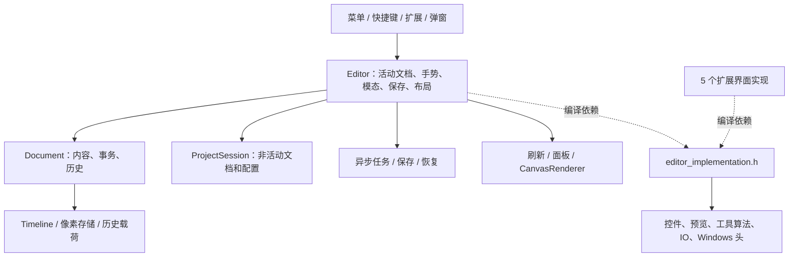

# 当前原生版代码耦合审计与分阶段修复方案

审计日期：2026-11-12（北京时间）。对象：本仓库 `native/` 当前工作区。分支：`dev`；首次读取 HEAD：`88f8c0244c27f95cdc38416579b8c4eb9819927a`。

初次只读审计仅新增本文档，没有修改源码、测试、构建配置或来源登记，也没有构建或运行软件。用户随后授权直接实施优化，实施范围与实际验收另见第 10 节；第 1—9 节保留审计时的证据与分阶段方案。开始时已有 `src/editor_support.h` 的工作区修改和若干未跟踪日志、测试目录，均保留。结论以工作区实际内容为依据，不把 HEAD 当作干净源码快照。

**共享工作区快照说明。** 写文档期间检测到其他任务继续更新代码和 HEAD；最后定向核对时 HEAD 已为 `276b6f0520b60a38950357b7eeaf730b25fcb21f`，扩展菜单/设置实现及其头文件存在新差异。本任务只读核对了这些差异，没有干预；同一边界脚本再次执行仍返回下面相同的六条失败。本文体量和依赖指标是前段采样，源文件行号也是读取时位置，不保证与持续变化的工作区逐行一致。这些新差异没有消除本次发现的依赖总头问题；不能把它们视为本方案已经实施，其他新增行为也未纳入完整验收。

## 1. 结论与阅读顺序

当前问题主要是**职责和状态仍集中在少数对象中，文件拆分后的所有权、命令入口与异步生命周期尚未完全分开**。不是所有模块都存在严重耦合，也没有依据认定这些结构风险已经造成数据损坏。

已有可继续复用的边界包括：`Document` 的内容与历史写入、`Timeline` 私有状态与合成缓存、`CanvasRenderer`、`DocumentSnapshot`、`RecoverySession`、`LatestTaskQueue`、扩展权限和会话代次检查。应在这些基础上收口，不重写绘图算法、不引入 WebView、不另建全局状态容器或万能事件总线。

优先处理三件事：

1. 恢复当前已失败的依赖边界检查，消除扩展界面对编辑器实现总头的依赖。
2. 把撤销、重做等入口汇入同一应用命令，解决扩展、快捷键和其他入口各自处理手势与播放的差异。
3. 明确文档、预览任务、保存任务的所有者，逐步减少对“当前活动文档”和共享模态字段的隐式依赖。

| 编号 | 耦合问题 | 优先级 | 当前证据 |
| --- | --- | --- | --- |
| C01 | Editor 集中职责、实现总头扩散到扩展界面 | P1 | 静态确认，现有边界检查失败 |
| C02 | 活动文档与非活动会话采用两套存放方式，工具配置手工搬运 | P1 | 静态确认；遗漏字段等后果属于风险 |
| C03 | 同一编辑命令存在不同的手势、播放和焦点处理路径 | P1 | 原生与 legacy 调用链差异已确认；运行场景待验证 |
| C04 | 预览任务、模态状态和统一计时器相互依赖 | P1 | 静态确认；没有据此认定线程越界或悬空访问 |
| C05 | 保存、恢复清理、关闭续接与 UI 共享同一组状态 | P1 | 静态确认；现有身份与保存点保护仍有效 |
| C06 | 局部刷新附带跨面板同步和持久化调度 | P2 | 静态确认；额外耗时未测量 |
| C07 | Document 历史载荷与回放分派集中，领域扩展要改多个中心位置 | P2 | 静态确认；不建议分裂文档事务所有权 |
| C08 | 核心构建目标包含 Windows 剪贴板实现，IO 目标职责过宽 | P2 | 源码和 CMake 确认；未运行跨平台构建 |
| C09 | 大量验收实现与正式程序、Editor 内部状态绑定 | P2 | 静态确认；现有 GUI 集成测试仍有必要 |
| C10 | 架构门禁覆盖范围窄，历史文档不能代表当前结果 | P1/P2 | 已执行检查，加上检查脚本源码核对 |

P1 表示宜先收敛，P2 表示随后降低维护成本；不代表已发现同等级线上事故。各项的修复方案和验收标准见第 4 节，执行顺序见第 6 节。

## 2. 范围、方法与实际检查结果

### 2.1 检查范围

- 对 `src/` 自有 C/C++ 文件进行体量和本地引号 include 图统计；重点阅读 Editor、会话切换、命令、预览任务、保存、刷新、历史、扩展界面及相关 CMake。
- 阅读[需求基线](requirements-baseline/README.md)、[核心事务要求](requirements-baseline/requirements/core.md)、[UI 设计规范](ui-design-spec.md)、[2026-10-18 耦合拆分记录](coupling-refactor-2026-10-18.md)和[来源登记](legacy-provenance.json)。
- 定向核对 legacy 的 `DocumentSession`、事务注册、历史命令、扩展宿主及 `LatestTaskQueue` 的实际代码；测试文件作为后续回归依据阅读，没有执行 legacy 测试。
- 不包含第三方依赖缓存的内部审计、全部业务算法的语义等价证明、Rust/Lua 引擎的全量架构审计、真实桌面性能测量和长时间耐久验收。

这是覆盖主要依赖结构和关键调用链的审计，不是逐个函数、逐条异常分支全部审查。行号对应上述工作区快照；实现时应以符号名重新定位。

### 2.2 可复核的体量和依赖指标

| 项目 | 本次结果 | 解释 |
| --- | ---: | --- |
| `src/` C/C++ 文件 | 519 | `.h/.hpp/.cpp/.c`；不含依赖缓存 |
| 上述源码物理行数 | 67,180 | 含空行、注释；仅作体量指标 |
| `editor_*.cpp` | 59 个，26,970 行 | 多文件仍可实现同一个类，不等同于 59 个独立模块 |
| `editor.h` | 3,454 行；非空 2,020 行 | 类中同时有状态、方法声明和内联实现 |
| `document.h` | 1,046 行；非空 1,036 行 | 事务与领域数据的集中入口 |
| `editor_smoke.cpp` | 9,476 行；非空 5,727 行 | 正式目标直接编译 |
| `main.cpp` | 962 行 | 大量诊断命令分派；并非重新包含 Editor 实现 |
| `MOON_SESSION_TOOLS` | 58 个表达式 | 每次切换手工保存、恢复的工具配置清单 |

以下统计只解析 `src/` 本地 `#include "..."`，按唯一文件去重，不展开系统头、依赖库头、预处理条件或模板实例；它表示可能的编译依赖影响面，**不是实测重编译数量或构建耗时**。

| 头文件 | 直接本地依赖 | 传递本地依赖 | 被多少个 `.cpp` 传递包含 |
| --- | ---: | ---: | ---: |
| `editor.h` | 59 | 141 | 58 |
| `editor_implementation.h` | 65 | 135 | 64 |
| `editor_support.h` | 10 | 59 | 64 |
| `document.h` | 35 | 46 | 131 |
| `timeline_model.h` | 6 | 12 | 150 |
| `native_widgets.h` | 3 | 3 | 69 |

这个本地 include 图没有发现环。**无 include 环不能排除共享状态、回调、调用顺序和构建目标耦合。**

### 2.3 初次只读审计的实际检查

命令工作目录为 `native/`。

| 命令 | 实际结果 | 能证明什么 |
| --- | --- | --- |
| `python scripts/check-editor-boundaries.py` | 失败，6 条诊断 | 当前源码违反既有边界规则，详见 C01/C10 |
| `python scripts/check-legacy-provenance.py` | 通过，835 个登记对象，来源摘要验证通过 | 登记完整性与已登记来源未漂移 |
| `python scripts/check-legacy-provenance.py --strict` | 失败；`allLegacyAligned=false`，664 项 `legacy-partial` | 已登记迁移缺口仍存在；不是 664 个独立功能缺陷 |

边界检查的原始诊断为：

```text
extension_install_dialog.cpp: lower layer depends on Editor: editor_implementation.h
extension_menu_adapter.cpp: lower layer depends on Editor: editor_implementation.h
extension_panel_host.cpp: lower layer depends on Editor: editor_implementation.h
extension_preferences.cpp: lower layer depends on Editor: editor_implementation.h
extension_settings_dialog.cpp: lower layer depends on Editor: editor_implementation.h
Compile Editor declaration first to detect hidden include-order dependencies
```

没有执行 CTest、正式程序 `--*-check`、构建、截图或交互验收。已有错误日志属于进入任务前的文件，未据此推断当前二进制失败。2026-10-18 文档中的成功检查、测试数量和失败清单属于当时记录，不能复用为本次结果。

## 3. 当前依赖形态与应保留的边界



`Editor` 作为工作区组合入口本身合理；问题是组合、业务决策和具体状态同时存在于同一个对象中。`Document` 同时协调图层、像素和历史也是必要的，不能为了减少依赖把一次编辑拆成多份独立历史。

保留以下机制：

- `DocumentSnapshot::matches/advance` 对身份、修订、几何等条件的校验以及分片复制；不改为 UI 线程整份序列化。
- `RecoverySession::tick(Document&, ...)` 显式接收所属文档；不恢复临时交换活动文档的旧做法。
- 像素共享、稀疏存储、区域损伤、合成顺序缓存和内存预算；不因抽象拆分增加整图复制或每像素虚调用。
- 扩展 `SessionHost` 的权限、会话 token 和代次校验；命令收口不能替代或绕过这些检查。
- `LatestTaskQueue` 的一个执行中任务、一个可替换等待任务、等待槽共享确认以及失败后继续推进的语义；不能直接拿它替代所有保存、预览队列。
- 像素 UI、10px 字体、默认 2×、既有布局和 legacy 图标来源；提取共享组件时仍使用同一套 `PixelDialog` 和标题几何。

## 4. 问题、修复办法与完成条件

### C01：Editor 与实现总头使职责重新聚合

**证据。** [editor.h](../src/editor.h) L87 起的 `Editor` 同时拥有文档（L113）、会话（L175）、导出参数、后台预览、菜单和大量控件；[editor_implementation.h](../src/editor_implementation.h) 导入算法、控件、IO、Windows API 和 `editor_support.h`。[editor_support.h](../src/editor_support.h) 又包含 `PreviewPanel`、悬浮栏目、曲线编辑器、精灵表预览、工具弹出窗等不同职责。五个扩展界面实现的第 1 行都包含实现总头。

这些扩展文件不一定真的需要访问 `Editor` 对象；实际读取到的用途包括 `PixelDialog`、文本转换、布局常量和 UI 类型。因此当前最直接的问题是**共享基础能力通过编辑器总头获取**，不是已经证明扩展业务反向调用编辑器全部逻辑。

**影响。** 改一个预览控件可能扩大其他扩展窗口的编译依赖；新成员可以被所有 Editor 方法直接访问，文件边界无法阻止跨职责修改。只把 `.cpp` 再拆小或只套 PImpl，不会解决状态所有权。

**修复。**

1. 先让五个扩展 `.cpp` 首先包含自己的 `.h`，随后显式包含所需控件、字体、UI、标准库和平台头；已有公共定义优先直接引用。
2. 确实只能从 `editor_support.h` 获取的通用能力，提取到低层、窄职责头/实现；只允许 UI 基础库与平台适配依赖，不含 `Editor`、文档保存或工具状态。不能把 `editor_support.h` 原样改名为另一个“公共总头”。
3. `editor_lifecycle.cpp` 第 1 个引号 include 恢复为 `editor.h`；新增独立头编译检查，避免用其他头补齐其隐式依赖。
4. `PreviewPanel`、栏目窗口等分别拥有实现文件；保持共享像素 UI 组件唯一，禁止复制标题、关闭按钮和间距逻辑。
5. 随 C02—C06 提取会话、命令、任务和刷新后，逐文件替换 `editor_implementation.h` 为实际依赖，最后删除空壳总头。每一批只迁移一个已覆盖职责。

**完成条件。** 五个扩展实现不再到达编辑器实现总头；自身头可独立编译；现有边界脚本通过；功能和布局不变。后续验收编辑器头依赖数下降应有实际结构原因，不设“凑到若干行”指标。

### C02：会话状态依靠手工镜像与活动文档搬运

**证据。** [editor_session.cpp](../src/editor_session.cpp) L33 按活动下标选择 `Editor::document` 或 `ProjectSession::stored`；L64—107 的 `storeActiveProject/restoreProject` 搬运文档、恢复状态、视图和工具。L70—78 的宏列出 58 个配置表达式，并把恢复动作存为捕获 `this` 的 `std::function`。`settleProjectGesture` L45—62 手工列举需要结束的交互。

legacy [workspace-types.ts](../../legacy/src/renderer/src/store/workspace-types.ts) L187 起的 `DocumentSession` 明确拥有文档、历史、工具和工具配置，是复用会话所有权的依据。

**影响。** 新工具参数若只加进 Editor，而漏加保存/恢复清单，就可能跟随活动窗口串到另一工程。活动槽为空、其他槽有文档的隐含规则使保存、恢复、扩展查询重复判断。这里没有证明现有 58 项已漏存，也不能仅凭 `this` 捕获认定悬空访问。

**修复。**

1. 先列出字段所有权表：应用共享、文档会话、正在进行的手势、可丢弃显示缓存。共享颜色和用户默认偏好不可误放入每份文档；临时笔刷原始像素不可改成按路径重新加载。
2. 第一批只把现有 58 项及相关临时笔刷配置组成有名称的 `ToolSessionState`，提供明确 capture/restore，替代宏和闭包；保持字段默认值、激活次序和现有搬运方式不变。
3. 增加统一 `resolveSession(documentIdentity)`，先封装现有双存储结构，调用方不再自己写活动下标条件。排队任务绑定文档身份，不绑定可变化的标签下标。
4. 在各调用方已经改为显式会话接口后，使每个 `DocumentSession` 稳定拥有 `Document`、工具、视图与恢复状态；`WorkspaceSessionStore` 只记录活动身份，切换时重绑展示。这个内部所有权调整需分批实施，不能与事务算法重写混在同一批。
5. 手势仍按 legacy 在切换前确认或取消；将现有处理顺序变成可检查的 `settleForSwitch`，不要一律取消所有工具。迁移中禁止同时维护两份可写真值。

**完成条件。** A/B 反复切换可恢复各自工具、子类型、笔刷配置、临时笔刷、视图、选择及历史；标签重排不改变排队任务目标；非活动恢复不激活窗口；新工具配置无需再扩展手工闭包清单。沿用 `multi-document`、`extension-workspace-ui`，追加切换期间任务完成、临时资源被删除仍保留会话快照的用例。

### C03：同一命令没有统一的应用层前置处理

**证据。**

- [editor_shortcuts.cpp](../src/editor_shortcuts.cpp) L190—195 会在手势期间排队，保留文档身份；L189 的常规命令分派通常先 `cancelStroke()`。
- [editor_tools.cpp](../src/editor_tools.cpp) L1510—1523 的 `Editor::cancelStroke` 同时停止播放、清工具交互、释放捕获并刷新，不等同于 `Document::cancelStroke`。
- [editor_extension_workspace.cpp](../src/editor_extension_workspace.cpp) L50—51 的扩展 undo/redo 直接调用 `document.undo/redo`；没有经过上述 Editor 手势处理。L31—45 的工具设置为了使用快捷键路径，临时修改 `homeOpen_`、`paletteFocused_` 并恢复，暴露出键盘环境与工具命令的耦合。
- [editor_history.cpp](../src/editor_history.cpp) L16—18 又有自己的忙碌判断与延迟跳转，并显式停止播放。
- legacy [ExtensionRuntimeHost.tsx](../../legacy/src/renderer/src/components/extensions/ExtensionRuntimeHost.tsx) L450—451 调用 `workspace.undo/redo`；[workspace-commands-history.ts](../../legacy/src/renderer/src/store/workspace-commands-history.ts) L478、553 起的实现处理手势锁和按文档身份延迟。[播放历史测试](../../legacy/src/renderer/src/store/workspace-history-playback.test.ts) 明确要求撤销停止播放并回到编辑的 Cel。

**影响。** 调用路径差异已确定：扩展撤销无法自动获得仅存在于 Editor 路由中的播放、工具与手势处理。具体桌面表现和生产扩展触发范围尚未验证，不宣称已复现“撤销导致作品丢失”。

**修复。**

1. 从现有 `menus::Commands` 的执行处理提取共享应用动作，首先仅统一 undo/redo/history jump。菜单、快捷键、工具按钮和扩展调用该动作；核心仍由 `Document` 修改。
2. 将“输入是否可触发”与“命令如何执行”分开：输入框本地撤销、键盘焦点、首页快捷键拦截属于输入适配；暂停播放、手势结算、目标身份检查属于应用动作。扩展不需要伪造焦点或首页状态。
3. 复用现有延迟机制；排队记录 `documentIdentity`、命令与参数，执行前重查身份及前置。是否要求仍为活动文档沿用 legacy，不把旧动作自动转发给新活动工程。
4. 给内部执行结果区分已执行、已排队、不可用、失败。扩展对外仍维持既有协议的返回值和错误语义，内部枚举不能直接改变 API。
5. 普通历史与多边形草稿点撤销等特殊语义必须保留；不能把所有 Ctrl+Z 强制变成文档历史撤销。先形成入口决策表，再迁移其他命令。

**完成条件。** 同一个领域动作经各入口具有一致的文档修改结果；入口特有焦点行为仍按旧版保留。增加笔画中扩展 undo/redo、播放中扩展 undo、排队后切到 B、输入框编辑、浮动选区、多边形草稿、扩展缺权限与过期 token 用例。已有权限校验继续在命令执行前生效。

### C04：预览任务、模态枚举和调度顺序绑在 Editor 中

**证据。** [editor.h](../src/editor.h) L379—393 同时存抗锯齿、卷积、渐变映射的参数、future、取消 token、generation、控件及提交标志；L1367 的 `Pending` 混合模态类型、关闭、新建和保存。任务的启动/取结果在 [editor_dialogs.cpp](../src/editor_dialogs.cpp) L110—136、169—204、218—254；清理又分布在 `resolve` 和 [Editor 析构](../src/editor_lifecycle.cpp) L23。[同文件](../src/editor_lifecycle.cpp) L134 的 16ms `recoveryTimer_` 顺序轮询图库、恢复、缩时、保存、播放和多种绘图任务。

**已有防护。** 工作线程主要捕获任务快照和取消 token；UI 用 generation 过滤结果。`Document::publishAntiAliasSurfaceTask` 等还核验文档、内容、预览版本、蒙版、选区和调色板上下文。不能把这些代码描述为“没有异步隔离”，也不能将 `detach` 直接等同于 UAF。

**影响。** 增加一个预览工具需要同时调整打开、调度、提交、取消、切换和析构路径；漏掉一个位置容易产生迟到结果或错误提示生命周期问题。共享计时器让单个阶段的阻塞影响后续处理；本次没有测出具体卡顿。

**修复。**

1. 每种预览先提取有类型的控制器，独立拥有 options、task、token、generation、提交意图和状态；视图只提供值和展示结果。先选抗锯齿一条完整链路试点。
2. 在三条链路的行为已固定后，才提取共同的任务机制：启动、请求取消、非阻塞 poll、丢弃过期结果、可观察错误。领域捕获与 publish 校验继续留在各自实现，不能削成一个 `revision` 比较。
3. 任务绑定文档身份、事务/预览身份及所有现有校验维度。关闭窗口时取消并解除 UI 接收端；worker 只持快照，不持控件或可变活动文档引用。
4. 保留“一次运行、可合并等待预览”的实际行为；Apply/保存等必须执行的动作不能被 latest-only 替换掉。复用 `LatestTaskQueue` 之前逐项核对其确认与失败语义。
5. 第一阶段保持现有计时器调用顺序，只把调用转交控制器，避免调度改变掩盖回归。之后给调度阶段记录耗时、积压和预算，按已验证依赖拆分任务调度；不另开绘制主循环。
6. 收敛模态生命周期为带具体载荷的会话；确认、取消、关闭、失败都由所属控制器结束一次。`Pending` 可暂作兼容路由，不能继续成为所有业务状态的唯一判定。

**完成条件。** 确认只提交一步历史；取消、切文档、关闭后旧结果不能发布；A→B→A 参数乱序完成只展示有效结果；失败可继续使用同一窗口；析构不访问已销毁 UI；保存需要的任务不能被丢弃。使用受控执行器制造乱序和失败，不依赖 sleep 碰时序。

### C05：保存状态既属于文档，又属于当前 UI 模态

**证据。** [editor_session.cpp](../src/editor_session.cpp) L399—639 中，`savePath/saveProject/saveTick/backgroundSaveTick` 同时负责格式决策、路径冲突、缩时屏障、快照、worker、保存点确认、最近工程、恢复清理、控件状态和关闭续接。L519—521、571—572、485—488 通过同名局部引用选择真实 owner；这说明已有按身份处理非活动文档的保护。L433 和 L498 使用修订、内容修订、对称中心、面板状态及活动事务共同判断保存点。

**影响。** 前台与后台完成分支重复维护“接受文件—更新路径—清理恢复—续接关闭”；新增格式或完成状态需要在多个分支同步。保存结果正确归属依赖 `saving*` 字段、队列记录和 UI 状态相互一致。不能据此声称现在非活动保存必然写错文档，代码已显式解决该目标选择。

**修复。**

1. 建立显式 `SaveRequest`/`SaveJob`：文档身份、路径、格式、source-only、便携缩时、缩放、确认依据、快照校验值和完成意图。创建后不再从全局 `saving*` 补读关键参数。
2. `SaveCoordinator` 管理请求、快照分片、worker 和完成状态；文件选择与兼容性对话框仍由 UI 适配提供。`DocumentSnapshot`、编码器、原子写入和备份策略直接复用。
3. 合并前台和后台的结果接纳函数，显式接收解析后的会话与任务。只有验证 exact 的保存完成才能按原语义标记对应版本已保存、合并重复 Save 和安排所属恢复清理。
4. 状态建议明确为：等待交互安全点 → 等待缩时屏障 → 捕获快照 → 编码/原子写入 → UI 安全点接纳 → 必要清理 → 续接关闭。失败保留请求上下文、dirty 和恢复数据；“文件成功但恢复清理失败”与“保存失败”分别呈现。
5. 关闭意图绑定目标身份，不绑定 `Pending` 的瞬时值或标签下标。保存后又有新编辑时，维持现有追加保存/重新确认规则；Save As 不能被普通 Save 的去重吞掉。
6. 同一路径的所有者冲突检查继续使用现有路径语义；不要在本次结构整理中顺带改变大小写、规范化或格式损失策略。

**完成条件。** A 保存时编辑/切换 B；A 保存后再编辑；排队 Save 与 Save As；关闭等待中失败；格式确认期间上下文变化；恢复清理失败；原格式与工程另存均有确定结果。除文件成功且符合 exact 条件外，不提前清 dirty、删除恢复或关闭文档。保留测试目录限制，禁止用用户工程验证失败注入。

### C06：refresh(scope) 尚未形成完整的局部更新边界

**证据。** [editor_refresh.cpp](../src/editor_refresh.cpp) L100—145 在检查 `RefreshScope` 前执行 `saveLayerPanelState()`；L111—116 无条件同步自由瓦片、参考图、历史、数位板、tileset、笔刷库和文档视图状态。L113 还可初始化 docking 并修改 `docking_.custom`。`syncDocumentViewState` L18—50 更新播放上下文、选择枢轴等；精灵表预览也可能重建。

[editor_rotation.cpp](../src/editor_rotation.cpp) L351—370 的 `saveLayerPanelState` 包含首次读取、比较、JSON 序列化和写队列调度。它有去重和异步写入，不能表述成“每次 refresh 都同步写磁盘”。

**影响。** 调用者请求 Canvas/Commands 更新，也会进入其他面板同步路径。新加一个面板就可能扩大所有刷新路径的工作量；视图刷新还承担部分状态收敛职责，调用顺序更难推断。

**修复。**

1. 先列出刷新中的三类工作：文档/会话状态变更后的协调、视图模型同步、实际布局/失效请求。逐个标明输入版本与输出，不只按函数名判断。
2. 面板状态改变时标记持久化 dirty，在现有写队列中合并；切文档/关闭仍按原有顺序 flush。初始化和错误恢复不能因移出 refresh 而丢失。
3. 每个面板声明所依赖的变化，如选择、帧、图层结构、资源版本、视口、偏好；按变更标志或稳定版本跳过无关同步。只改变指针覆盖层不应扫描资源库或重排历史面板。
4. 把 docking 初始化、播放上下文切换等移到明确生命周期动作；保留必要的只读“确保显示缓存同步”入口，画布子控件独立重绘仍必须正确。
5. 增加布局、内容上传、面板同步、持久化入队计数；功能测试证明结果一致，计数证明更新范围缩小。全量刷新保留用于初始化和确实需要的布局变更，不作为常规错误兜底。

**完成条件。** 单纯画布损伤不触发无关面板 rebuild/持久化入队；播放不产生全工作区布局；面板状态改变仍能保存并恢复；局部和完整绘制像素一致。实际耗时与长时性能另行测量，不把计数下降直接换算为 FPS。

### C07：历史载荷采用大而稀疏的组合结构，回放依赖字段组合与顺序

**证据。** [document.h](../src/document.h) L730—805 的 `Edit` 同时容纳像素、surface、图层、帧、蒙版、文字、瓦片、调色板、完整结构、回滚与本地历史，部分条目含 `children`。[document.cpp](../src/document.cpp) L1578 的 `applyEdit` 通过可选字段和 flags 分支；L1610 起的字节计量、L1688 的 `pushEdit`、本地历史捕获/恢复还必须认识相应载荷。

这是一种**字段协议与回放顺序耦合**。统一历史所有权本身是优点，不能拆成图层历史、像素历史和 UI 历史后各自提交，否则会破坏单步撤销与选区恢复。

**修复。**

1. 先建立 Edit 契约表：实际存在的载荷组合、before/after 完整性、目标 ID、是否改变文档、损伤、字节计量、选择与资源恢复顺序。组合来自现有构造位置与测试，不能假定所有字段互斥。
2. 将已经独立的职责按域提取 builder/apply/cost/validate；保留 `Document` 作为唯一提交者。优先从已有 `PixelHistoryEdit`、surface/metadata 等成熟结构开始。
3. 使用有类型载荷表示互斥的 edit 类别，使用显式复合条目表示必须组合的变化；允许内部 `variant` 或同等封闭表示。不要把大 Edit 机械换成另一份巨型 variant，也不要每个像素创建多态对象。
4. 提取 `HistoryStore` 管理 push、undo/redo 位置、预算、分组和分支裁剪；领域应用仍由 Document 的内部接口完成。不能向外暴露任意修改 `Timeline::state_` 的能力。
5. 提交后通知继续区分历史变化、内容变化、仅帧视图变化与缩时记录。保留 `publishChange` 的共享图层、几何投影和 dirty region 行为；不要一律全图失效。
6. 本地历史持久化应消费已提交、版本匹配的载荷。继续复用 `CommittedCapture/JournalSession`，禁止以工程 encode/decode 代替撤销快照。现有 copy/move 对运行会话绑定的区别也必须保留。

**完成条件。** 每个迁移 edit 的 apply→undo→redo，像素、透明 RGB、链接关系、选择、帧/层焦点、资源和预算都与原实现一致；组合 undo 逆序/redo 正序不变；失败前校验，不能留半应用状态；没有内容变化的操作不新增内容历史。此项最后分域实施，避免一次改动所有历史类型。

### C08：核心与平台、编解码和宿主构建边界不吻合

**证据。** [CMakeLists.txt](../CMakeLists.txt) L1013—1017 在没有 `WIN32` 条件的地方将 `new_document_clipboard.cpp` 加入 `moon-core` 并 PUBLIC 链接 `user32`；[new_document_clipboard.cpp](../src/new_document_clipboard.cpp) L2 直接包含 `windows.h`，L14 起调用系统剪贴板 API。它不属于像素事务算法。

同一 CMake L138 起的 `moon-project-reader` 同时承担工程解析、写入、预览、调色板、恢复、缩时视频、图像导出和本地历史，且位于 `MOONSPRITE_BUILD_APP` 分支内，并链接平台及媒体依赖。项目目前交付 Windows 原生程序是允许的；问题是逻辑模型与平台依赖的边界不清，便携核心测试的注释也不能再当作保证。

**修复。**

1. 先移出系统剪贴板探测实现到 Windows 平台适配目标；保留纯 DIB 尺寸解析和新建尺寸选择策略在独立纯逻辑模块。应用注入 `readSystemSize`，核心无需链接 `user32`。
2. 对 `moon-core` 的系统头、平台链接和直接编译源列出显式允许清单；已经必要的其他原生适配逐项审查，不能仅改这一项就宣称全核心可移植。
3. 将大 IO 目标按工程编解码、图像/视频平台能力、恢复与本地历史宿主分开；先用 OBJECT/STATIC 目标收敛已有依赖，保持 ABI、文件格式和错误语义。不要先搬目录造成来源追溯困难。
4. 为每个目标设置最小 PRIVATE/PUBLIC 链接范围；只在公共头确实泄露依赖时使用 PUBLIC。`MOONSPRITE_BUILD_APP` 只控制应用组合，不应自动把可独立测试的服务都隐藏。
5. 若当前只要求 Windows 交付，以 Windows 无 UI 的核心/服务测试作为最低完成标准；非 Windows 编译作为后续明确的架构门禁，不能冒充已提供新平台支持。

**完成条件。** 核心目标不再因为剪贴板功能依赖 `user32/windows.h`；对应纯逻辑测试不初始化 UI；Windows 适配测试仍验证系统读取和失败返回。唯一正式产物及 `start-native.bat` 保持不变，不创建 preview 应用。

### C09：测试需要了解大量 Editor 内部实现，正式程序承载大量测试代码

**证据。** [CMakeLists.txt](../CMakeLists.txt) L493—499 直接把 `editor_smoke.cpp` 编入正式程序；[main.cpp](../src/main.cpp) 大量 CLI 分派调用 Editor 的 smoke 方法。其他 `editor_*.cpp` 也混合实际功能和 smoke。`editor.h` 暴露许多测试方法与测试注入字段。`savePath` L529 根据 `smoke_` 等条件选择异步/同步路线，说明只通过普通 smoke 并不能自然覆盖正式异步保存。

**影响。** 重构私有状态会牵动大量测试；测试可能通过直接赋值构造正式入口不会出现的状态，或绕过需验证的生命周期。另一方面，现有 GUI 测试覆盖实际命中、控件、绘制，不能整体删掉或改成 mock。

**修复。**

1. 随控制器提取，把会话、命令、异步和保存的行为测试放到 `tests/`，通过公开契约及可控执行器/文件选择器/时钟驱动。测试应继续调用生产算法。
2. 保留少量真实 UI 集成验收，负责输入路由、弹窗布局、缩放、选择边框 alpha 命中、渲染和正式入口接线；不要用服务测试代替 GUI 验收。
3. 整理诊断分派表，把参数解析与执行分开，减少 `main.cpp` 手工分支；先保留现有 `--*-check` 兼容入口，不把取消这些入口当成默认重构内容。
4. 测试驱动从函数注入窄接口，不继续扩大 Editor 公共字段。移出纯算法/服务测试后，再决定哪些诊断需要测试构建选项；若会移除用户使用的正式诊断能力，应先作为单独决策。
5. 对保存等双路径优先添加正式异步路径的确定性测试；通过 `smoke_` 仅隔离测试数据目录，不应跳过所测状态机。

**完成条件。** 修改预览内部字段不会要求修改不相关的保存/面板测试；服务行为测试不创建整个工作区；真实 GUI 和原 CLI 验收能力保留；测试数据只进入测试自有路径。

### C10：边界门禁能发现部分问题，但不足以守住完整架构

**证据。** [check-editor-boundaries.py](../scripts/check-editor-boundaries.py) 只扫描 `src.iterdir()` 下 `.h/.cpp`，只解析引号 include，以文件前缀识别层级；不分析系统头、链接目标、类型所有权、回调生命周期或命令入口。刷新副作用只检查少数方法名；无条件面板同步、写队列调度和平台 API 不在规则中。

**修复。**

1. 先修 C01 的六项实际失败，禁止用扩展文件白名单、删除规则或给文件改前缀来“通过”。
2. 建立简单的模块归属与允许依赖清单，按真实目标和头接口区分 core、application/session、UI、platform、codec、extension adapter、tests；递归扫描自有源码，规范化相对路径。
3. 静态检查系统 include 与 CMake 目标边，而不仅是 `editor*` 字符串。对宏和条件编译无法确认的依赖报告范围限制，不假装正则就是完整 C++ 分析器。
4. 给独立公共头建立最小编译检查；复杂类型/调用关系必要时利用编译数据库分析，避免新增低质量关键字黑名单。
5. 共享状态、时序和语义依靠 C02—C09 的行为测试；门禁中增加小型负例夹具，证明允许/禁止边均能被识别，避免规则命中面消失后一直绿灯。
6. 每批新增/调整代码更新 `legacy-provenance.json` 并执行覆盖检查；已知迁移缺口仍存在时 strict 必须失败。架构改善不是降低 `legacy-partial` 分类的证据。

**完成条件。** 架构检查通过且负例能失败；新增子目录、系统头和目标依赖进入检查范围；文档记录实际命令、退出码、范围及未验证项。

## 5. 建议的目标结构与最小接口

以下名称是实施方案，不表示仓库已经存在这些文件。先按职责提取，暂不要求大规模目录搬迁。

| 所有者 | 应拥有 | 不应拥有 |
| --- | --- | --- |
| `Editor` / 工作区宿主 | UI 组合、窗口、控件连接、输入转发 | 每种任务的 future、所有领域的提交规则 |
| `WorkspaceSessionStore` | 稳定会话、活动文档身份、关闭/激活路由 | 像素算法、控件布局 |
| `DocumentSession` | Document、工具配置、视图、恢复/记录生命周期绑定 | 其他文档状态、全局用户默认偏好 |
| 应用命令 | 前置、手势结算、播放协调、目标解析、调用 Document | 窗口坐标、JSON 协议、系统文件选择器 |
| 预览控制器 | 当前任务、取消、代次、预览/提交意图 | 任意全局活动文档引用 |
| `SaveCoordinator` | 请求、快照、任务、完成接纳与关闭续接 | 弹窗控件和鼠标焦点 |
| `Document` 与内部 `HistoryStore` | 内容、事务、历史、资源、损伤、版本 | UI 控件、平台剪贴板、文件选择窗口 |
| 面板/画布 presenter | 面板视图模型与缓存、局部失效 | 隐式提交编辑或决定保存点 |
| 平台适配 | Windows IO、剪贴板、系统对话框 | 全局业务状态 |

建议接口形状如下，仅表达边界，不是可直接复制编译的最终 API：

```cpp
struct DocumentKey { std::uint64_t identity; };
struct PreviewKey { DocumentKey document; std::uint64_t transaction, generation; };

// 初期可适配现有活动/非活动双存储，后期内部换成稳定会话所有权。
DocumentSession* resolveSession(DocumentKey);

// 来源用于保留入口差异；领域执行不读取 UI 焦点或伪造首页状态。
CommandResult executeHistory(DocumentKey, HistoryAction, CommandOrigin);

// 保存校验不只比较一个 revision，保留现有全部快照匹配条件。
SaveTicket requestSave(SaveRequest);
void pollSaveCompletions();

// 回 UI 线程先检查接收端生命周期和预览身份，再走原领域 publish 校验。
bool publishPreview(PreviewKey, DomainPreviewResult);
```

约束：所有内容提交在既有所有者线程完成；worker 只能处理不可变输入或独占任务数据。关闭会话先撤销接收资格，再处理必须完成的保存/恢复工作。仅预览可以丢弃结果；保存、恢复、历史持久化的确认与错误必须保持可观察。

## 6. 可执行的实施顺序与回退边界

每批独立验证。下面的“回退”指撤销该批代码调整，不删除工程、恢复记录、录像或测试证据；实际撤销也必须保留用户同期修改。

| 阶段 | 具体改动 | 依赖 | 最低完成标准 | 回退边界 |
| --- | --- | --- | --- | --- |
| S0 固定行为 | 为入口、会话字段、预览和保存列契约；把 C03 关键差异写成回归；记录现有失败 | 无 | 用例能区分当前路径差异；不改正式行为 | 仅新增测试/文档 |
| S1 修边界 | 五个扩展实现显式 include；独立共享 UI 能力；自身头优先 | S0 | 当前六条诊断消除；对应头与正式目标可编译 | 每个扩展适配单独回退 |
| S2 命令收口 | 先 undo/redo/history jump；抽离键盘焦点处理与领域动作 | S0、S1 | 手势、播放、切文档、权限回归通过 | 保留原菜单/快捷键/扩展协议适配 |
| S3 会话清晰化 | `ToolSessionState`；统一身份解析；再稳定会话所有权 | S2 | 双文档隔离、重排、临时笔刷、恢复通过 | 先保留双存储适配，切换真值时一次完成 |
| S4 任务生命周期 | 一个预览控制器试点，再迁移卷积/渐变等；保持调度顺序 | S2、S3 | 乱序、取消、失败、关闭不发布旧结果 | 一次只替换一种预览 |
| S5 保存收口 | 显式 SaveJob，共用结果接纳；分离 UI 进度与关闭意图 | S3、S4 | 保存成功/失败/另存/旧版本/恢复清理矩阵通过 | 编码器、格式、原子写入不动 |
| S6 刷新收口 | 从 refresh 移出生命周期和持久化触发；按变化同步面板 | S2—S5 | 局部/全量画面相同；无关计数不增长 | 每次只替换一个同步域 |
| S7 平台与测试 | 剪贴板出 core；分解 IO 目标；服务测试独立 | S1，可与前述阶段顺序穿插 | 核心测试不拉 UI/剪贴板；GUI 验收保留 | 保持旧目标名可作兼容聚合 |
| S8 历史载荷 | 分域 builder/apply/cost，再明确复合载荷和 HistoryStore | S0、S3、S7 | 每种 edit 的预算/链接/UndoRedo/失败一致 | 一次迁移一类 edit，不改变存档格式 |
| S9 门禁收尾 | 递归模块/目标检查、负例、来源登记、验收记录 | 各阶段持续做 | 已迁移边界可自动防回归；严格迁移状态诚实 | 不通过删除检查回退 |

不建议一次性重命名所有文件、抽出所有类、重写全部历史与任务。首先完成 S1 和 S2 就能形成独立可评审的成果；后续阶段不是 S1 完成的前提。整个方案的风险主要在行为保持与生命周期，而不是目录命名。

## 7. 回归矩阵与验证方式

### 7.1 必须覆盖的行为

| 场景 | 操作 | 必须断言 |
| --- | --- | --- |
| 双文档 | A 使用不同工具/笔刷/视图，切 B 再切 A，重排标签 | 状态归属、临时资源、内容、历史、dirty 不串文档 |
| 入口一致 | 快捷键、菜单、扩展分别 undo/redo | 领域效果一致；焦点和草稿入口差异符合 legacy |
| 手势锁 | 绘制时请求 undo，释放前后检查；其间切文档 | 不在错误时间改内容；过期目标不作用于 B |
| 播放 | 播放中撤销最近绘制 | 停止播放；回到应编辑的 Cel；选择上下文正确 |
| 预览乱序 | 两组参数倒序完成，随后取消/关闭/切文档 | 只有合法代次发布；取消无额外历史；旧回调不触 UI |
| 异步异常 | 捕获、计算、发布、入队失败 | 原作品可继续编辑；错误可见；状态可恢复 |
| 保存竞态 | A 保存中继续编辑、切 B、再次 Save/Save As | 正确目标与格式；旧版本完成不能清当前 dirty |
| 保存关闭 | 关闭意图等待保存；写入或恢复清理失败 | 不误关、不删除未成功接纳的恢复数据 |
| 快照保护 | 捕获中改变身份、内容、几何、对称和面板状态 | 继续使用现有匹配规则，不能发布混合快照 |
| 历史复合 | 普通像素、蒙版、链接、文字、瓦片、资源操作 | 单步历史，逆/正回放、内存预算和资源身份一致 |
| 局部刷新 | 指针移动、播放、画布变化、面板变化 | 只更新所需范围；局部/全量 framebuffer 一致 |
| UI 几何 | 1×/2×、窗口移动、选中边框扩展区域 | 共享布局；渲染 alpha 与 selectionContains 逐像素一致 |
| 关闭释放 | 预览运行时关闭；保存运行时请求关闭 | 预览取消；必须完成的 IO 按协议处理；无跨会话回调 |

### 7.2 可复用的现有原生验证入口

以下为当前已登记或源码存在的入口，**本次均未运行**；实施时只运行该批受影响部分，所有阶段结束后再安排必要的集成组合。

| 范围 | 现有入口 |
| --- | --- |
| 会话与扩展 | CTest `multi-document`、`extension-workspace-ui`；扩展宿主生命周期/权限测试 |
| 快照与恢复 | CTest `raster-snapshot`、`document-snapshot`；`tests/editor_recovery_test.cpp`、恢复调度/编解码测试 |
| 保存与格式 | CTest `project-save`、`project-save-raster-resources`、`image-save`、`aseprite-save-policy`；正式程序原有 native/ASE 保存生命周期诊断 |
| 绘制与刷新 | CTest `canvas-performance`、`brush-preview`、`brush-preview-performance`、`window-input-hit-testing`；既有播放/局部绘制诊断 |
| 历史 | CTest `document-transactions`、`document-raster-history`、`history-panel`；`local-history-*` 定向测试 |
| 预览领域 | 既有抗锯齿、颜色调整、描边、瓦片及渐变测试；新增可控乱序/生命周期测试 |

未来在 `native/` 的定向命令示例：

```powershell
python scripts/check-editor-boundaries.py
python scripts/check-legacy-provenance.py
ctest --test-dir build -C Release --output-on-failure -j1 -R '^(multi-document|extension-workspace-ui)$'
ctest --test-dir build -C Release --output-on-failure -j1 -R '^(raster-snapshot|document-snapshot|project-save|image-save|aseprite-save-policy)$'
```

运行前必须先用仓库既有正式构建流程更新相关目标，确认测试使用本批源码；现成二进制通过不能证明修改通过。正式程序仍只交付 `build/Release/moonsprite-native.exe`，正常启动只走 `start-native.bat`。具体 smoke 参数以当前 `main.cpp` 为准，不猜测不存在的命令。

静态检查、行为测试、图像验收和实际性能分别记录。局部性能以当前已存在的预算和同机前后对照为准，不能在未测量时承诺提速比例。2 小时/8 小时耐久测试仍属于独立实际运行验收。

## 8. legacy 对照入口与复用要求

| 对照主题 | 已核对或供实施继续核对的依据 | 用法 |
| --- | --- | --- |
| 会话状态 | [workspace-types.ts](../../legacy/src/renderer/src/store/workspace-types.ts)、[workspace-session.ts](../../legacy/src/renderer/src/store/workspace-session.ts) | 已读会话字段/工具入口；逐域补齐默认值、资源与状态转移表 |
| 事务身份 | [document-transactions.ts](../../legacy/src/renderer/src/store/document-transactions.ts)、[对应测试](../../legacy/src/renderer/src/store/document-transactions.test.ts) | 已读注册/查找/完成/取消；保持文档与事务身份验证、逆序取消 |
| 手势与历史 | [workspace-commands-history.ts](../../legacy/src/renderer/src/store/workspace-commands-history.ts)、[canvas-tool-gesture-lock.ts](../../legacy/src/renderer/src/core/canvas-tool-gesture-lock.ts)、[播放撤销测试](../../legacy/src/renderer/src/store/workspace-history-playback.test.ts) | 已核对延迟与播放要求；优先移植同输入/同预期 |
| 扩展路由 | [ExtensionRuntimeHost.tsx](../../legacy/src/renderer/src/components/extensions/ExtensionRuntimeHost.tsx) | 已核对 workspace/undo/redo/tool/color 转发；原生保持权限与会话隔离 |
| 合并队列 | [latest-task-queue.ts](../../legacy/src/renderer/src/core/latest-task-queue.ts)、[对应测试](../../legacy/src/renderer/src/core/latest-task-queue.test.ts) | 已读队列实现；保留确认共享、替换释放与失败推进，不能泛化成所有任务策略 |
| 文件生命周期 | [现有需求核对](requirements-baseline/file-lifecycle.md)、[document-save-queue.test.ts](../../legacy/src/renderer/src/store/document-save-queue.test.ts)、[原生保存契约](project-save-contract.md) | 作为 S5 逐项输入/预期核对依据；本文未重新验证所有格式和失败分支 |
| 原生已有拆分 | [2026-10-18 耦合记录](coupling-refactor-2026-10-18.md)、[多文档说明](multi-document.md)、[性能框架](performance-framework.md) | 复用已有恢复、缓存和损伤方案；历史成功记录不替代当前检查 |

后续每个新增/变更源码、测试、脚本均登记具体 legacy 来源、必要原生适配和实际验证范围；复用新的外部代码前核对许可。初次只读审计仅新增说明文档，未改动 `legacy-provenance.json`；后续实施的登记与检查见第 10 节。

## 9. 修复完成的定义

本方案不是要求所有对象彼此零依赖。完成应体现为：

1. 内容和历史仍只有 Document 事务入口；UI 与扩展复用同一应用动作，入口差异明确。
2. 状态有唯一所有者，异步结果按稳定文档/事务身份接纳，切文档和关闭无需维护散落的特殊字段清单。
3. 保存完成接纳只实现一次，前台/后台呈现不改变保存点和恢复保护。
4. 刷新范围可解释、可计数，不靠全局 refresh 隐式修正业务状态。
5. 独立模块的编译和行为测试不依赖整个 Editor；必要 GUI 验收继续存在。
6. 门禁能防止已修边界重新退化；迁移缺口、未运行测试和未做图像/长期验收仍如实保留。

本文交付的是可分批实施、每批有检查和回退界限的修复方案。结构风险已经有源码证据；修复效果仍须由各阶段的实际实现和验收证明。

## 10. 授权后的实施记录

### 10.1 第一批：C01/S1 依赖边界修复（2026-11-12）

**范围。** 仅调整依赖声明与自动边界检查，保留工作区同期扩展设置和菜单生命周期修改。未改动产品交互、布局、绘图算法、保存、会话或历史状态机；没有为本批创建分支、外部工程或 preview 产物。

1. 五个扩展实现先包含自身声明，随后显式包含公共控件、UI、标准库与诊断截图头，移除 `editor_implementation.h`。
2. 将既有 `writeSmokeFrame` 声明移到 [ui_frame_capture.h](../src/ui_frame_capture.h)，函数归属改为 `moon`；实现仍在原编译单元，BMP 函数体逐字对照未变。公共截图能力不再需要 Editor 声明、实现总头或支持控件。
3. `editor_lifecycle.cpp` 恢复 `editor.h` 优先，由正式编译验证其声明不再依赖其他头先行补齐。
4. [边界检查](../scripts/check-editor-boundaries.py) 保留原规则，新增五个扩展实现及截图实现的自身声明优先检查，并遍历其传递依赖，拒绝重新到达 Editor 声明、实现总头或支持控件。
5. 为新增头及本批变更更新 [来源登记](legacy-provenance.json)，不修改迁移未完成的总状态，不把依赖拆分称为功能等价证明。

**自身头编译揭示的缺口。** 首次正式构建在扩展编译单元失败：`extension_runtime_directory.h` 直接调用 Win32 文件、进程与区域 API，却没有包含其声明；旧总头还遮住了 Windows `GetObject` 宏与 WinRT JSON 同名方法的冲突。已在这个既有 Windows 适配器中显式包含 SDK，并沿用项目已有的 `NOMINMAX` / `#undef GetObject` 约定；扩展面板实现补齐 `ui/manager.h`。单独编译又定位到贡献模型向 UI 头传播 Windows `TRANSPARENT` 宏的顺序依赖；已将面板公开头中的两个引用类型改为前置声明，贡献模型由实现显式包含。五个扩展实现随后全部通过正式项目 Release 配置的独立编译。未修改目录操作、安装、状态持久化、JSON 解析或面板业务函数体。

**共享工作区变化。** 正式构建期间又检测到其他任务修改 Document、Editor、缩略图、快照和 CMake，并新增 `selection_boundary.h`；这些差异保留，未归入本批修复。下面的构建与检查记录针对当次共享工作区，不能把其他任务的改动或验收结论归于本批。

**构建输入一致性。** 一次正式链接成功后，时间核对又发现 `selection_boundary.h` 与 `raster_snapshot.cpp` 在该轮构建期间更新，核心库的最终生成还晚于应用链接。因此补做构建一致性验证：使用原 vcxproj 的标准 `SelectedFiles` 与 `ForceRebuild`，强制重新编译早先读取旧头文件的 20 个既有应用单元，再正常重新链接；仅在 `build/test-tmp/` 记录构建清单、输入摘要和日志，不改写同期源码、不新建工程或替代程序。20 个单元补编成功，三个关键输入 SHA-256 与清单一致，补编期间未检测到源码或 CMake 后续修改。正常构建重新链接成功；正式程序生成时间为 2026-11-12 01:58:55（Asia/Shanghai），晚于核心库及最新应用对象。下列回归使用此正式程序。

**实际验证。**

| 检查 | 结果与范围 |
| --- | --- |
| 边界脚本 | 通过；最近一次为 521 个自有源/头（含同期其他任务新增文件），本次审计的原六条诊断消除 |
| 边界负例 | 通过；仅在内存中注入错误本地头顺序、外部 UI 头提前包含、共享头传递包含 Editor 三种回退，均被拒绝，未污染真实源码 |
| 自身声明优先编译 | 五个扩展实现全部通过；使用既有正式 vcxproj 的 Release `ClCompile` 与逐文件 `SelectedFiles`，没有新建工程或替代产物 |
| 截图函数体 | 对照本批之前的 Git 内容，除 include 与 namespace 外函数体未变 |
| 业务实现差异 | 五个扩展实现与生命周期实现的 namespace 后函数体对照 Git 未变；Win32 依赖修复也只变更头部 |
| 来源覆盖 | 最近一次通过；838 个登记对象，证据摘要验证通过；其中含同期其他任务新增登记 |
| 严格迁移 | 最近一次仍失败；`allLegacyAligned=false`、666 项 `legacy-partial`，其中包含同期其他任务的登记变化，不属于本批已修复范围 |
| 正式 Release 构建 | 通过；隐藏 SDK/宏/Manager 依赖已修复，完成 20 单元一致性补编并正常重新链接既有 `build/Release/moonsprite-native.exe`；另已更新目录测试目标 |
| 扩展界面与目录行为回归 | 首轮 5/6：`extension-preferences-ui`、`extension-menus-ui`、`extension-settings-ui`、`extension-runtime-directory`、`editor-boundaries` 通过；`extension-install-ui` 首轮失败，无源码或环境改动的单独诊断复跑 1/1 通过；不可表述为首轮六项全绿 |
| 图像与实际性能 | 本批尚未单独进行图像验收或性能前后对照；不据依赖图推断帧率、内存或编译耗时改善 |

**安装测试未关闭的问题。** 首轮安装 UI 在重复使用的显式测试目录 `build/Release/extension-install-test-owned/extensions/` 更新 `.state.json` 时报告 `Cannot replace extension state: Unable to remove the file to be replaced.`。失败日志时间为 2026-11-12 01:59:28；核对时目标为普通归档文件，无只读属性，也没有存活的 MoonSprite 测试进程。保留了原测试数据与权限；在没有修改源码、目录或测试参数的情况下，仅对安装用例诊断复跑一次，于 1.97 秒通过。该现象的根因尚未确定，不能据此断言是外部占用、宣称修复成功，或通过重试掩盖正式状态发布失败；本批未改变既有原子写入和错误传播语义。原始六项记录与单独复跑分别见 `build/test-tmp/coupling-s1-tests.log`、`build/test-tmp/coupling-s1-install-diagnostic.log`。目录测试另明确报告：当前权限无法创建目录与文件符号链接，因此这两种夹具未执行；其他目录状态与运行验证通过。

**可复核命令。** 本批使用既有正式目标和测试入口，未新增替代项目：

```powershell
cmake --build build --config Release --target moonsprite-native --parallel 2
ctest --test-dir build -C Release --output-on-failure -j1 -R '^(extension-(preferences|menus|settings|install)-ui|extension-runtime-directory|editor-boundaries)$'
ctest --test-dir build -C Release --output-on-failure -j1 -R '^extension-install-ui$'
python scripts/check-editor-boundaries.py
python scripts/check-legacy-provenance.py
python scripts/check-legacy-provenance.py --strict
```

构建清单、输入摘要、补编和正式链接日志分别为 `build/test-tmp/coupling-s1-consistency.json`、`coupling-s1-consistency-compile.log`、`coupling-s1-final-link.log`；它们是本地构建证据，不作为需提交的源码或产物。

**阶段边界。** 本批只解决 C01 中的扩展反向头依赖与声明顺序，C01 中 Editor 的进一步职责拆分仍待后续阶段；C02—C10 不因本批边界脚本通过而自动完成。下一批优先 C03/S2：先对照既有多边形草稿、本地文本撤销、浮动选区及按文档身份延迟规则补充契约和回归，再收口 undo/redo/history jump。

### 10.2 第二批：C03/S2 应用历史入口（实施中）

用户已明确要求修复本报告分析的全部耦合问题。本节记录实际推进，不将第一批或单个服务测试通过解释为整体目标完成。

**已写入的结构调整。** 新增 `history_commands.h`，以有类型的 Undo / Redo / Jump 请求及文档身份代替历史面板单独的延迟字段。队列只管理事件线程上的等待、顺序、连续跳转合并、失效身份与可观察异常；不持有 Document、Editor 或窗口，不替换 Document 的内容事务与历史算法。菜单、工具按钮、快捷键和生产扩展服务均转到 `requestHistoryAction`，由同一应用处理调用既有领域方法。普通快捷键仍保留自身焦点和可用性适配。

| 场景 | 统一后的决策与保留项 |
| --- | --- |
| 输入框或独立文字窗口内 Ctrl+Z | 仍由原输入适配返回给本地编辑器；不把文字框撤销强行改为文档历史 |
| 首页的键盘历史快捷键 | 保留首页入口限制；扩展的文档服务不伪造首页或焦点状态 |
| 绘制／捕获中的历史请求 | 绑定请求时文档身份，保留手势直到安全点；不先取消笔画 |
| 排队后活动文档变化 | 执行前重查身份，观察到其他活动文档时丢弃旧请求；不把 A 的动作转发给 B |
| 连续历史面板跳转 | 只合并连续 Jump；Undo / Redo 保持提交顺序，后来请求不得越过等待项 |
| 待确认渐变 | Undo 取消待确认渐变；Redo 保留预览并显示原有提示；领域校验维度不减少 |
| 多边形／自由形状草稿 | 继续调用现有点撤销／重做；不落入普通 Document 历史 |
| 有效文档历史 | 通过应用处理停止播放并清理循环播放状态，再调用原 Document 实现；无可执行历史时不改变播放 |
| 浮动粘贴 | 继续交给既有 Document 浮动内容撤销／重做语义；未重写像素或选区回放 |
| 扩展关闭、重载或权限不足 | 原请求权限检查仍在；新增弱生命周期授权凭据，真正执行排队动作前复查，失效后不写文档 |

扩展工具选择改为共享 `runToolCommand`，不再临时把 `homeOpen_`、`paletteFocused_` 改为 false 来借用快捷键路径。选择／线条子类、记忆渐变类别与原有工具实现继续复用；未重绘 UI、改变布局或替换图标。

**已得到的证据。** 最终版 `history-commands` 独立 Release 目标编译和 CTest 通过，覆盖文档身份、手势、模态等待、顺序、跳转合并、异常后推进、所有者消失和授权撤销。该测试不链接 Editor、UI、WinRT 或平台库。现有扩展工作区诊断已增加真实请求路径的播放、绘制延迟、切文档和会话撤销用例，仍须等待本批正式目标构建后实际运行。正式构建前已在 `build/test-tmp/coupling-s2-inputs.json` 记录 765 个当时的 CMake / C++ 源码 / 测试输入摘要，用于检查共享工作区构建漂移。

**尚未完成的验收。** 正式应用与 RequestHost 目标构建、扩展真实入口、历史面板 GUI、快捷键及特殊草稿／浮动选择回归尚未完成，因此 C03 暂不关闭。不能用无 UI 队列测试替代这些应用行为证明。

### 10.3 同期 C10 门禁增量

`check-editor-boundaries.py` 已改为递归扫描自有 `.h/.hpp/.cpp/.c`，以源目录相对路径保存节点，解析引号及角括号本地 include，解析包含者相对路径与根路径，统一 Windows 路径分隔符及大小写匹配，避免嵌套目录和同名文件绕过或误报。原有反向 Editor、领域到 UI、实现文件 include、循环、自身声明优先和刷新约束保留。

新增 `tests/editor_boundaries_test.py`，直接调用生产检查函数，在 `build/test-tmp/` 下的独立临时夹具中验证八项：合法嵌套／同名路径、嵌套环、角括号 UI 依赖、传递相对 Editor 依赖、自身声明优先、嵌套 C 实现 include、Windows 大小写及分隔符别名、Windows UI 路径。八项 unittest 及真实源码检查均通过；临时夹具只删除自身新建目录，不操作用户数据。

新增 `docs/architecture-boundaries.json` 和 `scripts/check-architecture-boundaries.py`，以实际生产目标归属实现文件，检查 core/application/platform/codec/extension/UI 的包含边及 CMake 链接边。显式领域头不会通过自动重新分类掩盖违规；未归属实现、未知目标／依赖、无法解析的源码表达式均失败。支持根 CMake 的字面 `set` 变量链、列表、引号、括号和注释；第三方 `.cc` 与生成适配源只接受显式路径规则，不把依赖缓存内部列入本次审计。检查覆盖 215 个根目标（含依赖目标 glue）和当时的 523 个自有源／头。

新增 `tests/architecture_boundaries_test.py`，13 个隔离用例通过，覆盖合法模块边、任意命名核心实现的 Windows/UI 依赖、传递依赖、显式 core 分类、系统链接、未知归属／依赖、遗漏源码、变量链、生成源、注释与错误语法。真实源码检查仍正确拒绝 C08 的四条边：剪贴板 Windows include、timeline 多余 Windows include、回滚直接 include 录制宿主，以及 core→user32；尚未将失败检查接为正式门禁。

此增量不执行 CMake、展开预处理条件或证明运行时所有权。正式构建进行中未改写其 CMake 输入；21 个 Python 用例目前以脚本定向运行。独立公共头编译门禁及 C08 修复后的真实图通过仍待落实，C10 尚未完成。

### 10.4 C08 平台适配准备（尚未接线）

已新增 `system_clipboard_size.h/.cpp`，准备承接原 `readSystemSize` 的 Win32 函数体；纯解析／策略和探测 worker 将留在原核心文件。新增系统适配测试仅读取剪贴板，并以持有读取锁验证 unavailable 分支，不写入测试图片或清空用户剪贴板。另新增纯 Document 的录制绑定测试，覆盖回滚／Undo／Redo 的设置恢复通知和绑定 copy/move/detach 语义。

这四个文件已登记来源，但正式构建仍在使用 S2 输入，因此尚未修改现有 C++ 与 CMake 接线、尚未运行上述测试；不能据新增文件声称 C08 已解决。

### 10.5 C04/C09 预览控制器独立测试（接线前）

新增 `PreviewTask` 及三个有类型控制器：抗锯齿、卷积、栅格渐变映射。任务持有快照、请求文档身份、取消 token、代次、等待预览和 Apply 意图；参数在请求时冻结。一个正在执行的任务加一个可替换的待执行预览，Apply 屏障不被后续预览覆盖。worker 不捕获控制器、活动 Document 或控件；析构只请求取消，不等待尚未启动的手动执行任务。

控制器继续调用现有 Document capture/run/publish/commit，没有降低预览、内容、选区、蒙版、调色板等原有校验。以 MSVC C++17 独立编译，并链接当时正式 `moon-core.lib` 的两个测试均退出 0：`preview-task-tests` 和 `filter-preview-controllers-tests`。手动执行器控制完成顺序，没有用 sleep 制造竞争；实际三个滤镜覆盖预览不写正式像素／历史、透明 RGB／alpha、Apply 单步历史、Undo/Redo、取消、身份切换、销毁、排队合并及失败恢复。输入摘要记录在 `build/test-tmp/coupling-preview-services-inputs.json`。

这属于接线前的独立服务证明，尚未注册 CMake 目标、替换 Editor 中原有 future/状态，亦未验证三个真实 GUI 入口。C04/C09 暂不关闭。

### 10.6 正式接线与本轮构建记录（进行中）

**S2 第一轮正式回归。** 正式应用于北京时间 02:59:09 链接成功；765 个原构建输入 SHA-256 与构建前清单一致。`extension-workspace-ui` 和 `--history-panel-check` 通过；七条正式诊断 `tool-property-shortcuts`、`selection-mode-shortcuts`、`view-zoom-shortcuts`、`palette-shortcuts`、`shortcuts-input`、`gradient-shape`、`pending-gradient-io` 全部退出 0。通用 `--shortcuts-check` 首轮失败，断言仍读取已淘汰的 `deferredShortcuts_`。已将此夹具改为验证实际统一队列、手势结束后的执行和切换文档后的撤销资格；尚须重新构建后运行，不将首轮记录写为全绿。新历史 GUI 夹具又补入与 legacy 相同的播放中返回编辑 Cel、浮动剪贴板、待确认渐变、多边形／自由形状点历史、Entry／TextArea 焦点和首页入口。源码核对发现首页快捷键仍可能走通用菜单，已显式收口到有首页限制的键盘适配。

**C04/C09 正式接线。** 三个控制器已接入原 Editor 控件、计时器、stop/open/resolve 路径，移除其散落 future、generation、cancel、scheduled、commit 字段及重复 worker 启动函数。参数仍由原控件修改，Apply 请求在控制器内部冻结；控件的布局坐标、素材和图层调整模式路径保留。GUI 关闭回归通过服务 poll 等待已取消任务，并断言关闭后无结果发布，不再读取私有 future。新增服务测试已注册 CMake；正式行为验收仍在进行。

**C02 工具快照。** `ProjectSession` 现在保存 `ToolSessionState` 值；58 项旧表达式逐项对应具名字段，capture 使用要求完全相同类型的模板赋值，防止渐变 dither 等整数被窄化为 bool。原临时笔刷像素快照、共享颜色重映射、偏好默认值、激活顺序不变；扩展真实双文档夹具另加入 dither=7／3 的往返断言。活动／非活动 Document 存放方式和稳定所有权尚未迁移，因此只关闭宏与闭包这一子项。

**C08 平台边界。** 原系统剪贴板函数体已移到 `moon-system-clipboard`，`user32` 只由该适配目标 PRIVATE 链接；纯 parser/probe 测试只链接核心。Document rollback 在原调用位置通知窄录制设置绑定，生产 Session 安装原 `restoreSettings`，copy 清绑定、move 保留、detach 清空。首次服务正式构建失败，暴露 timeline 仍使用 `CompareStringEx`，不能仅删 Windows include；现已将原比较器逐字移至 `moon-system-text`，布局算法接受显式比较函数，生产 Editor 总是提供该 Windows 比较器，保留等范围名称的地区排序；纯核心支持注入比较器并覆盖稳定等价排序。该修复需要重新构建验证；广义 IO 目标拆分尚未完成。

**C10 正式门禁。** 模块检查和 21 个隔离 Python 用例已注册 CTest，正式应用依赖 `architecture-checks`。该目标编译各自仅包含一个公共头的 OBJECT 单元，再运行两条真实边界检查。首轮 14 个公共头独立 Release 编译通过，随后新增 `ToolSessionState` 后需重跑；没有创建替代应用。当前真实图 530 个自有源／头、223 个根目标检查通过。静态图通过没有发现 C++ 中的未声明 Windows 函数，前述真实编译已补足这项盲区；门禁不声称证明行为等价或跨平台支持。

本轮失败和日志保留在 `build/test-tmp/coupling-s2-gui-results.json`、`coupling-s2-gui-additional.json`、`coupling-s4-headers.log`、`coupling-s4-services-build.log` 和 `coupling-s4-syntax.log`。正式程序集成验收、图像核对与性能测量尚未完成；不能据此关闭整个 C01—C10。

### 10.7 保存任务收口与稳定文档所有权（进行中）

**上一轮验收完成。** 修复比较器边界后，十二项定向 CTest 全部通过：preview-task、filter-preview-controllers、document-recording-binding、system-clipboard-size、new-document-clipboard、timelapse、timeline-model、history-commands、editor-boundaries、editor-boundary-fixtures、architecture-boundary-fixtures、architecture-boundaries。新增 ToolSessionState 后的十五个公共头独立 Release 编译通过，正式平台比较库也构建成功。776 项冻结输入 SHA-256 最终无漂移。构建命令曾写错 `moon-timeline-tests`，导致前面有效目标完成后退出 1；补建正确 `timeline-model-tests` 和后续目标成功，不把命令错误记成代码缺陷。

**C05 结构调整。** 新 `save_task.h` 用有类型 SaveTask 统一保存身份、revision/contentRevision、原小数对称坐标、完整图层面板状态、目标、格式选项、分片快照和 worker；关闭进度把完整任务移到后台，不再逐字段复制元数据。前台和后台均调用 `acceptSaveResult` 与 `completeSaveJob`，使用同一身份和精确代次判断、原 Document/native/image 接纳、路径更新、最近文件、统计及恢复清理。原编码器、2ms 快照推进、原子写入、100ms 最短进度显示及可见中文提示保留。纯 SaveTask 服务不链接 UI、平台或编码库。

收口时核对 legacy `document-file-service.ts` L325 的 `!request.options`，修复了原生精确保存完成时可能删除显式选项请求的问题；普通 Save 仍按原身份合并，Save As 与带 options 的请求独立。新增真实 GUI 夹具使用 PNG 的 100%→200% 保存验证这项行为，尚待正式程序运行。

**恢复清理确认。** RecoverySession 自身提供 `scheduleSavedCleanup`；poll 取走失败 future 后仍保留文档身份和错误，自动关闭续接会显示“工程已保存；恢复清理失败”并保留标签和恢复文件。独立服务测试使用真实测试所有文件、禁止删除共享的读取句柄，验证错误被两次 poll 消费后仍可见、错误身份不调度、解除锁后重试成功。该定向入口 `editor-recovery-tests <owned-directory> --saved-cleanup-only` 实际退出 0。正式 GUI 又补入相同锁定、恢复先轮询、阻止关页和重试场景，尚待运行。

**真实失败保留。** 本轮 `editor-recovery` 完整 CTest 首轮退出 8；跨进程序列化、崩溃与临时文件恢复段已通过，随后旧有八个并发 recovery metadata 写入段报告 WinRT `0x80080008`（CO_E_SERVER_STOPPING）。当时新增 cleanup 用例尚未执行。没有无修改重跑整个测试来抹去失败，也尚未确定这条运行时失败的根因；单独 cleanup 成功不能作为完整恢复套件通过证据。失败日志为 `build/test-tmp/coupling-s5-recovery-tests.log`。

SaveTask 的正式 Release 目标及 CTest 通过；覆盖前后台完整任务转移、真快照后编辑、精确／旧代结果、身份不符拒绝、未修订对称预览、活动编辑、录像元数据、原格式来源路径、有损格式接纳及写入失败后重试。新增第十六个公共头独立编译与架构门禁通过。接入后的七个 Editor 单元语法检查通过；这不替代正式链接与 GUI 运行。

**C02 文档所有权。** 活动与非活动 ProjectSession 均拥有同一个堆上 Document，标签切换通过 `currentDocument()` 和 PreviewPanel 显式重绑，不再把 Document 在活动成员和 optional 之间搬运。保存、脚本身份查询、非活动录制与恢复读取同一会话文档；共享颜色和偏好传播显式排除活动槽，避免新结构下重复应用。机械访问适配仅针对 Editor 成员，自由函数及保存 owner 的局部引用仍保持显式目标。59 个变更文件的先前字节与摘要保存在本地 `build/test-tmp/coupling-s3-before/`，用于精确对照，未创建外部工程或工作树。所有 Editor 单元编译与双文档／脚本／预览真实回归正在进行，不能将本节写为 C02 全部完成。

### 10.8 共享 UI 实现拆分与常驻面板重绑（进行中）

原 `editor_support.h` 中的 PreviewPanel、FloatingColumnSurface、DockFeedback、DialogBackground 和浮动缩放几何已拆到窄职责公共头／实现；`zoomPreviewTo` 也归入 `preview_panel.cpp`。函数体直接搬运，原有字体、素材、布局、捕获、计时器及绘图语义未重写；搬运前函数体摘要保存在 `build/test-tmp/preview-panel-body-hashes.json`。类外定义残留的四个 `override` 已在编译前纠正。新增实现必须自身头优先，边界检查禁止其直接或传递依赖 Editor／支持总头；新增传递负例后九个 Editor 边界夹具通过。六个新增文件已登记来源，覆盖检查为 864 项，已知迁移缺口仍保留。

稳定 Document 所有权的接线复核发现，除了 PreviewPanel，常驻参考图、自由瓦片实例、瓦片集面板原本也持有活动文档引用。现在三者提供显式 `bindDocument`，切换保留旧 owner 直到视图完成解绑；继续使用各自原有的身份变化清理策略。独立参考图浮窗仍绑定原会话，关闭活动标签时先关闭所属浮窗再移除会话。双文档真实 GUI 夹具增加 A/B 往返后的三个面板目标断言。后台非活动关闭路径的同类释放仍待收口核对，不能据活动标签路径已修就关闭此项。

二十三个公共头已通过正式 Release 独立编译，两条真实边界检查通过（537 自有源／头，224 根目标）。第一组七个单元语法通过；第二组接线语法发现 `FreeTileInstancesPanel` 完整类型缺失，已在两个调用单元补上直接 include。正式构建当时仍在公共头阶段、尚未编译应用单元；853 项原输入及这两处应用编译前修正分别保留在 `coupling-s3-s5-preview-inputs.json`、`coupling-s3-s5-preview-pre-app-amendment.json`、`coupling-s3-s5-preview-app-inputs.json`。后续应用链接、当前源码 GUI 与输入一致性检查尚在进行。

**恢复并发失败诊断。** 临时只链接生产 `recovery_codec.cpp` 与 Windows Runtime 的独立探针使用 8 个并发线程、24 波、每线程 24 次 metadata encode/decode（4608 对），不创建 UI、不读写用户文件、不使用 sleep。原实现分别出现访问冲突和与完整套件相同的 `0x80080008`。增加诊断后的原实现仍复现相同 HRESULT；单独改成局部工厂引用仍失败，不能把缓存猜测写成已确认根因。以 Windows `CoIncrementMTAUsage` 保持 MTA 生命周期、去掉每次调用的全局缓存清理的候选探针，完整 4608 对通过。证据支持短任务之间的 Runtime teardown／重新激活竞态，候选尚未接入生产，也尚未重跑完整恢复套件，因此失败状态继续保留。诊断日志见 `recovery-codec-concurrency-original.log`、`recovery-codec-concurrency-stack.log`、`recovery-codec-local-factory-uncached.log`、`recovery-codec-mta-lifetime.log`。

同一候选在主线程显式初始化 STA 的情形也完成 4608 对，退出 0（`recovery-codec-sta-lifetime.log`）。另外以 `MOONSPRITE_BUILD_APP=OFF` 在 `build/coupling-services-only` 做独立服务配置，首轮在 CMake L855/L856 失败：仍向未创建的 `moon-project-reader` 调用 `target_sources/target_link_libraries`。未生成第二个应用；此失败保留在 `coupling-services-off-first-config.log`，不能声称无 UI 配置已经可用。

后续入口核对还发现 C03 的三个未收口生产路径：`onProcessMessage` 中旧 Ctrl+Z/Y 兜底、数位板动作、液化重置历史跳转。`cancelStroke` 内部的历史回滚属于手势取消实现，不能机械改走会再次取消手势的应用命令。前面阶段记录不代表这些剩余入口已完成；应迁移并验证后再关闭 C03。

### 10.9 Runtime／IO 正式验证、会话唯一所有权与刷新分域（进行中）

**恢复并发生命周期修复已验收。** 新增 `system_winrt_apartment.h/.cpp`，由进程 MTA usage cookie 保持 Runtime 服务生命周期，每次调用的线程 apartment 仍按成功初始化配对释放；STA 调用方不被解除初始化，不再在每个短任务结束时清理全局工厂缓存。恢复 codec 保留原字段、限制与错误映射。正式服务构建成功，24 个公共头独立 Release 编译和两条架构检查通过（539 个源/头、229 个根目标）。原访问冲突／`0x80080008` 失败记录保留，证据支持 Runtime teardown／重新激活竞态；没有把工厂缓存单一假设写成已确认根因。

`coupling-runtime-io-services-tests.log` 中 12 项 CTest 全部通过：恢复 codec、8 线程 24 波共 4608 对并发编解码、STA 下相同并发与线程初始化所有权、恢复 preferences/catalog/scheduler、完整 editor-recovery、saved-recovery-cleanup、Editor／架构真实检查与负例夹具。此前失败的完整恢复套件在本次生产修复后通过。

**Windows 无 UI 构建已实际执行。** 新 `moon-raster-io`、`moon-recovery`、`moon-timelapse-io` 将原 reader 的图像导出／调色板、恢复、媒体任务分开；reader 继续组合工程与本地历史。编码器、WinRT／系统／媒体依赖使用 PRIVATE，公共领域接口保留 `moon-core`；APP OFF 使用已固定的 Skia ICU 与 VPX 库，不实例化 laf/UI，不生成另一份应用。`build/coupling-services-only` 的 history、preview、save、filter controller、clipboard、recovery 服务目标均实际编译、链接成功。

首轮无 UI 定向 CTest 为 **13/14**：唯一失败是跨进程恢复测试的子进程报告 `Cannot commit recovery`，尚未提供具体 Windows 错误码；其他核心／服务及三种 apartment 测试通过。已仅将该原子 rename 失败接入既有 `failed()` 错误映射，保留后续错误码，不改变提交顺序、不增加重试。随后单独诊断运行完整 editor-recovery，3.06 秒通过；因为这次只改变诊断，没有行为修复，不能据此宣称那次提交失败已找到根因或被解决。两轮失败／成功及构建证据分别见 `coupling-services-only-tests.log`、`coupling-services-only-recovery-diagnostic-tests.log`、`coupling-services-only-build.log`；保留测试自有目录和 child-error 文件。

**上一轮正式 GUI 结果。** 北京时间 04:42:04 的正式应用在 853 项输入一致性核对后链接成功，17 项顺序 GUI 中 **15 项通过**：multi-document、preview-panel、history-panel、shortcuts-input、extension-workspace、anti-alias、convolution、gradient-map、native-save、aseprite-save、playback-floating、loop-unicode-name、script-entry、script-playback、script-window-host。通用 shortcuts 90 秒超时，pending-gradient-io 断言 `Shortcut silently discarded gradient`；原记录为 `coupling-s3-s5-preview-gui/results.json`。不能将这轮写成全部通过，也不能用它验收随后修改的源码。

**C03 收口。** Ctrl+Z/Y 兜底、数位板历史动作、液化 reset 接入同一应用命令；保留数位板忙碌门限、首页／文本焦点以及取消笔画内部回滚。键盘与鼠标快捷键进一步共用 `dispatchShortcutAction`，历史先进入统一身份队列；稳定待确认渐变的 save/export/close 能进入已有决策弹窗，真正拖动／捕获继续延迟。新增鼠标手势排队、文档更换撤销资格、鼠标与键盘渐变 IO 回归。通用快捷键增加仅写测试自有位置的模态阶段记录，以定位超时，不凭静态猜测修改弹窗行为。

**C02 会话所有权。** `ProjectSession` 现在稳定持有活动／非活动的路径与 RecoverySession，活动指针只选择会话；移除独立活动路径字段、恢复字段及 `swapRecovery`。保存仍显式解析请求身份，局部 owner 别名不退回活动会话。新增双文档／重排后路径、恢复对象地址不变断言；非活动保存后关页先释放其参考图窗口和参考会话。具名工具与 UI 视图投影继续按原次序捕获／恢复，尚未把全部 UI 字段改成会话直接访问。源码语法核对发现备份弹窗的局部 `currentPath` 与新 accessor 同名，已改为 `backupSourcePath`，不改变回档校验。

**C06 刷新分域。** 从 `refresh` 移除 `saveLayerPanelState`，持久化改由独立 120ms UI 计时器观察，切标签与关闭时仍显式保存／flush，复用原缓存、去重、不可变请求和异步写队列。Canvas 刷新跳过实例、参考图、历史、数位板、瓦片集、笔刷资源与快捷栏同步；其他范围按依赖组合，完整初始化保留原顺序。GUI 新增 20 次局部刷新计数断言和局部／完整帧缓冲逐像素比较；尚待正式程序运行，不声明这项像素检查已通过。新门禁与负例拒绝刷新路径重新调度面板持久化。两个瞬态 Document 显示策略 setter 和派生 UI 状态仍在同步适配中，未把这一批称作全部刷新生命周期拆分。

**C09 诊断入口。** `main.cpp` 中 28 个同形诊断用有类型参数／成员函数／错误路径表共用执行计时器；保留全部原参数、180ms 时机、错误文件、退出和批准关闭语义，专用多步诊断保留。首轮正式构建在架构门禁失败：原 `Editor::` 子串规则把合法成员函数指针误判为实现。现改为检测实际类／方法定义，并添加合法分派与非法实现正反夹具；12 个 Editor 边界夹具通过，规则没有为某条 CLI 加豁免。该次构建失败与之后仅修改检查脚本／夹具的摘要保存在 `coupling-session-refresh-app-build.log`、`coupling-session-refresh-pre-app-amendment.json`。

**当前验收边界。** 快捷键、刷新／会话和 main 分派定向语法检查通过；完整 Editor 语法轮次中的回档命名错误已修并单独重验，不能把旧有失败日志改为成功。新正式应用正在既有唯一目标上编译，859 项输入已冻结于 `coupling-session-refresh-app-inputs.json`；其最终链接、失败两项 GUI、新会话关闭／数位板／液化／局部刷新回归及截图核对均尚待完成。来源覆盖通过为 866 项；strict 仍按已知迁移缺口保持失败。

### 10.10 最新正式应用与剩余诊断（2026-11-12 05:30）

上一节的正式应用构建已成功退出 0，859 项冻结输入最终哈希核对无漂移。唯一正式产物 `build/Release/moonsprite-native.exe` 的本地生成时间为 05:30:15，SHA-256 为 `0efb5866b6432afdd2f0463bbc87cfd824eb1f72ec90447289de6eb094df6d28`。构建及一致性证据为 `coupling-session-refresh-app-second-build.log`、`coupling-session-refresh-input-consistency.json`。

该程序 19 项顺序 GUI **17 项通过、2 项未通过**，完整记录为 `build/test-tmp/coupling-session-refresh-gui/results.json`：

- pending-gradient-io、shortcuts-input、multi-document、native-save、tablet-assist、paint-tools（含液化）、preview-panel、extension-workspace、anti-alias、convolution、gradient-map、aseprite-save、playback-floating、loop-unicode-name、script-entry、script-playback、script-window-host 通过。其中包括最新路径／恢复对象地址保持、非活动参考图释放、鼠标历史排队、渐变 IO 决策及液化 reset 的新增断言。
- shortcuts 再次 90 秒超时。阶段日志显示 recorder、cel modal、layer settings 均已经返回；超时关闭后 exit 0 仍算失败。仅观察到阶段结束及屏幕上的遗留弹窗，尚不能宣布根因已确定。正在增加方法结束及 UI manager 窗口归属诊断，不通过延长超时或循环重试使其“通过”。
- history-panel 在新增键盘夹具失败：`Keyboard fallback bypassed common undo`。核对发现该夹具清空自定义绑定后，错误期待旧默认快捷键恢复；生产路由明确保留“移除／重绑后抑制旧默认”的语义。现已增加清空后应无操作的断言，再显式分配 Ctrl+Z/Y 验证统一应用入口；不改变用户的解绑语义。修订尚待重新构建运行。

**图像验收限制。** 新程序的 preview-panel 行为测试通过，但 BMP 仍为全黑。LAF 源码确认 `Widget::flushRedraw` 仅排入绘制消息，真正合成由消息分派和 `Display::flipDisplay` 完成；不能将黑图或读取尚未合成的两个相同缓冲区当作画面一致证明。已修订验收代码：预览要求 paint count 实际增长；历史刷新要求非纯色初始帧、Canvas-only 移动后画面确实变化，再与全量重绘逐像素比较。两处均排空绘制消息并显式合成显示，修订构建进行中。旧 BMP 与失败日志保留。

**C07 准备。** 新增[历史条目契约](history-edit-contract.md)，记录终结分支、合法组合、固定回放阶段和专用成本优先级，并对照 Legacy `HistoryStack` 及原测试。存储候选仅位于验证目录，独立 C++17 编译和契约测试退出 0；尚未替换生产 Document，也未宣称 C07 完成。其余七共享控件的拆分候选独立语法检查也已通过，函数体摘要保留；尚未接入生产。

### 10.11 焦点生命周期修复与正式回归收口（2026-11-12 05:44）

**正式行为回归为 20/20。** 05:41:42 链接的唯一正式程序 SHA-256 为 `110db305f055026bd4981b65c63329b2e3b8013f7d8a72cad2f7b828784793ec`，859 项冻结输入核对无漂移。顺序运行 shortcuts、pending-gradient-io、shortcuts-input、history-panel、multi-document、native-save、tablet-assist、paint-tools、preview-panel、extension-workspace、anti-alias、convolution、gradient-map、aseprite-save、playback-floating、loop-unicode-name、script-entry、script-playback、script-window-host、plain-number，全部退出 0、没有超时或错误文件；paint-tools 的正式入口为 `--workspace-check --named-workspace-only --paint-tools-only`，包括 Airbrush、Smooth 和 Liquify。证据为 `build/test-tmp/coupling-focus-lifecycle-gui/results.json`、同目录 `app.json`、`coupling-focus-lifecycle-build.log`、`coupling-focus-lifecycle-inputs.json`。前面的 17/19 和定向 2/3 失败记录保留，不能改写成首轮全绿。

**shortcuts 超时已有生产修复及回归。** LAF 排队的 FocusEnter 可以在控件失焦或父窗口关闭后才到达；`PixelEntry` 原先仍无条件调用 focus 回调，可能重新打开数值浮窗。共享控件现在只对仍可见且仍为 Manager 当前焦点的 entry 调用回调；`showPropertyRange` 也核验 Editor 与 entry 的实际可见性。新增真实 PixelEntry 回归验证有效焦点只触发一次、过期 FocusEnter 不触发。原超时用例在修复后 2.39 秒正常退出，未延长超时或添加重试。没有改变数值、素材、布局和 scrub 语义。

**新增验收夹具已核实。** history-panel 保留“解绑后旧默认快捷键不恢复”，显式重新绑定 Ctrl+Z/Y 后验证统一历史入口及停播。局部刷新计数、非纯色初始画面、Canvas-only 移动确实改变像素及其与 full refresh 逐像素一致均通过；preview-panel 要求实际 paint 次数增长后再截图。诊断 BMP 已人工查看，为正常原生工作区而非先前全黑图；此次检查仅证明所测场景，没有推断所有界面或实际 FPS。图像证据保留在 `coupling-gui-diagnostics` 和最终 GUI 目录。

**最终格式重链。** 随后仅清理 `main.cpp` 新增区域 27 条空白行的行尾空格，非空白字符完全相同；`git -c core.safecrlf=false diff --check` 通过。增量正式构建退出 0，当前程序本地生成时间 05:44:26，SHA-256 为 `32fc9e04ad37eaf6109409d4a9cdc0054e102fa6235099d96b65e8fa3fdb109a`；859 项输入再次无漂移，见 `coupling-main-whitespace-amendment.json`、`coupling-focus-final-build.log`、`coupling-focus-final-consistency.json`。20 项 GUI 的程序与当前程序仅有上述不改变 C++ 语义的格式修订，未声称在格式重链后重跑完整矩阵。

**完成范围。** C03 原审计列出的各入口、播放、特殊草稿、焦点、浮动选择、身份和扩展授权条件已有正式应用及独立服务证据，按本次审计范围完成。其他项目的剩余结构工作仍按下表跟踪，20 项通过不等于 C01—C10 全部完成。来源覆盖最近通过为 866 项；strict 已知迁移缺口保持，不因本批回归通过而调整分类。

### 10.12 七控件正式拆分及支持总头退役（已完成本批验收）

前面仅在验证目录的七个候选现已生产接线：PixelTheme、CurveEditorNative、SpriteSheetPreview、ToolPropertyPopup、LoopNumberEntry、FrameDurationPaletteEntry、LayerLabelSeparator 各有独立声明／实现。提取前原类与候选的 **32 个方法体 SHA-256 一致**，未重写绘制、数值、回调或布局。新实现只包含各自需要的依赖；七单元的生产路径 MSVC C++17 定向语法检查全部退出 0，日志为 `coupling-ui-production-syntax.log`。

`editor_support.h` 已退役。原 InteractionProfile／InteractionScope 完整迁到独立 `interaction_profile.h`；光标应用函数迁回既有 `legacy_cursors.cpp`，原生窗口最小尺寸回调归入 main 的私有启动范围。调用方直接包含所用共享控件／辅助接口，保留原值和函数体，不保留新的支持总头。原工作区文件字节保存在 `coupling-ui-integration-before`、`coupling-support-retirement-before`，没有覆盖同期功能或性能变更。`editor_implementation.h` 仍是待逐单元替换的依赖集合；不能据支持总头退役声称 C01 整体完成。

新增八个独立公共头编译输入，正式构建已完成 **32 个公共头** 编译；真实边界检查通过（553 个源／头，229 个根目标）。Editor 边界 13 项与架构边界 13 项隔离夹具通过，新增用例逐个验证七控件不能重新依赖 Editor。来源覆盖通过为 880 项，新增两个 legacy 测试来源摘要已登记；strict 仍退出 1，保留已知迁移缺口。差异空白检查通过。

全部 Editor 单元的额外语法轮次在前 11 单元完成后主动停止，改由正式 Release 目标执行完整编译，避免重复两轮相同输入；这次停止不记为语法全通过。正式构建冻结清单为 `coupling-ui-integration-inputs.json`（876 项），途中仅清除移除 include 遗留的空白 EOF，并记录 `coupling-ui-integration-pre-app-amendments.json` 和修订清单 `coupling-ui-integration-app-inputs.json`；非空白字符相同。正式构建退出 0，876 项输入最终无漂移，程序本地生成时间 06:15:02，SHA-256 为 `92b4ff4c83b088e41577deaeea219e4addc9af35ce1031a22321c5ef9210975f`。证据为 `coupling-ui-integration-build.log`、`coupling-ui-integration-consistency.json`。

新正式程序顺序 GUI **26/26** 全部退出 0、无超时或新错误。在上批 20 项之外，增加 window-input、layer-label-width、frame-duration-input、sheet-png-auto、dialog-geometry、sheet-new-document，验证光标／窗口适配、图层分隔条、帧时长输入、共享弹窗和精灵表预览接线。记录为 `build/test-tmp/coupling-ui-integration-gui/results.json`；同目录预览／历史截图已人工查看，为正常原生画面。未把有限截图解释为全界面视觉等价证明，曲线独立绘制未在本批单独截图验收。

### 10.13 本地历史目标独立与兼容回归（本批已验收）

从 `moon-project-reader` 移出十五个原有 `local_history_*.cpp`，组成 `moon-local-history`。新目标 PUBLIC 暴露领域核心，工程编解码和 Windows Runtime 为 PRIVATE；reader 不反向链接本地历史。唯一应用、七个历史测试及确实使用历史适配的 project-manifest 测试显式链接新目标。没有移动文件、改历史格式或创建另一份应用。正式／APP OFF 两种配置均已实际编译、链接。

首轮无 UI 七测试为 **6/7**，原记录保留在 `coupling-local-history-services-20261111-222348/results.json`。成本测试在 populated 根元数据拒绝合法工程：原生成器使用真实 legacy 解码，根 `activeLayerId` 与规范化 `layerPanelState.activeLayerId` 可以不同；原生导入恢复面板焦点，而初始成本适配仍强求根焦点相同。这不是链接缺符号。适配现绑定规范化面板焦点，并在成本传输图保留 legacy 的根焦点；身份、archive、frame、revision 和后续活动焦点失效检查保持。新增显式断言，保留原全部图身份／顺序／成本对照，没有跳过失败数据或改变 UI 导入行为。测试新增模板表达式首次编译触发 CHECK 宏逗号解析错误，补外层括号后编译运行通过；失败日志同样保留。

针对性修复后的成本测试退出 0（`coupling-local-history-focus-cost.log`）；其余六项已分别通过预算、hydration、持久化、已提交增量、策略和归档。生成输出放在新的测试自有目录；没有覆盖原夹具。新已提交增量经真实 legacy 反向解码／回放／编译通过，见 `coupling-local-history-legacy-verify.log`。旧版生成器同时产出 264 个成本图参考；不把生成参考本身当作原生行为全部通过的证明。

正式应用构建退出 0，876 项冻结输入无漂移（`coupling-local-history-consistency.json`）；程序本地生成时间 **06:32:52**，SHA-256 为 `e36da0c8f04c465588fe41d11a718c5f70fd489c5d0e057e167bedc17667f1da`。随后 history-panel、native-save、multi-document 三个正式 GUI 入口均退出 0、无超时或新错误，见 `coupling-local-history-gui/results.json`。新 project-manifest 测试正式构建后通过，125.44 秒，见 `coupling-local-history-project-manifest.log`。本批不改变布局，未重做上批二十六项完整 GUI 或全界面图像验收。

C08 原审计的核心／Windows 边界、按职责拆分 IO、PRIVATE 可见性及 Windows 无 UI 最低条件现已具备实际证据，按本次审计范围完成。前面跨进程恢复的偶发 `Cannot commit recovery` 仍未查明根因，继续作为 C05 失败矩阵的未决项；本批没有恢复行为修复，不能用新通过记录覆盖那次失败，也不据此声称非 Windows 已支持。

### 10.14 HistoryStore 生产接入（本批验收已补齐，C07 整体未完成）

独立 `HistoryStore<Entry>` 已接入 Document；移除分散的 vector／position／undo bytes／limits 字段。Document 保留事务、领域回放、dirty/state/revision、工程计数、内容发布、历史与录制通知。undo/redo 的两个阶段显式保持“领域应用 → 位置 → 原发布点 → 字节计量”；领域应用异常不移动栈。调色板 view 注释仍修改最近已应用条目而非 vector 最后条目，并避免重新遍历昂贵成本。链接帧／脚本标签修订、复合历史及预览草稿消费均改用受控存储接口。

两条本地历史安装路径先预备记录与已应用成本，再提交领域状态，最后无分配安装；不 push、不回放、不发送历史通知。完整恢复保留预备限额，不静默改成普通设置的 10000 上限；只安装栈的路径保留 checkpoint、dirty、录制和原限额。原有全部 Edit 字段组合、apply 及 bytes 公式没有随存储接入重写，分域载荷／回放工作仍待完成。

生产接入前，十五个文件的候选中十三个 C++ 单元在完整头覆盖目录做 MSVC C++17 语法检查通过（`coupling-history-store-staged-syntax.log`）；原文件摘要接入前再次核验，并保留 `coupling-history-store-before`。新增纯存储 Release CTest 已实际通过；断言显式启用，覆盖预算／redo／组合／异常／安装限额及发布阶段。

相关无 UI 服务目标正式构建退出 0。**九项测试已通过**：history-store、document-transactions、document-raster-history、preferences-history、local-history-hydration、local-history-budget、local-history-committed、image-resize-task、outline-document。后三类分别验证恢复安装、既有预算／生命周期、已提交增量及两处 draft 历史消费；新 committed 输出再次由真实 legacy 反向解码与回放通过。证据为 `coupling-history-store-core-tests.log`、`coupling-history-store-local-results.json`、`coupling-history-store-draft-tests.log`、`coupling-history-store-legacy-verify.log` 和对应 build 日志。本节记录时正式应用尚未重新构建／运行这批源码；后续当前源码的构建与 GUI 结果见 10.16，不能把 10.13 的旧程序结果归到新存储实现。新增公共头已注册同一门禁；来源覆盖扩至 882 项，真实图 554 个源／头、231 个根目标通过，strict 迁移缺口仍保留。

### 10.15 Editor 实现总头逐单元退役（实施与首轮失败记录）

第一批二十个 Editor 单元已改为首先包含 `editor.h`，随后只补充独立编译实际缺少的工程 IO、背景预设或 Windows shell 声明。移除 include 后的全部非预处理、非空白源码 SHA-256 不变；没有改方法体、回调或布局。首轮二十个候选实际有七个单元缺少原先由总头隐式提供的声明；先前仅统计并修复六个，遗漏 `editor_shared_colors.cpp` 的 `remapSelectionPatternBrush`。其余十三个和已修订的六个通过，遗漏项随后被正式构建检出。这里修正此前“六个失败、其余十四个通过”的错误统计，原失败日志保留。证据为 `coupling-editor-includes-1.log`、`coupling-editor-includes-small-fixes.log`、`coupling-editor-includes-first-changes.json`，原字节保存在 `coupling-editor-includes-first-before`。

其余三十七个 Editor 单元现已分批接入生产；所有五十七个单元移除 include 后的非 include、非空白源码摘要均与原文件一致（条件编译指令也保持）。首轮缺少直接声明的失败日志保留；逐项补充所用工程、恢复、调色板、工具、弹窗和 UI 声明，这三十七个单元定向语法检查通过（不含前述第一批遗漏项）。证据包括 `coupling-editor-includes-mid-fixes.log`、`coupling-editor-includes-large-fixes.log`、`coupling-editor-includes-final-fixes.log`、`coupling-editor-includes-timeline-fix.log` 和两批 `*-changes.json`；中间失败不被最后一次成功覆盖。

最后退役检查还发现启动入口 `main.cpp` 同样依赖总头。改成具体依赖后，Windows RPC 的 `small` 宏与扩展表单一个局部布尔变量冲突；原总头通过无关的 tween preset 头偶然清除了该宏。现仅将该变量及其四处出现改为 `compactPrompt`，表达式、尺寸和布局不变；启动单元独立语法检查通过（`coupling-main-direct-includes-fixed.log`）。所有生产引用清除后，`editor_implementation.h` 已备份原字节并删除，精确移除其来源记录；没有改名成另一份总头。

边界门禁新增已退役总头禁用规则及包含大小写／Windows 路径／未解析目标的隔离用例。**14 个 Editor + 13 个架构夹具通过**；真实图为 553 个源／头、231 个根目标，来源覆盖 881 项通过，strict 仍按已知迁移缺口失败。来源 JSON 删除记录遗留的一条空白行已清理，`diff --check` 通过。包含 C07 与全部直接依赖的新正式构建正在唯一应用目标上执行，冻结清单为 `coupling-history-editor-app-inputs.json`（877 项）；首轮正式构建已报告前述共享颜色缺声明，须最小修正后重新构建；正式链接和本批 GUI 尚待完成，不能使用 06:32 的旧程序代替。

### 10.16 当前正式应用验收与 C01 收口（2026-11-12 07:30）

**首轮失败及最小修正。** `coupling-history-editor-app-build.log` 首轮正式构建退出 1，仅报告共享颜色单元缺少 `remapSelectionPatternBrush` 声明；原先第一批统计漏记了这条失败。现已补入现有 `selection_pattern_brush.h`，函数体摘要不变。原字节、输入摘要与修正原因保留于 `coupling-shared-colors-include-before.cpp`、`coupling-history-editor-build-amendment.json`；此前日志未改写。前述启动入口 Windows 宏冲突也只改局部变量名。全部 **58 个调用单元**（57 Editor + main）的非 include、非空白源码无漂移，见 `coupling-history-editor-body-consistency.json`。

**正式产物。** 修正后的增量构建退出 0，日志为 `coupling-history-editor-app-fixed-build.log`；唯一正式应用仍在 `build/Release/moonsprite-native.exe`。本地生成时间 **07:25:18**，SHA-256 为 `68c546974e3377f4848bda2ee93554ed5499a1364297f0e2cd86cabc3c024393`。新增 HistoryStore 在内的 **33 个公共头**已在正式目标独立编译；真实架构检查通过。877 项修订后冻结输入在运行前后均无漂移，见 `coupling-history-editor-app-fixed-inputs.json`、`coupling-history-editor-fixed-input-consistency.json`。

**26 项正式 GUI 全部退出 0、无超时或新错误。** 当前程序实际运行 history-panel、native-save、aseprite-save、multi-document、script-entry、script-window-host、paint-tools、outline、image-resize、mask-resize、attached-masks、anti-alias、convolution、gradient-map、preview-panel、shortcuts、shortcuts-input、pending-gradient-io、sheet-png-auto、sheet-new-document、dialog-geometry、extension-form、brush-library-panel、palette-sync、layer-label-width、frame-duration-input。记录为 `build/test-tmp/coupling-history-editor-final-gui/results.json`，同目录 `app.json` 绑定上述正式程序。历史和预览 BMP 已转换 PNG 并实际查看，为正常原生画面；验收只覆盖这两个场景，不代表全界面图像等价或性能测量。

**脚本失败不计作产品通过。** 首次二十七项运行使用 Windows PowerShell 5.1，未可靠取得退出码，不能据无新错误就算通过；原记录在 `coupling-history-editor-gui` 保留。修订脚本时一次误写退出码自赋值，被显式空值检查阻止；随后改为持有进程句柄、等待结束并读取实际 ExitCode，在当前 PowerShell 运行形成上面的二十六项有效记录。没有覆盖原无效结果。

**额外平铺综合检查尚未通过。** 首轮新增的 tile-repeat 在原 90 秒预算内未结束；超时收尾采集到 `Text dialog creation placement/history`，记录和原错误文件副本保留在 `coupling-history-editor-gui/results.json`、`tile-repeat-error.txt`。该综合用例包含大范围逐像素旋转／命中与真实文字模态创建；尚未隔离实际功能失败、执行耗时和超时关闭的副作用，不能据此宣布 HistoryStore 有错或没有错。它未加入随后二十六项通过的分母，也未被原样反复执行或延长超时掩盖；继续作为后续历史／模态验收的未决项。

**完成边界。** C01 本次审计的扩展反向依赖、共享 UI 独立声明／实现、自身头编译及两份总头退役已具备结构与适用 GUI 证据，按该耦合范围完成。上述额外综合失败仍公开保留，不宣称全部 Editor 功能已穷尽验收。C07 的 HistoryStore 接入已有九项服务与当前应用回归；Edit 分域载荷／回放／成本及额外文字综合检查未完成，因此 C07 整体仍开放。十四个 Editor 与十三个架构隔离用例通过，来源覆盖最终为 881 项；strict 仍退出 1，已知迁移缺口保留。保存失败矩阵新增于 [save-lifecycle-failure-matrix.md](save-lifecycle-failure-matrix.md)，未决跨进程恢复提交失败未关闭。

### 10.17 平铺检查分组诊断与刷新生命周期继续收口（进行中）

**原综合超时已取得阶段证据。** opt-in `MOONSPRITE_TILE_REPEAT_TRACE` 只在显式输出路径存在时读时钟和写阶段；原用例、断言和 90 秒预算不变。正式诊断构建成功。`coupling-tile-trace-gui/stages-before-close.tsv` 显示：约 17.6 秒进入旋转文字逐像素比对，约 43.7 秒进入真实文字弹窗，前两个取消弹窗分别约 18.1、18.7 秒，约 80.5 秒开始第一个确认弹窗；90 秒关闭发生在其返回之前，随后才记录 `Text dialog creation placement/history`。因此原超时不能直接解释为历史存储回放失败；也不能据此排除其他功能缺陷。原日志、关闭前追踪和失败文件保留，未覆盖。

**分组执行保留原断言。** 新 `scripts/check-tile-repeat.ps1` 顺序运行 geometry 和 text-0…11，共 13 组，每组仍为 90 秒；文字组按 X/Y/Both × 自由/框选 × 取消/确认划分，每组保留主画布和重复副本两次真实弹窗，共 24 次。完整 `TextToolDialog::smokeEditing`、像素比较、位置、历史条数、Undo/Redo、取消与会话恢复断言保留；没有标记阶段时，原综合入口仍执行全部场景。脚本绑定唯一正式 exe 的 SHA-256，检查真实退出码、只收集本次新错误、超时关闭前保存追踪、恢复环境变量，遇到首个失败停止且不重试。878 项输入与随后改动前字节核对无漂移，见 `coupling-tile-phases-input-consistency.json`。

分组正式程序 SHA-256 为 `12e5f970786f2a4af21825670fa27f49dbbbaa324aeeab954061d579cbdff1ca`。首轮 geometry 46.39 秒、text-0 38.58 秒退出 0；text-1 38.61 秒退出 1，**无超时**，报告 `Text dialog repeated creation differs`。两个确认窗口均正常返回，位置和历史条数断言先前已通过；尚须分清两次文字输入／偏好差异与重复坐标逻辑。原始记录在 `build/test-tmp/coupling-tile-phases-gui`。新增错误上下文将记录完整文字参数、源 surface 坐标／大小、主色和差异像素；尚未以其重新执行，不能提前认定根因。分组不是性能优化，也不将剩余未运行组计为通过。

**C06 明确入口接线。** 新 `bindTileRepeat` 同步活动会话的 repeat 值、身份和 Document 浮动交互策略；原模式命令、新会话初始化及已有会话恢复在刷新前显式调用。测试中原先直接写 Off 的位置同步使用相同绑定；保留原 fit、视图坐标、pan 和窗口绘制路径。`refresh` 不再写该 Document 策略。历史面板构造／切换原已初始化 docking；仅剩的工作区预设应用在 `layoutToolRail` 后、刷新前做相同初始化，删除 refresh 中的隐式初始化。

真实工作区 fixture 新增 `--workspace-check --named-workspace-only --refresh-lifecycle-only`，检查载入“显示历史＋未初始化 docking”预设时由应用入口完成初始化、None/Canvas/All 刷新不再改变工作区、刷新本身不擅自初始化及作品／历史／保存点不变。新增门禁和负例拒绝刷新路径重新加入 docking 初始化或 repeat 策略绑定。**15 个 Editor 与 13 个架构隔离用例通过**，真实图仍为 553 个源／头、231 个根目标，来源覆盖 882 项通过。修订后的正式构建及本批八项真实 GUI 已通过，版本与范围见下文。Deferred 显示策略和播放协调仍未移出，C06 整体保持未完成。

**本批正式编译的真实失败及修正。** `coupling-refresh-lifecycle-app-build.log` 退出 1：新增诊断调用 `encodeTextCel` 漏写所属 `project::` 命名空间，后续 const/string 错误是该未解析名称引起的级联。仅补充限定名后，`coupling-refresh-lifecycle-fixed-app-build.log` 正式构建退出 0；编译失败版原字节和修正摘要分别在 `coupling-text-namespace-before.cpp`、`coupling-text-namespace-amendment.json`。八项真实 GUI 均退出 0、无超时或新错误：refresh-lifecycle、history-panel、multi-document、preview-panel、view-rotation、slice、layer-move、pending-gradient-io。证据在 `coupling-refresh-lifecycle-gui/app.json`、`results.json`，绑定正式程序 SHA-256 `0dad1ec17044131023f4a55a04f2f9deb4751f5a358277bb4c543f1f8d6ef0d3`；878 项冻结输入无漂移，见 `coupling-refresh-lifecycle-fixed-input-consistency.json`。这是该批刷新接线的运行证据，不冒充随后字号修复版本的完整回归。

**文字冷启动字号根因已确认并修复。** 已对照 legacy `TextToolDialog.tsx` 的 `loadLastTextFontSize()`：原生冷启动先以 10px 构造新文字，再在 `editText` 初始化字体服务；暖启动读取服务内已保存字号。测试自有 LOCALAPPDATA 保存 18px，并复制有摘要的布局配置后，两个真实确认窗口均正常返回、位置与历史断言通过；诊断显示相同 TEXT、字体、颜色和原点下，首次 10px／27×11 surface，随后 18px／43×16 surface，共 140 个像素不同。原失败在 `coupling-tile-text-known-layout-gui/results.json` 及其错误文件，未覆盖。

修复仅在原 mouseup 的 try 内先初始化同一个 TextFontService，再读取 `lastSize()`；保留原放置、取消、失败和历史逻辑。测试脚本使用自有 LOCALAPPDATA、受控保存字号及 opt-in 结果字号断言，结束恢复环境变量；18px 是作品文字测试输入，不修改 Fusion 10px UI 规范。夹具另隐藏独立预览面板以露出实际画布，继续使用产品的真实命中和指针分派。两个实际源码单元 MSVC 语法检查通过，`coupling-cold-text-app-build.log` 正式构建退出 0。

**字号修复版的有限验收。** SHA-256 为 `a06e15b7d49a858a366d3ec3d49c391ed501f5d8af7d2095b20b218669a8fd96`，生成 UTC 为 `2026-11-12T07:13:54.987430+00:00`；878 项输入核对无漂移，见 `coupling-cold-text-input-consistency.json`。`text-1` 在全新测试配置下实际退出 0，40.16 秒，无超时或新错误；覆盖冷／暖两次真实确认弹窗、保存 18px、主／副本像素一致、放置、历史及 Undo/Redo。证据为 `coupling-cold-text-confirm-gui/app.json`、`results.json` 和阶段记录。这不代表其余文字组或全部十三组通过，也未做本批新图像验收。

随后在同一正式程序及另一全新测试配置下启动其余组，首个 geometry 在 0.97 秒退出 1、无超时，报告 `Repeated floating pointer entry`；阶段记录显示已进入 raster-input，尚未完成浮动选区拖动入口断言。结果在 `coupling-cold-text-remaining-gui` 保留，脚本按首个失败停止，text-0 与 text-2…11 均未执行。早期 geometry 在另一配置通过不能覆盖本次失败；后续诊断与完整分组结果见下文，原失败不删除或改写。

**干净配置的手势冲突已实际定位。** 仅新增诊断的正式程序仍在相同断言退出 1：`owns=1 pivot=1 hit=2`，位置 `814,417`，zoom `2.614583`，front 为 Editor，结束后无残留拖动／捕获，见 `coupling-floating-pointer-diagnostic-gui`。`editor_input.cpp` 在内容拖动前处理 `selectionPivotHit`；干净配置默认显示轴心，fixture 按下位置同时命中正常内容和轴心，产品按原优先级开始轴心手势。此失败不是内容浮动回放失败，也不支持修改轴心产品行为。内容手势 fixture 现与已有快捷键／自由瓦片变换夹具一样显式关闭轴心显示，保留原指针分派、所有权／命中门限及全部断言；错误上下文继续保留。

**十三组正式运行全部通过。** fixture 修订版构建退出 0，SHA-256 为 `07380c44688dd731d1d29e9ab334fb7d1143e026096ed437f9489e921ad54ab1`，878 项冻结输入无漂移，见 `coupling-tile-gesture-fixture-consistency.json`。geometry 48.60 秒退出 0；text-0…11 每组 39.10—45.15 秒全部退出 0，共 24 次真实弹窗，均无超时或新错误。证据分别为 `coupling-tile-gesture-fixture-gui`、`coupling-tile-gesture-text-gui` 的 app/results/trace，以及 `coupling-tile-gesture-matrix-summary.json`。该组仍覆盖原旋转／镜像／缩放逐像素 alpha 与命中、平铺内容与资源、主／副本创建、取消、放置、保存字号、历史及 Undo/Redo；不等同于全产品或长期性能验收。此次分组验收关闭本次新增平铺综合检查的诊断待办，C07 的分域载荷／应用／成本仍未实施。

### 10.18 Document 显示策略显式绑定（本批验收通过，C06 未全部完成）

`refresh` 剩余的 `setDeferredFloatingDisplaySupported` 移至 `bindProjectDocument`；既有明暗模式命令继续同时设置 renderer 和策略。初始会话在构造函数成员初始化完成后显式绑定，新建／恢复会话沿用同一绑定入口。`ensureContentCache` 中原有文档身份变化时重置明暗模式的语句也移入该入口，使输入前策略与显示模式一致，绘制不再切换明暗模式或文档身份。保留原生既有的身份变化重置语义；Legacy 每会话 view 的完整承接仍列于 C02，不借本批宣称完成。

实际读取 Legacy `canvas-composite-cache.ts` 的 365／391 附近门限：相对明暗模式禁用选区／剪贴板优化预览。没有改变优化门限、替换缓存算法或移除优化。工作区生命周期真实夹具新增两个 257×257 文档，在首次刷新前检查 `beginSelectionContentMove` 的真实 `floatingDeferred()`，覆盖明暗开关、None/Canvas/All 刷新及 cache 同步、另一文档与返回原文档，检查像素、历史、revision、dirty 并恢复原 owner。门禁增加显式 setter 与间接文档 rebind 的负例，防止把副作用藏到刷新中的新方法调用。

五个候选 C++ 实际单元 MSVC C++17 语法检查退出 0，见 `coupling-display-binding-candidate-syntax.log`。核对七个生产输入摘要后接入，原字节保留在 `coupling-display-binding-before`；878 项冻结于 `coupling-display-binding-inputs.json`。15 个 Editor 门禁用例及真实图 553 源／头、231 根目标检查通过；此前同轮 13 个架构夹具通过，本次没有修改该脚本／用例。来源覆盖 882 项通过，strict 按已知缺口退出 1，原始输出保存于 `coupling-display-binding-provenance*.log`。

**唯一正式产物与实际运行。** `coupling-display-binding-build.log` 正式构建退出 0。程序生成 UTC 为 `2026-11-12T08:10:49.245807+00:00`，SHA-256 为 `b66c0f4b84775621741d54922510c56645d39aa8090c66e4ff6f44d63c0a7c05`。运行前后 878 项输入均无漂移，见 `coupling-display-binding-before-gui-consistency.json`、`coupling-display-binding-after-gui-consistency.json`。十项真实 GUI 均退出 0、无超时或新错误：refresh-lifecycle（包含新实际 deferred 策略断言）、relative-luminance、preview-luminance、history-panel、multi-document、preview-panel、view-rotation、slice、layer-move、pending-gradient-io，证据为 `coupling-display-binding-gui/app.json`、`results.json`。

本批同一程序的 geometry 组也在干净配置下 46.76 秒退出 0、无超时或新错误，见 `coupling-display-binding-tile-gui`，覆盖实际旋转／镜像逐像素命中及内容／资源／历史操作。上一批十二个文字组仍明确绑定 `07380c44…`，不将旧运行冒充本批重跑；本批未改文字创建／对话框逻辑，也未重做全界面图像或长期性能验收。播放协调仍在刷新内，C06 整体未完成。

### 10.19 保存确认上下文与 owner 生命周期（本批运行验收通过，C05 未全部完成）

独立 `SaveDecisionContext` 固定文档身份、saved/source 路径、格式和已批准损失类别；没有 UI、编码器或活动标签依赖。对照 Legacy `document-file-service.ts` 的按身份重新取文档、类别授权和写入前检查：普通像素修改仍允许保存最新内容，新损失类别与跨格式批准不得沿用。`saveProject` 保留请求所属的会话和 Document，在确认、文件选择及写入前检查原 owner 仍存在且身份与路径未变；切换活动标签继续保存原 owner，关闭或替换后拒绝持久化。保持原队列、编码器、保存任务和结果接纳协议。

新增纯上下文断言与 opt-in `--aseprite-save-check --save-decision-only` 真实兼容弹窗夹具：PNG／ASE／PSD 各八类场景，以及三个原生 chooser 场景，共 27 项。覆盖路径变化、Document 替换、新增损失、取消、关闭、切换标签和继续像素编辑。27 项已在唯一正式程序中实际通过，阶段记录完整至 `completed=27`，见 `coupling-save-decision-gui/stages.txt`。

三个实际 C++ 单元 MSVC 语法检查退出 0；APP OFF 的 save-task 和公共头构建退出 0，save-task CTest 已实际通过。真实 Editor／架构边界与隔离正负夹具通过；来源覆盖 883 项通过，strict 因既有迁移缺口退出 1。证据为 `coupling-save-decision-syntax.log`、`coupling-save-decision-services-build.log`、`coupling-save-decision-services-tests.log`、`coupling-save-decision-boundaries-tests.log`、`coupling-save-decision-boundary-fixtures.log` 和 `coupling-save-decision-provenance*.log`。879 项冻结输入在正式构建前核对无漂移，见 `coupling-save-decision-before-build-consistency.json`。正式应用构建退出 0，见 `coupling-save-decision-app-build.log`；生成 UTC 为 `2026-11-12T08:29:29.3576206Z`，SHA-256 为 `8f9ed3d09d174d246f85762dc95d25c366bb4eb4a6155145c39ebc98c647c97e`。新增 27 项实际 GUI 在 3.22 秒退出 0；同一程序的 aseprite-save、native-save、multi-document、script-entry、script-window-host 五项回归全部退出 0，均无超时或新错误，见 `coupling-save-decision-gui` 与 `coupling-save-decision-regression-gui` 的 app/results。879 项输入在正式构建后及 GUI 后核对均无漂移，见 `coupling-save-decision-after-build-consistency.json` 与 `coupling-save-decision-after-gui-consistency.json`。本批未改变布局或素材，未声称完成新图像验收；C05 整体仍未完成，恢复提交偶发失败和其余格式失败矩阵保留。

### 10.20 会话直接持有视图状态（本批正式运行验收通过，C02 未全部完成）

详细所有权、明确待办和完成条件见[会话状态归属](session-state-ownership.md)。

原先在 Editor 与 ProjectSession 各存一份、切换时手工复制的十六类字段，已改为唯一的 `ProjectSession.view`（`ProjectViewState`）：canvas、zoom、rotation、tileRepeat、图层／帧滚动及余量、调色板滚动、显式帧选择、时间轴 guides、最近颜色、选择 pivot、drawingAnchor 及其可见／启用值。所有原入口通过 `currentView()` 直接访问所属会话，切换不再复制／移动这些值，非活动会话也保留同一存储对象。原工具快照、临时笔刷与手势结算、缓存重绑和持久化仍按各自原顺序处理。

实际对照 Legacy `workspace-types.ts` 的 DocumentSession、`workspace-session.ts` 的 createSession view 初始化和 `workspace-commands-view.ts` 的 setView／setViewForDocument／setTileRepeatMode。原生 Rect 与 rotation 的表示形式保留；未借整理修改缩放默认值、布局、图标或坐标公式。三十个文件改动前字节位于 `coupling-session-view-before`；除 session 协调、smoke 与头声明以外，二十七个实现单元只有字段访问表达式替换，逐文件反向替换与原字节相等，见 `coupling-session-view-substitution-proof.json`。这证明局部代码变更范围，不等于运行行为已验收。

新增 opt-in `--multi-document-check --session-view-only`：检查未执行 store 前活动视图已属于会话、B 的默认隔离、非活动 A 的直接修改、标签重排、A/B 返回、刷新、旋转映射、关闭 B 后 A 的稳定地址，以及像素／历史保持。门禁增加一组正例及十六个重引入 Editor 工作副本的负例，真实边界和隔离夹具 CTest 四项通过，见 `coupling-session-view-boundaries.log`。来源覆盖仍为 883 项，通过；879 项输入冻结于 `coupling-session-view-inputs.json`。二十九个实际 C++ 实现单元的独立 MSVC C++17 语法检查退出 0，见 `coupling-session-view-syntax-fixed.log`。最初生成检查命令时误以 UTF-8 读取既有 UTF-16 response 文件，生成器退出后未执行编译；该记录保留于 `coupling-session-view-syntax.log`，按文件实际编码生成后完整执行通过。879 项冻结输入在正式构建前再次核对无漂移，见 `coupling-session-view-before-build-consistency.json`。首轮正式构建退出 0，程序生成 UTC `2026-11-12T09:06:19.0433549Z`、SHA-256 `755cba3ade6cb06284c0496197d79533bca2ace9b154a91a3474bc0fb98a577a`；新专项在 0.65 秒退出 1，错误 `Reordered A lost view selection/recent/anchor state`，原记录保留于 `coupling-session-view-gui`，未继续回归矩阵。Renderer 明暗、播放及其他尚未直接归属的视图／工具投影仍须继续核对，C02 整体不关闭。

**夹具失败已取得实际诊断。** 只增加状态输出后的正式构建退出 0，相同专项仍退出 1（`coupling-session-view-diagnostic-build.log`、`coupling-session-view-diagnostic-gui`）。实际值为 `frameSelection=0 guides=0 layerRemainder=0 frameRemainder=0 pivot=1 pivotX=4.5 pivotY=6.5 anchorX=.25 anchorY=.75 anchorVisible=0 anchorEnabled=1 recent=ff123456`。`layoutLayers` 从 Document.selectedFrames 重建显式选择，`layoutTimelineScrollBars` 按内容范围夹紧滚动；原夹具单层／单帧时直接设 true 和非零余量，没有真实帧选择或溢出。此证据不支持修改产品选择与夹紧规则。夹具现创建十七层／九十七帧并实际 selectFrameHeader，且明确断言纵向至少 11、横向至少 13 的滚动范围；原状态保持门限全部保留。两个失败版源码、失败运行与诊断文本均保留，新冻结输入与局部摘要在 `coupling-session-view-fixture-inputs.json`、`coupling-session-view-fixture-amendment.json`。修订版正式构建退出 0（`coupling-session-view-fixture-build.log`），程序生成 UTC `2026-11-12T09:13:24.2666065Z`，SHA-256 `3eda8756195402a3827905268e40682dab0e6902680e3cd4eae028033a079d6d`。新专项在 1.06 秒退出 0，无超时或新错误；实际值 `frameSelection=1 guides=0 layerRemainder=11 frameRemainder=13`，其余 pivot／锚点／recent 原值全部保持。证据在 `coupling-session-view-fixture-gui`，保留 app/results、诊断及结果文本。后续回归的前 30 项全部退出 0。runner 对 drawing-anchor 误用未注册 CLI 参数 `--drawing-anchor-check`，启动普通应用后 90 秒超时（`coupling-session-view-regression-gui`），不能算产品入口的失败或通过；refresh-lifecycle 尚未执行。改用既有 workspace named 入口后，实际锚点夹具退出 1，见 `coupling-session-view-regression-remainder-gui`。来源说明补充夹具证据后的 879 项冻结输入在 `coupling-session-view-verified-inputs.json`；该说明变更不改变已构建生产代码。


**锚点旧夹具适配。** `smokeDrawingAnchor` 原来 storeActiveProject 后直接修改同一个活动会话对应的 Editor 工作副本，再 restoreProject 同一下标，借第二份状态恢复锚点；在唯一会话存储下，这种操作本来就是修改原会话，不再具有回滚语义。旧产品没有用这种路径实现视图撤销；实际产品的切换路径为 activateProject/store/restore。夹具改为创建 B、修改 B、真实激活 A，检查 A 的原锚点坐标、可见／启用值和稳定 view 地址，再关闭 B 后继续原 Curve／Freeform 门限。原失败、修改前字节保留；没有增加第二份产品副本或放松实际锚点手势断言。修订版正式构建及后续验收结果见下一段。

**最终修订版的实际结果。** 上述锚点夹具修订后的正式构建退出 0（`coupling-session-view-anchor-build.log`）。唯一正式程序生成 UTC 为 `2026-11-12T09:21:01.5435325Z`，SHA-256 为 `8b148c9caf1fb090fd2dbe208d82e5b8ef0038deaed1826d1d51cad38911662f`。同一程序的 32 项顺序 GUI 全部退出 0、无超时或新错误，记录在 `build/test-tmp/coupling-session-view-regression-fixed-gui/app.json` 与 `results.json`，包括真实 drawing-anchor 和 refresh-lifecycle 入口；会话专项另在 `coupling-session-view-final-gui` 的 1.08 秒运行中通过。保存确认专项独立执行，在 `coupling-session-view-save-decision-gui` 的 3.51 秒运行中退出 0，包含 27 个真实交互场景；不把仅执行首项就退出的外层 runner 当作后三项已执行。最终检查前冻结清单 880 个键无漂移（`coupling-session-view-before-final-checks-consistency.json`）；键数不解释为源码文件数。四项真实边界／隔离夹具 CTest 通过，来源覆盖 883 项通过，strict 既有缺口保留，最终差异空白检查通过。同一程序在干净配置下完成全部十三组平铺检查：geometry 55.82 秒，text-0…11 各 42.05—49.72 秒，全数退出 0，无超时或新错误，包含 24 次真实文字弹窗，记录于 `coupling-session-view-tile-gui/app.json`、`results.json` 和各组阶段文本；检查后 880 项冻结输入无漂移，见 `coupling-session-view-after-final-checks-consistency.json`；本批没有新增全界面图像验收，C02 整体仍未完成。

### 10.21 明暗与选择轮廓的会话所有权（本批正式运行验收通过）

`ProjectSession.view` 新增 relativeLuminance、showSelectionOutline 和其所属 Document identity。Legacy `workspace-session.ts::createSession` 明确使用 false／true 初值，`workspace-commands-view.ts::setView/setViewForDocument` 按会话直接修改且不增加领域历史。原生绑定已有会话时恢复这两个值，只有同一会话换成新 Document identity 才重建显示默认值。`setRelativeLuminance` 将会话值投影到 renderer 和既有 deferred-floating 策略，输入前完成；移除刷新与绘制中的选择轮廓 identity 重置。菜单、快捷栏与蚂蚁线资格读取所属会话，预览继续保留原作用域与独立 override 规则，没有改变布局、素材、像素转换或缓存算法。

新增 `--multi-document-check --session-display-only`，覆盖真实命令、A/B 往返、非活动 A 值修改、显式替换身份、刷新／cache 同步前后的值与实际浮动策略，以及像素／历史／revision／dirty 保持。原蚂蚁线夹具的新文档改用显式 bind，以验证初始化已从刷新移到生命周期入口；原逐像素对照及命中优先级保持。十九个退役 Editor 字段和刷新／绘制重置被生产门禁拒绝，17 项隔离夹具通过，真实 Editor 边界通过；来源覆盖 883 项通过。原字节在 `coupling-session-display-before`，880 项输入冻结于 `coupling-session-display-inputs.json`，正式构建已退出 0，运行结果见下一段。首次局部脚本因文件换行拼写不匹配在头修改后停止，随后按真实字节补齐；不把该停止当编译或行为失败。C02、C06 均保持未完成。

**正式程序与运行证据。** 唯一正式程序生成 UTC 为 `2026-11-12T10:12:36.727086+00:00`，SHA-256 为 `96adb92747e6afc24512f9d0063e5987b6ffb018f4842789414e1439d6fb9948`；`coupling-session-display-build.log` 构建退出 0。880 项冻结输入在构建后、运行后均无漂移，见 `coupling-session-display-before-gui-consistency.json`、`coupling-session-display-after-gui-consistency.json`。同一程序十四项顺序 GUI 全部退出 0、无超时或新错误：session-display、session-view、relative-luminance、preview-luminance、ants、refresh-lifecycle、multi-document、native-save、aseprite-save、save-decision、preview-panel、history-panel、script-entry、playback-floating。新增 session-display 在 0.80 秒通过，实际验证 A/B 明暗与轮廓不同、返回 A、非活动值修改、替换身份的默认值、各刷新范围与 cache 不重置决定，以及首次刷新前真实 floatingDeferred 策略、像素／历史／revision／dirty 保持。save-decision 阶段记录完整至 completed=27；原 ants 的六十组逐像素参考对照及快捷键／浮动选区断言也通过。app/results、阶段和结果文本均保存在 `build/test-tmp/coupling-session-display-gui`。

**检查与图像范围。** 四项真实架构／Editor 边界与隔离夹具 CTest 全部通过，见 `coupling-session-display-boundaries.log`；17 个 Editor 正负夹具通过，来源覆盖 883 项通过。strict 实际退出 1，继续保留既有迁移缺口，输出为 `coupling-session-display-provenance-strict.log`。蚂蚁线、历史及预览三张实际 BMP 转 PNG 后人工查看，均为正常画面，未用纯黑工作区代替图像验证；证据保存在该 GUI 目录。图像核对仅限三张既有场景，本批未做全界面或长期性能验收，未重复上一版本完整平铺十三组。C02 的轴心显示、调色板横向滚动及播放会话归属，C06 的播放协调仍未完成。

### 10.22 轴心显示与调色板横向滚动（本批正式运行验收通过）

将 `selectionPivotVisible_`、`paletteScrollXPixels_` 移至 `ProjectSession.view.selectionPivotVisible/paletteScrollX`；构造初值、`selection-options.txt` 的初始化与重新读取、原手动／自动布局、可滚动范围夹紧、物理坐标及轴心命中优先级保持。旧版依据已实际核对：`EditorToolOptions.tsx` 使用 session.view.showSelectionPivot 并经 setView 更新；`PalettePanel.tsx` 使用 `useProjectScrollMemory(document.id, 'palette')`，原 hook 与测试明确分别保存两轴，A=420/86、B=12/60 切换与重挂载均恢复。此处承接会话所有权，保留用户已接受的原生轴心 true 初值与偏好规则，没有引入旧版 false 默认值。

十个 C++ 文件修改前字节保存在 `coupling-session-pivot-palette-before`；除头声明和 smoke 外，八个实现单元反向替换后逐字节一致，证据为 `coupling-session-pivot-palette-substitution-proof.json`。门禁增加两个退役字段，17 项正负夹具与真实 Editor 检查通过；来源覆盖 883 项通过，12 条来源记录已更新。新增 opt-in `--multi-document-check --session-palette-pivot-only` 使用实际两轴溢出的调色板、原滚动 changed 回调和实际格子位置，检查真实轴心命中、A/B 返回、非活动值修改、负值／过量夹紧、无溢出归零、偏好重读、关闭及像素／历史／revision／dirty 保持。新增实际 smoke 实现单元 MSVC C++17 `/Zs` 编译通过；首轮 UTF-8 响应文件使中文路径解析失败，原失败日志保留，改为 UTF-16 响应文件后通过（`coupling-session-pivot-palette-smoke-syntax*.log`）。这不是产品运行失败或通过。880 项输入冻结于 `coupling-session-pivot-palette-inputs.json`；正式构建在唯一目标退出 0，使用进程级 `/MP2` 限制编译并发，没有修改持久构建配置、优化级别或程序路径。

**正式程序与运行证据。** 唯一正式程序生成 UTC 为 `2026-11-12T10:41:25.7508797Z`，SHA-256 为 `5f4d3cad54c8f9114b278ed2456fc94e47b13e3657b89a31c7248815716fb094`；构建日志为 `coupling-session-pivot-palette-build.log`。运行前后 880 项冻结输入均无漂移，见 `coupling-session-pivot-palette-before-gui-consistency.json`、`coupling-session-pivot-palette-after-gui-consistency.json`；880 为清单键数。同一程序 21 项顺序 GUI 全部退出 0，无超时或新错误：session-palette-pivot、session-display、session-view、relative-luminance、preview-luminance、ants、refresh-lifecycle、multi-document、native-save、aseprite-save、save-decision、preview-panel、history-panel、script-entry、playback-floating、palette-sync、palette-manual、palette-gradient、view-rotation、drawing-anchor、shortcuts。app/results 及阶段文本保存于 `build/test-tmp/coupling-session-pivot-palette-gui`；新专项 1.46 秒通过，实际覆盖 32 列×20 行手动调色板的 A=420/86、B=12/60 两轴滚动和 swatch 原点位移、真实轴心命中、非活动修改、夹紧与自动布局归零。保存确认阶段完整至 `completed=27`。

**检查与图像范围。** 四项真实架构／Editor 边界及隔离夹具 CTest 全部通过，见 `coupling-session-pivot-palette-boundaries.log`；17 个 Editor 正负夹具通过。来源覆盖 883 项通过，strict 实际退出 1，继续保留已知迁移缺口，见本批 provenance 两份日志。当前版本 history-panel 截图正常；drawing-anchor 与 view-rotation 两张截图全黑，属于无效图像证据，不计图像验收通过，也不能据此断定产品画面故障。功能断言通过与图像范围分开记录，原图保留；本批未重跑此前版本的十三组完整平铺。轴心显示与调色板横向滚动两项完成本批验收，C02 的播放及选择投影核对、C06 的播放协调仍未完成，整体目标不关闭。

### 10.23 播放运行状态的会话唯一所有权（定向正式运行通过，综合动画超时未决）

Legacy `workspace-types.ts` 的 DocumentSession、`workspace-session.ts::createSession` 以及 `workspace-commands-animation-playback.ts` 明确分别保存 playing、rate、mode、start frame、循环位置／次数／栈／tag cycle 和 return-to-start；暂停保留往返方向，完成才清进度。`workspace-commands-session.ts::setActive` 只切换活动身份。此次将十四个 Editor 运行字段移至 `ProjectSession.playback`，全部生产与测试调用直接访问所属会话，未保留切换时复制的工作副本。偏好 mode、rate、return-to-start 单独作为新会话默认值；更新 rate 不应把旧会话其余设置写回新默认值。显式 bind 初始化新身份，已有身份保留运行进度；原生单活动文档时钟切回运行中会话时重新安排 deadline，避免补播未活动期间的时间债务，不改逐帧计算和一万次追帧上限。

新增 `--multi-document-check --session-playback-only` 覆盖真实 ping-pong 反向位置暂停／恢复、A/B 默认值与设置隔离、B once 完成、切回仍运行的 A、非活动值修改、偏好序列化、替换身份与关闭后的稳定对象地址，并核对像素／历史／revision／dirty 保持。既有一次／全部／tag、disabled-frame、脚本和浮动选区检查继续使用原断言。原文件保存在 `coupling-session-playback-before`；表达式替换阶段的 33 个实现单元有反向逐字节证明，后续 bind／偏好／新增 smoke 的行为适配另列，不能把这些新增逻辑称为逐字节不变。

本批 smoke 实现单元实际 MSVC C++17 `/Zs` 通过；四项边界与夹具 CTest 全通过，17 个 Editor 隔离夹具通过，门禁拒绝十四个旧播放字段重新进入 Editor。来源覆盖 883 项通过，strict 仍实际退出 1 保留迁移缺口。修改脚本首次在反向证明中因字段名前缀重叠停止，按原字节核对后继续；头文件原有混合换行导致退役声明首轮未移除，真实门禁指出后已按原换行精确移除并通过。两者为实施工具阶段问题，不记为产品编译或运行失败。880 项输入冻结于 `coupling-session-playback-inputs.json`；正式程序正在唯一目标构建，实际 GUI 结果待补。播放状态归属接入不等于 C02 全部完成；C06 的刷新播放协调仍未迁出，不关闭整体目标。

**首轮正式结果与夹具修订。** 首轮构建退出 0，正式程序生成 UTC `2026-11-12T11:11:03.499191+00:00`，SHA-256 `69f6993556f01072a34e92ca8b48a3a5b500d16e16e90c509652063e283b47c4`；880 项冻结输入无漂移。新专项退出 1，断言 `B playback changed artwork/history/save point`，其他 GUI 未执行。夹具在第二帧绘制后记录当前帧像素，却要求 once 完成回第一帧后的当前画面仍等于第二帧；这是两个不同 Cel，不支持改动原返回首帧规则。修订改为记录／比较每个 Cel 的实际 surface 像素，同时保留 history／revision／dirty 门限；未改产品算法或移除保持检查。原失败程序记录在 `coupling-session-playback-gui`，失败版源码为 `coupling-session-playback-failed-smoke.cpp`。runner 还存在双 BOM 导致首行 ErrorActionPreference 未设置的问题，改为单 BOM，新 runner 独立保存，不改写原日志。修订输入冻结于 `coupling-session-playback-fixture-inputs.json`，正式增量构建与重验待完成。

**第二轮定位到生产切换生命周期。** 逐 Cel 夹具修订版构建通过，UTC `2026-11-12T11:15:13.791993+00:00`，SHA-256 `3e658c3f4cedae226e8ac343377a30a6568ce2b80e36b48949d5ec2da6c2c2f0`；880 项输入无漂移。专项继续失败于 `Rebind lost playing state or replayed inactive timer debt`，记录在 `coupling-session-playback-fixed-gui`。实际调用链 `activateProject → settleProjectGesture → cancelStroke` 中，通用 cancelStroke 无条件停播。Legacy setActive 只结算交易并换活动身份，没有清除所属会话 playing。现修订切换结算：记录原 playing／identity／revision，完成原结算后仅在身份与 revision 均未变化时恢复 playing；浮动提交或其他真实修改仍保留原停播门限，不复活旧版本播放。未改循环算法、暂停按钮或普通编辑命令。修订输入在 `coupling-session-playback-settle-inputs.json`，该版正式构建和 GUI 待完成；前两轮失败不改写为成功。

**修复后的真实运行。** 结算修复版正式构建退出 0，UTC `2026-11-12T11:20:27.315948+00:00`，SHA-256 `d9395ab75058f936456feacc98a01ba21643eb52e4338ea267a364bb2d20c052`。新 session-playback 在 1.01 秒通过，随后综合 `--animation-check` 在 90 秒超时（关闭等待后记录 92.06 秒），无断言错误；此项未通过，不能登记为综合播放全绿。该程序另外 24 项独立 GUI 均通过，见 `coupling-session-playback-remainder-gui`。为定位超时，新增只调用原有六组播放方法的 `--multi-document-check --session-playback-regression-only`，保留原断言与原综合入口，并在综合入口各测试调用前追加测试自有阶段记录。

**当前唯一正式版本。** 诊断版生成 UTC `2026-11-12T11:31:56.214368+00:00`，SHA-256 `9bfe6b7f11465667bd666c51e060b03cdc7bce8d1968179b60978830fe3de81b`；构建日志 `coupling-session-playback-diagnostic-fixed-build.log` 退出 0。诊断字符串首轮误写换行造成编译失败，已按字节修正，仅测试日志改变，失败源码与 `coupling-session-playback-diagnostic-build.log` 保留。880 项输入在运行前后均无漂移，见 `coupling-session-playback-diagnostic-before-gui-consistency.json` 与 `coupling-session-playback-after-gui-consistency.json`。同一程序 **26/26 项定向 GUI 通过**，无超时或新错误，结果位于 `build/test-tmp/coupling-session-playback-diagnostic-gui`：六组原播放回归、session-playback、loop-unicode-name、script-playback、script-window-host、session-palette-pivot、session-display、session-view、relative-luminance、preview-luminance、ants、refresh-lifecycle、multi-document、native-save、aseprite-save、save-decision、preview-panel、history-panel、script-entry、playback-floating、palette-sync、palette-manual、palette-gradient、view-rotation、drawing-anchor、shortcuts。六组原测试逐项 mode-persistence／tag／all／once／disabled-frames／preferences 通过，阶段完整至 `completed=6`；保存确认完整至 `completed=27`，结果和阶段文本已复制至该 GUI 目录。

**综合超时仍未解决。** 同一诊断版的 `--animation-check` 仍在 90 秒超时，阶段止于第一个 `smokeFrameHeaderProperties begin`，没有进入后面的播放方法；见 `coupling-animation-diagnostic-gui/results.json` 及阶段文本。这一证据只能缩小定位到帧标题属性测试，尚不能确定是产品、模态／焦点生命周期或夹具原因，更不能用定向六组通过覆盖综合失败。下一步对首个测试的实际调用继续分段定位，禁止盲重试或增加超时。本批未新增有效图像验收，也未重跑完整平铺十三组。

**本批范围。** 14 个旧运行字段退役；29 个最终实现单元除字段访问表达式外反向逐字节相等，四个有 bind／偏好／生命周期／夹具适配的单元明确排除，见 `coupling-session-playback-final-substitution-proof.json`。最终四项架构／Editor 及隔离夹具 CTest 全通过，见 `coupling-session-playback-final-boundaries.log`；来源覆盖 883 项通过，strict 仍失败保留已知缺口，差异空白检查通过。会话运行状态归属的定向验收通过，但综合动画超时、刷新中的播放决策和选择投影核对均未收口，因此 C02／C06 及整体目标保持未完成。

### 10.24 综合动画阻塞定位与测试状态隔离（进行中）

**帧属性超时已修复。** 框架 `native/.cache/aseprite/src/ui/widget.cpp:1651` 将未处理的 DoubleClick 转成 MouseDown。共享 PixelButton 原先在 `doubleClickLeftOnly` 下拒绝右键双击并交回框架，造成右键菜单再次打开而等待。现在有 doubleClick 回调的按钮消耗该消息，仅在允许的按钮上执行回调。保留普通右键按下的菜单和左键双击行为，不改变布局、素材或命中坐标。原四个属性测试通过 opt-in `--multi-document-check --timeline-properties-only` 实际运行，未删原综合入口及断言。

正式程序 `30ffc0fd9de49b0682fa19a64c9ba8c9052cff1c40771ab96b81c915a7457a1e` 构建通过，属性专项 1.01 秒通过，综合动画不再超时，而在 7.86 秒报 `Project brush UI selection`，证据 `coupling-left-only-double-gui`。原图像笔刷夹具直接注入资源后调用选择，未装载现有资源库控制器；产品点击选择要求缓存已有且所属文档／目录一致，不能改为点击时重新扫描和解码。夹具现显式通过原面板同步入口装载资源，然后调用原选择并执行原像素断言。该版 `80ee021bca92b8f41baca58227d3e8bb27655acfb01e3324f4de72f57179c7a2` 属性专项 1.06 秒通过，综合动画 6.05 秒失败于 `Image brush pointer stroke`，见 `coupling-left-only-double-brush-fixture-gui`。

**笔刷失败的实际诊断。** 正式诊断版构建通过，生成 UTC `2026-11-12T11:55:52.350892+00:00`，SHA-256 `39879eb275b4924f4fbaf20d91ec8fe015f8b3d9744da91dcc79bc8ff9e0f8a4`。880 项冻结输入无漂移，见 `coupling-image-brush-diagnostic-before-gui-consistency.json`；属性专项 1.20 秒通过，综合动画 6.65 秒报 `actual=0,4278255360 expected=2147483903,4278255360 history=1 ordinary=1 active=0 angle=37.500000 tool=pencil`。源码 `editor_brush_library.cpp` 的前置资源库持久化测试将角度设置为 37.5 并验证重读，原笔刷测试却未设置角度而要求未旋转的两像素原图。夹具现显式指定 0°，成功后恢复调用方角度，保留原 RGBA／历史／Undo／选区提取／PNG 元数据／空选区断言；未修改产品角度处理。结果在 `coupling-image-brush-diagnostic-gui`，失败原样保留。

角度隔离版冻结于 `coupling-image-brush-angle-inputs.json`，正式构建退出 0，生成 UTC `2026-11-12T12:01:57.651165+00:00`，SHA-256 `e5103635c4542c24e529fb655ab8a47f856d80a9d65044c8b1df0cebea48f448`。同一程序 **28/28 项 GUI 全部退出 0**、无超时或新错误，见 `build/test-tmp/coupling-image-brush-angle-gui`；综合 animation 22.13 秒通过，属性专项 1.07 秒通过，六组播放原回归 `completed=6`、保存确认 `completed=27`。其余覆盖 session-playback／loop-unicode／脚本及窗口／会话调色板轴心、显示和视图／明暗／ants／refresh-lifecycle／多文档／native 与 ASE 保存／preview／history／playback-floating／调色板三组／旋转／drawing-anchor／shortcuts。冻结输入运行前后均无漂移，前后 consistency 文件保留；原失败程序结果不改写。共享按钮批次四项边界通过，来源覆盖 883 项通过；strict 已知迁移缺口仍保留。本批没有新增图像验收，也没有重跑完整平铺十三组。本次适用综合动画检查已通过；刷新播放协调、掩码／时间轴投影及其他原剩余条件未因此完成，C02／C06 和整体目标保持未完成。

### 10.25 播放生命周期通知与独立会话服务（接线及 28 项 GUI 通过，C06 未关闭）

以 Legacy `workspace-commands-animation-playback.ts`、`workspace-commands-animation-frame.ts`、`workspace-history-playback.test.ts`、`workspace-commands-history.ts` 的显式操作为依据，新增 `AnimationChangeBinding`。Document 的手动选帧与 Playback 选帧有明确来源，导入 loop 标记变化直接通知，已有 push／undo／redo／clear／trim 历史发布点同时报告最终状态。`applyEdit` 的嵌套 replay scope 屏蔽中间 Cel 激活，避免 Undo 的内部选帧误作手动 retarget；scope 异常退出也恢复。保留原历史监听者接口与事件，副本／checkpoint 不继承新观察器，移动保留，回调可安全取消自身订阅。原 11 处播放内部选帧（包括脚本播放）显式标记 Playback，不改变原循环推进算法。

`PlaybackSession` 从 Editor 的嵌套结构提取为独立应用服务，ProjectSession 仍唯一直接持有原字段。显式 `bindProjectDocument` 安装仅捕获所属会话 weak_ptr 的观察器，检查 Document 地址与 identity；不捕获 Editor，不延长关闭会话寿命，不临时切换活动文档处理非活动事件。服务同步处理原 loop 模式变化与手动 tag retarget；Playback 来源只更新观察帧，保留 loop current／position／iteration／stack 和 tag cycle。暂停期间不清理可恢复遍历。

新增两个不链接 UI／Editor 的实际服务测试：`document-animation-binding` 检查通知来源、最终 revision／history position、loop 导入、Undo／Redo、重放不泄漏中间手动帧、无效／同帧不通知、clone／assignment／move 隔离及自取消；`playback-session` 检查往返位置与栈、手动内外段 retarget、暂停、非活动 owner、loop Undo／Redo／import、checkpoint 和关闭。两个实际 CTest 均通过；七项检查批次及后续合并八项检查（两个新服务、四项架构／Editor 门禁、Document transactions 与 recording binding）均通过，日志 `coupling-animation-observation-checks.log`。首轮 service fixture 辅助函数名 `bind` 被 ADL 解析到 `std::bind`，编译警告 C4834 并导致未订阅的夹具失败；改名 `bindSession` 后真实重建通过，原失败 `coupling-playback-observation-first-test.log` 保留，未改产品规则或放宽断言。两个新公共头分别作为唯一 include 编译通过。

**明确剩余。** 直接 `currentDocument() = ...` 替换按 copy/move binding 契约移除现场观察，仍需迁到显式绑定生命周期，且部分旧 smoke 依靠刷新后的 identity 初始化。因此刷新内原三类播放决策暂未删除；不能将本批服务接线声称为 C06 已完成。正式程序构建退出 0，生成 UTC `2026-11-12T12:44:15.525725+00:00`，SHA-256 `df50874083828140ffd292a006dc0779d7412e5a0f7300ebef2796a83332a58f`；同一程序 28/28 项 GUI 全通过，综合 animation 25.82 秒通过，原六组播放 `completed=6`、保存确认 `completed=27`。证据 `coupling-animation-observation-gui`；884 项最终冻结输入运行前后无漂移，见 final-inputs 与 before/after-gui-consistency。关闭 owner 强化夹具重新构建并通过，见 `coupling-playback-observation-close-test.log`；来源覆盖 887 项通过，strict 继续退出 1 保留原缺口。785 处直接 Document 赋值的文本清单及三处非 smoke 函数的测试分支人工核对，保存在 `coupling-animation-replacement-inventory.json`，不能将此清单当作迁移已经完成。没有新增图像验收，不关闭 C02／C06／C09 或完整目标。

### 10.26 播放偏好读取脱离刷新初始化（正式构建及 28 项 GUI 通过）

`readPlaybackPreferences` 原先只把 modeIdentity 置零，依赖后续非 Canvas 刷新填充 mode／tagMode／tagCycle／loop／modeIdentity／modeLoop／observedFrame。现在在偏好读取完成时立即执行原 identity-reset 对应的初始化，沿用 Legacy `workspace-session.ts::createSession` 的偏好优先、无偏好按 timeline.loop 推导 all／once 的规则。没有调用 refresh 或整体 bind，也不重新设置 playing、startFrame、due、运行身份／revision；rate 归一化与旧偏好输入、输出格式保持。生产单元只有这一处变化，反向字节核对见 `coupling-playback-preference-lifecycle-proof.json`。

真实 Editor 夹具在调用任何 refresh 之前检查 tag／once 的 modeIdentity、模式及 tag 标记，以及旧两字段偏好的 all／once 推导、清空旧循环状态和观察帧；保留原 A/B、偏好序列化、循环方向、像素／历史／dirty 等断言。来源覆盖 887 项通过，strict 仍退出 1；八项服务／架构检查通过，见 `coupling-playback-preference-lifecycle-checks.log`。正式程序构建退出 0，生成 UTC `2026-11-12T14:53:56.365025+00:00`，SHA-256 `b9ca173afe4dcc85b57eb9b4610d14837f548a3b979a50a0393a672d1680dab5`。884 项冻结输入运行前后均无漂移，见本批 inputs／before/after-gui-consistency。同一程序 **28/28 项 GUI 全通过**、无超时或新增错误；综合动画 15.60 秒通过，session-playback 专项 0.61 秒通过，原六组播放 completed=6，保存确认 completed=27，证据及阶段文本保存在 `coupling-playback-preference-lifecycle-gui`。

本批只关闭偏好读取依赖刷新这一入口。785 处测试文档赋值的显式播放绑定及刷新中的 identity／loop／retarget 兜底尚未迁完，不能将本次初始化前移称为 C06 整体完成。C02 的选择投影、C04／C05／C07／C09 的原剩余条件继续保留。没有新增图像或完整平铺十三组验收。

### 10.27 刷新播放决策移除与夹具显式替换（正式构建及 28 项 GUI 通过）

已核对的 785 处测试直接赋值改为 `replaceDocumentForSmoke`，仍在原稳定 Document 地址执行原 copy／move assignment；不更换面板引用对象、不改变表达式、历史或测试预期。赋值清除现场观察器后，显式按原刷新身份规则初始化 mode 投影并重新安装所属会话 weak 观察器。恢复同 identity 的 checkpoint 仍显式协调 loop 变化。38 个候选单元的替换均有反向逐字节等价证明；最终 37 个实现单元与候选完全一致，smoke 另加刷新状态断言，见 `coupling-refresh-playback-candidate/proof.json` 和 `coupling-refresh-playback-final-proof.json`。生产 bind／偏好入口共享 `initializePlaybackMode`，保留各自原 playing、due、startFrame、rate 与身份／revision 停播门限；新文档绑定原有全状态初始化继续保留。

`syncDocumentViewState` 内 identity 初始化、loop 元数据协调和手动 tag retarget 三段已删除；播放推进及手动选择由审计 10.25 的领域通知承担。未改循环推进算法或手动 toolbar 的显式 retarget。门禁拒绝刷新直接访问 currentPlayback 或调用初始化／观察／retarget／替换入口，也拒绝 Editor 实现中在 session 单元外直接赋值 Document。两个正负用例加入后 19 个 Editor fixture 全通过；八项服务／架构 CTest 全通过。服务新增 mode 初始化断言，检查保留时钟、暂停状态、返回位置和运行身份；真实 session-playback 夹具新增 None／Canvas／All 刷新前后的暂停状态和循环栈保持检查。

来源覆盖 887 项通过，strict 继续退出 1；差异空白检查通过。首轮正式构建退出 0，生成 UTC `2026-11-12T15:14:14.984052+00:00`，SHA-256 `a8ae46d6cdf1b673ef143600ee678b39dfbeb42fc137a41fa88b210784bc15e6`；884 项冻结输入无漂移，帧属性专项 1.10 秒通过，综合动画 1.63 秒失败于 `All preference reload`，证据 `coupling-refresh-playback-gui`。实际夹具在显式绑定之后才调用 setImportedLoop；原刷新延迟初始化曾将二者合并，而领域通知将其识别为 live metadata change。现将同一输入的 loop 标记写入候选 Document 后再绑定，匹配真实 import／createSession 顺序；原 all／once／tag、历史／dirty／Undo 和 saved default 断言全部保留。两个相关夹具设置改动及源码原件保存在 `coupling-refresh-playback-import-fixture-before.cpp`，冻结输入 `coupling-refresh-playback-import-fixture-inputs.json`；导入夹具修订版正式构建退出 0，生成 UTC `2026-11-12T15:17:28.705901+00:00`，SHA-256 `5e21bf679f95aa7a7e4ec54ad8cce9ea6919c7fd476c9751586373896b84959e`，884 项输入无漂移。综合 animation 20.81 秒、原六组播放、session-playback（含三种刷新保持检查）、脚本播放／窗口、多文档及保存确认等前 20 项通过；第 21 项 script-entry 在 0.74 秒以 -1073741571（0xC00000FD 栈溢出）退出，未通过，无断言文本，后续未执行。原夹具已通过堆分配 Document 避免栈压力，本批按值替换参数重新制造临时 Document，未承接该方案。现改为 rvalue／const-reference 重载，分别沿用原 move／copy assignment，不新增 Document 参数对象，不提高程序栈、不改原测试。新门禁拒绝按值回归，20 个 Editor fixture 通过；引用修订正式构建正在执行，最终冻结输入为 `coupling-refresh-playback-reference-final-inputs.json`（只在脚本／门禁测试增加后更新，不改编译中的源码），运行结果待补。原两轮失败保留，均不改写。**引用修订后的实际运行。** 正式构建退出 0，生成 UTC `2026-11-12T15:36:59.029326+00:00`，SHA-256 `85f3e18dc290b6f714cf0093dd73a39d8d50443cc38d467cd965caf0c9a7eccb`。同一程序 **28/28 项 GUI 全通过**，无超时或新增错误：script-entry 8.47 秒通过，综合 animation 21.79 秒通过，session-playback（含 None／Canvas／All 刷新状态保持）0.93 秒通过，六组原播放 completed=6，保存确认 completed=27；其余覆盖帧属性、loop-unicode、脚本播放／窗口、会话调色板轴心／显示／视图、明暗、ants、refresh-lifecycle、多文档、native／ASE 保存、preview、history、浮动选区、调色板三组、旋转、drawing-anchor 和 shortcuts。证据及阶段文本保存在 `coupling-refresh-playback-reference-gui`，同一组独立 case 仅把脚本入口提前验证。运行前哈希检查曾因来源台账新登记门禁而停止，未启动 GUI；核对唯一差异为非编译的 `docs/legacy-provenance.json` 后单独冻结 verified-inputs，原不一致记录保留。884 项 verified 输入运行前后均无漂移，见 before-gui-verified／after-gui-consistency。

最终八项服务／架构检查和 20 个 Editor 正负夹具通过，见 reference-checks／reference-editor-fixtures；来源覆盖 887 项通过，strict 实际退出 1 保留已知缺口，差异空白检查通过。明确修正按值参数产生的栈临时对象，沿用原堆分配方案，不将该失败归咎环境，也没有扩大程序栈。播放协调这一剩余项已从刷新移出并完成适用验收；完整目标继续保持，C06 的掩码／轴心等选择投影与精灵表预览等剩余刷新工作仍需逐项核对，不因只移除播放块就宣布所有刷新职责已完成。没有新增图像验收或完整平铺十三组运行。

### 10.28 蒙版选择归属会话（正式构建及 30 项 GUI 通过）

旧版 `workspace-types.ts:353-355` 与 `workspace-session.ts:562-564` 将蒙版单元格选择及范围锚点初始化在各 DocumentSession；`workspace-animation-selection-history.ts:39-41,64-66` 明确捕获与恢复两者。原生旧实现却将 `selectedMaskSlots_`、`maskSelectionAnchor_` 与消费历史事件的 identity／serial 留在 Editor。刷新切换 identity 只重置锚点，未恢复所属会话的选中格，存在跨文档残留。

本批将四项直接放入 `ProjectViewState`，调用方仅替换访问表达式；`bindProjectDocument` 与两种引用参数的测试替换入口都显式绑定蒙版选择身份，同 identity 保留当前选择，新 identity 清空并初始化消费游标。Document 的 `MaskSelectionHistory` 继续作为历史恢复事件载荷，不能用它覆盖每次切换时的实时选择；serial 变化投影仍暂留刷新，未声称 C06 完成。

新增 `--multi-document-check --session-mask-selection-only`，覆盖 A/B 不同空蒙版格、多选与锚点、三轮来回切换、历史／revision／保存点／像素保持以及替换身份在刷新前清空选择。原蒙版真实鼠标范围、撤销／重做、链接及逐像素命中断言保留。门禁禁止重新引入四个 Editor 字段，21 个正负夹具通过，887 项来源覆盖及证据快照检查通过。唯一正式目标正在构建，日志 `build/test-tmp/coupling-mask-session-build.log`；884 项输入冻结于 `coupling-mask-session-inputs.json`，30 项 GUI runner 已备妥，当前不得将未执行场景计为通过。

时间轴核对另确认 `timelineSelectedCels_` 从 Document 正式选择重建，是投影缓存；`virtualSlots_`／`virtualAnchor_` 则承载空组格选择与范围锚点，旧版对应 `selectedAnimationGroupCellKeys`／`animationCellSelectionAnchorKey` 属于会话。后两项仍待迁移和验收，本批未关闭 C02，也未新增图像或完整平铺十三组验收。

**最终实测。** 唯一正式程序构建退出 0，生成 UTC `2026-11-12T16:05:05.7910533Z`（北京时间 11 月 13 日），SHA-256 `4447c1431b792fc03026014fddc73df429a34573b52ab9f63b3b65005a7b552d`。同一程序 **30/30 项 GUI 全通过**，无超时及新错误，结果与程序身份保存在 `build/test-tmp/coupling-mask-session-gui`。新增蒙版会话专项 0.91 秒、原 attached-masks 3.65 秒、综合 animation 24.01 秒通过，原六组播放 `completed=6`；其余 27 项与审计 10.27 的原 28 项集合相同。884 项输入在运行前及整组完成后均无漂移，见 before／after-gui-consistency；新增专项结果副本一同保留。四项架构／边界 CTest、21 个 Editor 正负夹具通过；三个未改领域模块的既有独立测试 attached-masks／timeline-model／layer-panel-tree 另行通过，不能用它们替代新 GUI。来源覆盖 887 项通过，strict 实际退出 1 保留原迁移缺口，差异空白检查通过。蒙版会话归属本批适用验收通过，历史选择事件迁出刷新、空组格会话归属及原其他项目仍需继续完成，整体目标未完成。

### 10.29 空组格会话归属与蒙版历史通知（正式构建及 34 项 GUI 通过）

沿用旧版 `workspace-types.ts:348-355`、`workspace-session.ts:560-564` 及 `workspace-animation-selection.ts:148-152` 的会话选择语义，将空组格集合和范围锚点直接放入 `ProjectViewState.virtualSlots`／`virtualAnchor`。实际 Cel 集合仍由 Document 持有，`timelineSelectedCels_` 继续从它重建。本批保留原 Ctrl／Shift 范围和空格处理算法，六个实现单元除访问表达式外反向逐字节相等，见 `coupling-timeline-selection-substitution-proof.json`；header、smoke 明确排除独立证明。替换文档身份时明确清空上述临时选择，切换已有会话不搬运或重置它们。

`projectMaskSelectionHistory` 按原 serial／anchor 三态规则同步所属会话；原动画通知绑定改名 `bindSessionAnimationObservation`，通过 weak owner 和实际 Document 地址验证归属，接入最终 HistoryChanged，非活动文档同样能同步。LinkedSelection 拒绝移动分支原来只改变选择不产生历史，因此新增 MaskSelectionChanged 通知，播放服务明确忽略；未增加历史条目、修改链接算法或播放状态。`syncDocumentViewState` 中的历史游标轮询删除，门禁禁止重新引入。

新增真实 `--session-timeline-selection-only`：A/B 空组格与锚点隔离、Ctrl 多选、三轮切换、恢复后 Shift 扩展、替换身份首次刷新前清空及像素／历史／保存点保持。原蒙版会话专项扩展非活动文档的创建／链接／删除／undo／redo 和无历史拒绝分支，逐步断言均在任何激活／刷新之前执行。独立通知服务测试检查事件身份、最终选择及不变的 history／revision；播放服务增加选择通知不得 retarget 的检查。22 个 Editor 正负夹具、887 项来源覆盖检查通过；唯一正式程序构建退出 0，UTC `2026-11-12T16:34:34.9504701Z`（北京时间 11 月 13 日），SHA-256 `920f8b9989ed83591bab95753593d7b6303369538a481fa3b7a8563079a6ea57`。同一程序 **34/34 项 GUI 全通过**，无超时／错误：新增时间轴会话 0.79 秒、分组时间轴 1.05 秒、蒙版剪贴板 0.72 秒、描边 1.62 秒、蒙版会话 0.68 秒、原 attached-masks 2.85 秒；其余 28 项沿用 10.27 回归集合。原六组播放 `completed=6`，保存确认 `completed=27`。884 项输入运行前后无漂移，证据位于 `coupling-timeline-selection-gui` 及 before／after-gui-consistency；四项架构／边界 CTest 及最终六项服务／架构检查通过。来源覆盖 887 项通过，strict 实际退出 1 保留原迁移缺口，差异空白检查通过。本批空组格会话归属、蒙版历史事件通知、刷新历史轮询移除均完成适用验收；C02／C06 的其他独立职责及整体目标继续未完成。

### 10.30 精灵表预览显式生命周期与最近颜色绑定（正式构建及 39 项 GUI 通过）

删除通用刷新中的精灵表图像生成。`openSpriteSheet` 开启专用 UI 计时器并立即生成首张预览；实际选项／数值／输出模式回调显式调用 `updateSpriteSheetPreview`。计时器仅在该窗口开启时检查既有 options／identity／revision／content／selection／来源范围缓存键，覆盖外部源或 checkpoint 改变；不会调用 refresh。取消或完成后先停止计时器，再隐藏控件，避免失焦回调重新生成；文件选择取消／保存失败仍保留当前窗口。算法、PNG／新文档输出和成功缓存字段均沿用现有实现。

失败尝试也记录输入键，失败时清空图像并禁用确认。相同失败键不会在每个 40ms tick 自动重试；显式参数动作或输入变化可在同一窗口重试。该计时器为现有原生 inline 预览的代次检查适配，不是 Legacy 预览文档功能已完整迁移的声明。Legacy `SpriteSheetExportDialog.tsx:77-95,176-206` 的参数依赖、失败／关闭代次管理已实际核对，原生子集差异继续保留。

现有原生最近颜色仍由会话 view 持有，新文档身份重置从 refresh 移入 `bindTimelineSelection`，同 identity checkpoint 不清空；退役 `recentColorsIdentity_`，返回已有标签仍保留其自身值。本批不重设计 Legacy RecentColors 共享存储或原生历史适配。

扩展真实 sheet-new-document：四种刷新不得发起选项变化后的生成、实际选项按钮立即更新、外部源／checkpoint 无刷新更新、失败键不轮询重试、显式失败重试、同窗口恢复和关闭后不再生成；原输出／取消／边界断言保留。新增 `--session-recent-lifecycle-only` 覆盖 A/B 三轮切换、四种刷新、checkpoint／替换身份及像素／历史／保存点。门禁禁止刷新生成／调度精灵表预览及重置最近颜色，24 个正负夹具通过，887 项来源覆盖通过。正式唯一目标构建中，见 `coupling-sheet-preview-build.log`；884 项输入冻结，39 项 GUI runner 已备妥，未执行结果不计通过。

本轮另核对 Legacy `normalizeAnimationSelection`：它受结构命令或历史条目的显式 normalization 标记控制，且关联完整动画选择快照；不能在所有历史通知中直接删除失效会话键，否则会改变 Undo 后选择恢复。本批未擅自加入这种近似规范化。该契约与刷新中的轴心协调继续保留为 C02／C06 待办；C04／C05／C07／C09 原剩余条件也未关闭，没有新增图像或完整平铺十三组验收。

**最终实测。** 首版构建退出 0，UTC `2026-11-12T17:11:04.8558194Z`，SHA-256 `724e8d7da8c9f307b19892facb74bfe135c0d0e459189d2ef1d41e3c315f5c65`，39 项 GUI 全通过，884 项输入运行前后无漂移，见 `coupling-sheet-preview-gui` 及 before／after-gui-consistency。随后源码复核发现原数值失焦回调在 constraint=None 时仍会写 fixedHeight，从而可能间接触发生成；加上有效窗口／有效约束守卫，并补 active Change 仍正常、inactive／hidden／closed blur 不改参数且不生成的断言。该修改不是失败复跑，首版成功证据保留。

最终唯一正式程序增量构建退出 0，UTC `2026-11-12T17:18:04.2281514Z`（北京时间 11 月 13 日），SHA-256 `d14b1ceb7ceedc3a53aba6987d95fbc74a4ea7c344a60a496e647bb7479d6ca6`。同一程序 **39/39 项 GUI 全通过**，无超时／新错误；sheet-new-document 0.87 秒，open-after 0.82 秒，PNG-auto 0.71 秒，最近颜色会话专项 0.76 秒，recent-export-directory 1.10 秒；另含 10.29 的全部 34 项回归。综合 animation 18.57 秒通过，原六组播放 `completed=6`、保存确认 `completed=27`。证据 `build/test-tmp/coupling-sheet-numeric-gui`；884 项最终冻结输入运行前后无漂移，见 numeric-inputs 与 before／after-gui-consistency。最终四项架构／边界 CTest、24 个 Editor 正负夹具通过；来源覆盖 887 项通过，strict 仍退出 1 保留既有迁移缺口，差异空白检查通过。三项首版实现隔离证明和数值守卫版独立证明分别保留，不把新增守卫声称为纯表达式替换。本批关闭通用刷新生成精灵表预览和重置最近颜色两项交叉职责，未关闭 C06 轴心／浮动选择协调及整体目标。

### 10.31 会话轴心观察与历史显式投影（正式构建及 44 项 GUI 通过）

轴心坐标已属于会话，但原 `selectionPivotIdentity_`／`selectionPivotMask_`／`selectionPivotObservedRevision_` 及 `trimPivotIdentity_`／`trimPivotSerial_` 仍为 Editor 工作副本。现直接归入 `ProjectViewState`，切换时不再重写它们。普通命令及手势单元只替换字段访问；候选八个单元的反向逐字节证明位于 `coupling-pivot-session-substitution-proof.json`。最终 smoke 另加行为场景，明确排除纯替换声明。

`projectSelectionPivotHistory` 沿用原 serial 比较、轴心 payload 和观察选区投影，接入现有会话 weak owner／Document 地址验证的最终通知；不捕获 Editor，也不切换活动文档。刷新中的历史 identity／serial 轮询已删除，新身份和 checkpoint 在显式绑定时协调。新身份先清空旧轴心，再消费非零历史 serial；同身份相同 serial 保留自定义轴心。原 `restoreProject` 重写游标的语句退役。普通选区变更和浮动选择协调保持原时序，防止居中／移动命令在返回后调整轴心之前就被清空。

Legacy 依据为 `workspace-types.ts::DocumentSession.selectionPivot` 和 `workspace-view-selection-helpers.ts::combinedPixelHistoryEntry` 的会话 Undo／Redo；serial 为原生既有适配。刷新隔离字节证明 `coupling-pivot-history-refresh-proof.json` 证明除了访问表达式和移出的历史块外，原刷新源码不变。门禁拒绝重新引入五个工作副本和刷新历史轮询，26 个正负夹具及四项架构／边界 CTest 通过。来源覆盖通过，strict 继续退出 1 保留已知迁移缺口。

真实 `--session-pivot-history-only` 已加入：无刷新历史 push、活动／非活动 Undo／Redo、选区／保存点、三轮标签切换、四种刷新、serial 变化／不变的 checkpoint 及新身份立即清空。正式唯一目标构建中，44 项 GUI runner 已准备；实际运行证据未产生，不计通过。C02／C06 及整体目标继续未完成。

**首轮实际结果与夹具修订。** 正式构建退出 0，UTC `2026-11-12T17:38:04.0853106Z`，SHA-256 `8bf880c4b2f605b9a54d19756d7efb0289c421523b0f0ac9a37ea10b45aa940f`。884 项输入运行前无漂移，证据 `coupling-pivot-history-before-gui-consistency.json`。首项真实轴心回归在 0.57 秒失败于 `Inactive undo changed saved state`，已通过它之前的 push 和非活动 Undo 轴心／选区立即恢复断言；其余 43 项未运行，不计通过。失败完整保留在 `coupling-pivot-history-gui`。新夹具错误假定 Undo 回到原历史位置就清空 dirty；实际 `Document::dirty` 使用 `modified_`，内容 Undo 显式置 true，既有 `document_raster_history_test.cpp` 的选区删除 Undo 断言也要求保持 dirty。现用操作前复制且不继承观察器的同源 Document，执行完全相同 resize／undo／redo，比较像素、历史位置、dirty 和 revision；保留原历史位置及像素恢复断言，未修改产品脏状态规则。修订版冻结于 `coupling-pivot-history-oracle-inputs.json`，重建／运行结果另行登记。

**扩展画布回归发现旧异步夹具未接线。** 修订版构建退出 0，UTC `2026-11-12T17:40:05.9633714Z`，SHA-256 `c86e6a6fee7a300775617ebcadc6bfa01fffc77594ba230feddbc8afd6a19ff4`；884 项输入无漂移。轴心专项 0.62 秒、原图层移动 7.45 秒通过。第三项 canvas-resize 在 2.98 秒记录 `Large image dialog apply`，进程最终返回 `-1073741819`；首个断言失败原因已由源码定位，未据此宣称异常退出的系统层根因已查明。失败证据保存在 `coupling-pivot-history-oracle-gui`，其余 41 项未运行。现有生产图像缩放为 `ImageResizeTask` 异步任务，`resolve(true)` 仅启动任务；旧 `smokeCanvasResize` 仍立即检查同步完成。沿用 `smokePixelScaleDetection` 已用的 `waitImageResizeForSmoke`，在成功和预算失败两处显式等待终态；失败场景因此也必须真正等待任务失败，不能仅凭尚未完成就算通过。两处之外的原夹具反向逐字节一致，证据 `coupling-pivot-resize-wait-before.cpp`／`coupling-pivot-resize-wait-proof.json`。未修改生产缩放任务或尺寸／像素／历史／取消／Undo／Redo／失败断言。最终冻结输入 `coupling-pivot-history-resize-inputs.json`，本次新构建结果继续另记。

**公共专项夹具的栈耦合。** 等待修订版正式构建退出 0，UTC `2026-11-12T17:42:48.477568Z`，SHA-256 `a43c1c65ec1652ca65d895cb9461847fdff5cacc658a0cc0f02183bf05ed4173`。运行前 884 项输入无漂移，前 17 项 GUI 全通过，包括轴心、原图层移动、画布缩放及其真实预算失败、裁剪、选择、原精灵表三项、最近颜色、组／蒙版选择、描边、脚本；第 18 项 timeline-properties 在 0.44 秒以 `-1073741571`（栈溢出）退出，后 26 项未运行。证据保留在 `coupling-pivot-history-resize-gui`。新增阶段输出确认停在 frame-header begin。旧 PDB 实际为 11 月 11 日产物，PDB 符号检查及调试器解出的函数名均排除，不据此认定调用链；排除原因已写入 debug JSON。工具调试过程中两次因重复处理首机会／第二机会异常而初始化符号失败，未改产品，原诊断脚本日志保留。

重新构建时仅通过进程内 LINK 选项生成当前正式程序的 MAP，退出后恢复环境；不修改 CMake 配置、不增加 preview 或应用版本。当前 MAP 地址与正式 EXE 的 x64 `.pdata` 交叉核对确认公共 `smokeMultiDocument` 栈占用 **767,960 字节**，四个属性子项约 25–26 KiB。实际阶段结果、当前程序身份、MAP 和栈表分别为 `coupling-pivot-properties-map-app.json`／`coupling-pivot-properties-before-isolation.map`／`coupling-pivot-properties-map-stack.json`，不使用过期 PDB。现把该入口十个专项分支的原体放入同步 `std::function<void()>` 调用，隔离无关场景的 Document 临时对象栈空间。十个原体、原条件、原断言可去除包装后逐字节还原，见 `coupling-pivot-smoke-dispatch-before.cpp` 和 proof JSON。不是增加系统栈限制或删除检查。最终栈大小及 GUI 验收仍待当前构建完成后核对。

**最终实际验收。** 场景隔离后的正式构建退出 0，SHA-256 `6db627637489703d69dd28e65a638439dccc87c1ae29e41389d71617642586eb`，同版 44/44 项 GUI 通过，884 项输入运行前后无漂移，证据 `coupling-pivot-history-stack-gui`。当前 MAP 与 EXE unwind 证明公共入口栈从 767,960 字节降为 **77,080 字节**（减少约 90%），见 `coupling-pivot-properties-isolated.map`／`coupling-pivot-properties-isolated-stack.json`。原十个场景体逐字节还原，新增阶段记录确认四组属性均通过，未提高线程栈限制。

随后只清理包装引入的十处空白行尾随空格，原体反向字节证明仍通过，见 `coupling-pivot-whitespace-proof.json`；最终差异空白检查退出 0。收尾版本正式重建退出 0，UTC `2026-11-12T17:55:46.2972366Z`（北京时间 11 月 13 日），SHA-256 `0e3d407892658014f42a2c291942176d856745237277d5994167dc5caffe02a0`。虽为源码空白整理，重链后的 .text／.rdata 与上一程序不同，因此未用段比较替代运行验证，而是完整重跑同一 44 项 GUI。**最终同一正式程序 44/44 全通过**，无超时／新错误；轴心会话 0.64 秒、图层移动 7.55 秒、画布缩放 2.85 秒、裁剪 0.52 秒、选择 2.73 秒、原四组属性 0.68 秒、综合动画 12.98 秒。原六组播放 completed=6，保存确认 completed=27，阶段文本已复制入最终 GUI 目录。证据 `build/test-tmp/coupling-pivot-history-final-gui`；884 项最终输入运行前核对及完成后无漂移，见 final-consistency／final-after-gui-consistency。

最终四项架构／边界 CTest、26 个 Editor 正负夹具通过；来源覆盖 887 项通过，strict 继续退出 1 保留既有迁移缺口。源码／文档核对、自动实际运行均完成上述定向范围；没有新增人工图像验收或完整平铺十三组验收。本批完成会话轴心观察归属、刷新历史轮询移除、非活动历史轴心投影和专项夹具栈隔离；普通选区及浮动选择的其余刷新协调仍待迁出，C02／C06／C09 及整体目标均保持未完成。

### 10.32 浮动变换模式归属与显式完成通知（正式程序 45 项 GUI 与九项服务／架构检查通过）

将原 Editor `selectionFreeTransform_` 直接迁入 `ProjectViewState.freeTransform`，退役公共窗口工作副本。Legacy `workspace-types.ts::DocumentSession.freeTransformActive` 是归属依据；`workspace-commands-selection-floating.ts::beginFloatingSelectionTransform`／提交／取消保存会话变换语义。本批保留原生既有“浮动完成后结束模式”的规则，不据此声称旧版自由变换 quad／box 历史已完整迁移。

Document 原提交／取消体只改为私有 Impl 名称，由公共包装在原实现正常返回、原来存在浮动且最终已结束时发布 `FloatingSettled`。原体反向逐字节相等，见 `coupling-floating-domain-proof.json`；不增加历史、revision 或像素编辑，未开始浮动的 no-op 不发通知。失败并保留浮动状态时不提前结束。会话观察器验证 weak owner 和 Document 地址，直接清理所属模式；最终 HistoryChanged 与显式绑定也按最终浮动状态协调。播放服务明确忽略该通知，不能把它当作手动 retarget。刷新中对 freeTransform 的所有访问移除，普通选区轴心失效协调暂仍保留。

12 个候选实现单元完成字段访问反向逐字节证明；最终 smoke 增加实际场景、input 明确保留复制捕获模式，二者从纯表达式替换声明排除。Ctrl 开始复制拖动会同步提交旧浮动、建立新浮动；输入控制器现在显式捕获期望模式，在成功建立实际浮动之后恢复，避免用刷新延迟掩盖这段生命周期。原输入条件、捕获参数、约束、失败、取消算法可去除适配后逐字节还原，见 `coupling-floating-copy-capture-proof.json`。真实 Ctrl 指针事件已加入待运行专项，不能用源码证明替代行为验收。

独立 Document 通知服务新增无历史提交、取消、最终状态、源身份及 absent no-op 检查；独立播放服务检查此事件不改循环栈／观察帧。两个真实服务目标重新构建成功，两个服务与四项架构／边界 CTest **6/6 通过**，27 个 Editor 正负夹具通过，证据 `coupling-floating-services-build.log`／`coupling-floating-service-checks.log`。来源覆盖 887 项通过，strict 继续保留既有迁移缺口。正式唯一目标构建中，45 项 GUI runner 已准备；`--session-floating-lifecycle-only` 覆盖实际入口、无修改提交、取消、Undo 取消、非活动 owner、标签切换和新身份重置等刷新前断言，尚未实际运行，不计通过。整体目标继续未完成。

**首次正式运行与后续核对。** 该批正式程序构建成功，UTC `2026-11-12T18:21:54.3168873Z`，SHA-256 `1580f21fe9e6080df88772a430c8ebd7791fc8a3fae4aaefec81c095c8a8d8ee`。同版 45/45 GUI 全通过，884 项输入在运行前后无漂移，证据 `coupling-floating-lifecycle-gui`、before／after-gui-consistency。完整平铺十三组已启动，仍在执行，不提前计为全通过。

后续发现观察器不能把所有 `!floating()` 通知都当作最终状态：`document_script.cpp::withFloating` 会暂时移走浮动预览，恢复前执行真正的 Document 操作。普通 Lua 批次通常会分组抑制中间 Push，因此不能仅凭该源码推断每次 Lua 选区操作均可复现；新增检查分别执行完整 Lua Runtime 的选区操作，以及直接调用生产 scoped adapter 执行 `commitSelection`，后者明确覆盖可观察的中间 Push。模式清理已限定在 FloatingSettled 与最终 Undo／Redo，并把 restoredFromDeselect 的两处直接终止改为沿用已有 commit 包装，覆盖无历史可回放的终止。新增独立服务检查复用原 clipboard deselect／undo fixture 的半透明像素，验证四条有／无历史终止路径只通知一次且不重复叠色。这些后续修改尚待重新构建和运行，前一程序的 45 项结果不作为新源码验收。

完整平铺十三组首次运行最终 **13/13 通过**，无超时／新错误，仍对应 SHA `1580f21...` 的上一程序，证据 `build/test-tmp/coupling-floating-tile-repeat`。后续检查还确认 `ScriptDocumentBuilder::brushRollback` 只保留 recording/history 两项运行时观察器，检查点恢复会丢失新接入的 animation 观察器；本批沿用同一保存／恢复方式补齐第三项，没有改变 checkpoint 内容、资源删除或外部保存副作用。新增实际 Lua 先改选区后提交无效 palette 更新，失败恢复后检查原 identity、历史位置、选区、浮动、像素和 dirty，再取消并要求所属会话模式在刷新前清理。正式程序与五个相关服务目标重新构建中，输入冻结于 `coupling-floating-terminal-inputs.json`；本段新增行为均待实际运行，不提前宣称通过。

**新增夹具首次失败与修订。** 后续正式程序 SHA-256 `f0d881aa7e1f3f88866f1e414b665761cbad24c77c1cec1a2b0d875781f75d4a`，UTC `2026-11-12T18:34:07.2312134Z`，新 floating 专项 0.84 秒退出 1，错误 `Finish the active edit before running a Lua script`，后 44 项未运行。原记录 `coupling-floating-terminal-gui` 保留。新增夹具直接构造 InvocationCapture 时遗漏生产 `lua_script_runtime.h` 两个入口明确传入的 `allowFloating=true`，在执行 Lua 前即被正确拒绝；现补齐相同参数，未修改产品准入规则或降低后续模式／回滚断言。修订版须重新构建运行。

**修订版实际验收。** 唯一正式程序构建退出 0，UTC `2026-11-12T18:37:21.396463Z`，SHA-256 `819ea836010df767374f34dc4d8785e55c01d6f270842c4f9292a2a4ad2e7522`。同一正式程序 **45/45 GUI 全通过**，无超时／新错误；新增浮动专项 0.64 秒通过完整 Lua、生产 scoped adapter 中间 Push、实际脚本失败回滚后取消，以及原 Ctrl／非活动 owner／身份替换断言。图层移动 7.30 秒、选择 2.68 秒、脚本入口 6.51 秒、综合动画 13.98 秒、原生保存 5.50 秒、ASE 保存 5.93 秒、保存确认专项 3.04 秒均通过。证据 `build/test-tmp/coupling-floating-capture-gui`，程序身份与测试 Lua 文件同目录保留；884 项输入前后无漂移，见 capture-inputs、before／after-gui-consistency。

五个相关服务目标重新构建成功；`cel-selection-clipboard`、`document-raster-history`、`lua-script-invocation`、`playback-session`、`document-animation-binding` 与四项边界／架构检查 **9/9 通过**，见 `coupling-floating-terminal-build.log`／`coupling-floating-terminal-checks.log`。恢复预览四条终止路径的新增通知／半透明像素断言实际通过。原脚本 checkpoint 回滚体仅新增 animation binding 的移出与恢复，原体两处插入逆向删除后逐字节相等；Document 除两条终止委托之外逐字节不变，见 terminal-domain-proof。27 个 Editor 正负夹具通过，来源覆盖 887 项通过，strict 继续保留既有迁移缺口，差异空白检查通过。

本批完成浮动自由变换模式会话归属、刷新依赖移除、终态通知与脚本检查点观察器保留的适用验收。最终同一程序的平铺 geometry 42.97 秒退出 0，无超时／新错误，证据 `coupling-floating-capture-tile-geometry`；完整十三组的通过证据明确只属于前一程序。没有新增人工图像验收；普通选区轴心、结构选择快照及 C04／C05／C07／C09 的其他剩余条件继续保留，整体目标未完成。

### 10.33 历史领域回放阶段与成本边界（正式 45 项 GUI、14 项服务／架构检查及完整平铺十三组通过）

继续核对 C06 普通选区轴心时，确认 `centerContent` 在 Document 操作后调整轴心，图层移动持有并恢复轴心，`swapSelectionValue` 还参与临时保护／失败回滚；不能把所有赋值通知都提前为 UI 清理。这一范围仍保留为未完成条件。本批先将此前已登记的 C07 领域回放契约落实为实际边界，明确选区恢复在回放事务中的阶段，再继续按操作边界迁移普通选区生命周期。

原 `Document::applyEdit` 从通用 `document.cpp` 移到 `document_history_apply.cpp`。独立终结分支、嵌套 replay suppression 和原来源焦点／freePaint 捕获继续在入口原位置执行；非终结路径按原顺序调用六个私有方法：resources、structure、content、selection/focus、projection、source settlement。children 仍递归调用同一入口，redo 正序、undo 逆序；父级选区、焦点与投影仍在 children 后恢复。没有新事务 owner、公共写入口、payload 重排或跨域事件总线。`Edit::bytes` 原体完整移入 `document_history_cost.cpp`，保留 early return 优先级、UTF16 名称计量、组合 children 和现有预算公式。

`coupling-history-phases-final-proof.json` 对当前文件重建原 applyEdit 全体语句，逐字节相等；成本体逐字节相等，document.cpp 除两处迁出之外也逐字节相等，原始证据保存在 `coupling-history-phases-before`。这些源码证明不替代实际 Undo／Redo、成本和 GUI 验收。CMake 将两个新单元明确归属 moon-core；来源登记引用实际 Legacy history.ts、history.test.ts 与 workspace-commands-history.ts，维持 legacy-partial，未借拆分宣布完整行为迁移。

架构策略增加八个定义的唯一文件归属，防止回流通用 Document 或出现重复实现。15 个架构正负夹具实际通过，包括新增缺失／搬移／重复拒绝及正确 owner 接纳；当前 558 个源文件、233 个目标的 include／CMake 门禁通过。来源覆盖已纳入两文件，构建输入 887 项冻结于 `coupling-history-phases-inputs.json`。唯一正式程序和十个相关服务目标在构建，日志 `coupling-history-phases-build.log`；服务与 GUI 尚待运行，不计通过。C07 的有类型分域载荷及其他完整条件继续未完成。

**正式构建与实际运行。** 唯一正式程序及十个相关服务目标完整构建退出 0。正式程序 UTC `2026-11-12T19:00:19.205411Z`，SHA-256 `87f1dac7c79d969a4a84bcb289aaedc2bcd23f4c89ed9abbec40bb2db0989055`。同一程序 **45/45 GUI 全通过**，无超时／新错误，证据 `build/test-tmp/coupling-history-phases-gui`；887 项冻结输入在运行前后均无漂移。浮动与轴心专项各 0.75 秒、图层移动 8.93 秒、选择 3.35 秒、脚本入口 10.50 秒、综合动画 15.28 秒、原生保存 5.79 秒、ASE 保存 7.15 秒、保存确认 4.99 秒通过。此次运行与部分测试目标编译重叠，耗时不是独立性能基准。

`document-transactions`、`image-resize-task`、`local-history-budget`、`local-history-hydration`、`local-history-committed`、`preferences-history`、`document-raster-history`、`outline-document`、`history-store`、`document-animation-binding` 及四项架构／边界检查 **14/14 实际通过**，合计 18.29 秒；预算、组合顺序、历史回放、本地历史保存／恢复、选区／通知相关原测试均保留，证据 `coupling-history-phases-checks.log`。完整平铺 geometry 与十二个文字组已启动，证据目录 `coupling-history-phases-tile-repeat`，尚未全部完成，不提前计通过；C07 分域载荷和整体目标继续未完成。

**完整平铺最终实际验收。** 同一正式程序 `87f1dac7...` 的 geometry 与 text-0—text-11 **13/13 全通过**，无超时／新错误；geometry 46.20 秒，文字各组约 35.72—37.91 秒，见 `build/test-tmp/coupling-history-phases-tile-repeat`。程序身份与 45 项 GUI 完全相同；887 项输入最终仍无漂移，原体字节证明的四个源码哈希仍匹配，见 `coupling-history-phases-final-consistency.json`。来源覆盖 889 项通过，strict 实际退出 1 保留原已知迁移缺口，差异空白检查退出 0。

本批完成已登记的六阶段回放拆分和成本编译边界的适用自动验收。没有新增人工图像验收或性能基准；GUI 在测试目标编译期间的耗时不能用于声称性能提升。有类型分域 payload 与分域计量继续保留为 C07 后续条件；普通选区轴心、结构选择快照及其他五类未完项保持原范围，整体目标未完成。

### 10.34 帧历史可组合载荷与分域计量（本批正式验收完成，C07 整体未完成）

在 10.33 的固定回放阶段基础上，将帧顺序、disabled、单帧／脚本帧时长、循环区间和动画 loop 标记等十五个字段从扁平 Edit 直接归入私有 `FrameHistory` 值载荷。Edit 仍同时容纳帧载荷、children、共享 Cel、焦点与选择等其他域；没有改成互斥 variant，没有拆成多个独立事务。原 Edit 前三个聚合初始化字段继续保持；普通默认值和标准容器复制／移动沿用既有类型。组合父级的共享 `detachedCels`、before／after frame focus 及 selectedFrames 仍在 Edit，不能因为帧域使用它们就复制一份或丢弃图层域的同一资源。

`document_history_frames.cpp` 归属 moon-core，承接原 applyFrameEdit 的时长、disabled、结构重建、循环与帧选择回放体，仅调整十五个字段的访问路径，继续接受完整父 Edit 读取共享上下文。durationBytes、loopBytes、frameBytes 三项成本在原 Edit::bytes 位置委托给帧域，保留既有早返回优先级和算术公式；不把聚合表示调整称为性能或内存收益。原六个实现单元共 88 处字段访问反向替换后与原字节一致，document.cpp 在补回迁出帧体后也完全一致；成本委托展开后逐字节还原，证据 `coupling-frame-history-proof.json`／`coupling-frame-history-final-proof.json`，原始文件保留在 `coupling-frame-history-before`。

来源沿用实际 Legacy history.ts、workspace-commands-animation-frame.ts 及 workspace-animation-selection-history.ts 的组合历史／帧操作／选择快照语义，并继续登记 legacy-partial。架构策略将帧回放与三个计量定义限定到独立帧域单元；当前 559 个源文件与 233 个目标的架构和 Editor 边界检查通过，15 个架构正负夹具通过。新增文件来源已登记，冻结输入 888 项，见 `coupling-frame-history-inputs.json`。十三个相关服务目标已完成构建，原事务、预算、本地历史、播放、Lua、剪贴板及四项架构／边界检查 **17/17 实际通过**，耗时 23.50 秒，见 `coupling-frame-history-checks.log`。888 项冻结输入与原体证明的源码哈希无漂移，见 `coupling-frame-history-service-consistency.json`。唯一正式程序构建退出 0，UTC `2026-11-12T19:33:20.554306Z`，SHA-256 `aedaa66ceaadcfe7d92c8bf732b2e365f85e6c3c573547ec8e8450e97d5bcdb2`，日志 `coupling-frame-history-build.log`。同版 **45/45 GUI 实际通过**，无超时／新错误，见 `coupling-frame-history-gui`；888 项冻结输入运行前后无漂移且程序身份一致，见 before／after-gui-consistency。同一正式程序的完整平铺 geometry 与十二个文字组 **13/13 全通过**，无超时／新错误；geometry 43.31 秒，文字各组约 35.61—36.55 秒，证据目录 `coupling-frame-history-tile-repeat`。最终 888 项冻结输入及原体证明哈希均无漂移，GUI／平铺程序身份一致，见 `coupling-frame-history-final-consistency.json`。来源覆盖 890 项通过，strict 继续退出 1 保留既有迁移缺口，差异空白检查退出 0。没有新增人工图像验收或性能基准，不宣称本次表示调整降低了运行成本。C07 其他载荷域与分域计量、C02／C06 选择生命周期及完整目标继续未完成。

### 10.35 图层历史可组合载荷与计量（本批正式验收完成，C07 整体未完成）

将图层属性、名称／混合模式、顺序、分组 UI、结构快照、透明度投影、结构单元格保留量及图层瓦片资源共 28 个字段归入私有 LayerHistory。它与 FrameHistory 同时存在，父 Edit 继续持有共享 detachedCels、焦点、选择、children 等组合上下文。图层／帧复制、跨图层转移、文字转换和精灵表导入仍提交同一个事务，不能因字段分域而拆成独立撤销步骤。

原 applyLayerEdit 移入 moon-core 的 document_history_layers.cpp，仅适配字段路径；applyLayerStructure 的链接／目标预校验和像素所有权交换仍保留原位置与顺序，applyGroupUi 仍由既有图层组单元拥有。六项图层资源／名称／属性／顺序／投影／结构与分组快照计量，在 Edit::bytes 的原位置委托；metadata 成本提前返回、结构 Cel 保留量和其他域成本顺序保持原协议。十三个实现单元共 296 处访问均可反向逐字节还原，字符串常量未变化；成本委托展开后与原字节一致，见 coupling-layer-history-proof.json／coupling-layer-history-final-proof.json，原文件保留在 coupling-layer-history-before。此表示调整不声称性能或内存提升。

实际 Legacy 依据为 history.ts、workspace-commands-layer-properties.ts、workspace-commands-layer-structure.ts、workspace-cross-layer-history.test.ts 及 workspace-animation-selection-history.ts；原 C++ 领域算法保留，新增单元继续登记 legacy-partial。560 个源文件与 233 个目标的架构及 Editor 边界检查通过，15 个架构与 27 个 Editor 正负夹具通过；来源覆盖 891 项通过，差异空白检查退出 0。唯一单元定义门禁现在覆盖 21 项历史定义。889 项构建输入已冻结，21 个相关服务目标与唯一正式程序开始构建，日志 coupling-layer-history-build.log；47 项真实 GUI runner 已准备。核心与首批服务目标已构建，历史存储、文档事务、本地历史预算／恢复／提交、偏好、缩放及架构／边界检查 **11/11 实际通过**，耗时 15.04 秒，见 coupling-layer-history-first-checks.log。889 项输入与原体证明哈希无漂移，见 coupling-layer-history-first-consistency.json。随后图层结构、分组、链接、合并、metadata、文字、精灵表导入、时间线交互、Lua、剪贴板、描边、栅格历史及播放的剩余十四项服务 **14/14 实际通过**，耗时 9.44 秒，见 coupling-layer-history-remaining-checks.log；与首批合计 25/25，无重复计数。服务运行后 889 项输入及原体证明仍无漂移，见 coupling-layer-history-service-consistency.json。一次启动前就绪检查误把公共头验证库计入测试目标数量而停止，未启动测试；已改为逐个核对明确服务目标，未重建或重跑测试。唯一正式应用构建退出 0，UTC `2026-11-12T20:06:55.522548Z`，SHA-256 `71b4589c37937b44a91823475d797da0f1288ffb3e121f0f1aa75b054ce3b98a`，日志 coupling-layer-history-build.log。同版 **47/47 GUI 实际通过**，包括本批增加的图层显示／图层菜单专项，所有检查无超时／新错误，见 coupling-layer-history-gui。新增两项诊断使用的实际共用 native-smoke-error.txt 已纳入 runner 证据采集，未修改产品源码。889 项冻结输入及原体证明运行前后无漂移，正式程序身份一致，见 before／after-gui-consistency。同一正式程序的完整平铺 geometry 与十二个文字组 **13/13 全通过**，无超时／新错误；geometry 43.01 秒，文字各组约 35.33—36.45 秒，目录 coupling-layer-history-tile-repeat。最终 889 项冻结输入及原体证明哈希均无漂移，GUI／平铺程序身份一致，见 coupling-layer-history-final-consistency.json。最终来源覆盖 891 项通过，strict 继续退出 1 保留既有迁移缺口，差异空白检查退出 0。没有新增人工图像验收或性能基准；不声称此次表示调整降低运行成本。图层域这一批适用自动验收完成，其他载荷／生命周期及 C07、完整目标继续未完成。

### 10.36 魔棒异步控制器与 Legacy 手势状态机（本批正式验收完成，C04／C09 整体未完成）

依据已核对的 magic-wand-gesture.ts 与三组原测试，将 request sequence、ready、release、ended 和取消后迟到结果拒绝移植为 WandGesture。原生适配由 UI 保留已显示的 selectionPreview，状态机返回 Preview／Commit／Discard 动作，不额外复制一份选区。WandPreviewController 统一拥有 immutable source、document／contentRevision／layer／frame 上下文、单 worker、运行代次、最新待执行点与同点去重。工具选项仍由原控件维护，UI 捕获运行快照后 worker 只读计算；沿用旧原生 magicWandSelection／FreeTileSelectionRaster／symmetrySelection，不替换算法、参数或工具入口。

Editor 输入、松开／Enter、取消、会话切换和原 GUI 诊断均已接线，旧 worker／request／generation／released／previewReady 字段退役。仅 UI 负责 capture 与原 endSelectionGesture 的提交／恢复。普通失败保留取消当前手势与原错误文字；控制器还显式接纳捕获／派发失败，旧代次异常不污染新手势。单 worker 加合并请求的策略保留，不能因使用最新点而吞掉当前代次失败。完整边界见 [魔棒生命周期契约](wand-preview-lifecycle-contract.md)。

独立受控执行器测试通过，覆盖 Legacy 的提前松开、旧采样点、取消三组预期，以及同点去重、单 worker、最新点、合法空选区、四维上下文、捕获／派发／运行失败、失败后新手势、旧代次失败、析构后快照存活与释放。首轮独立编译失败于 Pixel 的隐式包含依赖和测试帮助函数的缺失括号；已使用兼容 Pixel 别名的 uint32_t 存储并补齐括号，避免引入 Document 头依赖，原失败日志 coupling-wand-preview-service-build.log 保留。修订构建与测试退出 0，见 service-fixed-build／service-checks.log。

新公共头编译单元首次归属门禁缺项，已按明确路径补登记，未豁免边界。561 个源文件与 234 个目标的架构／Editor 检查通过；15 个架构与 27 个 Editor 正负夹具通过，来源覆盖 893 项通过，差异空白检查退出 0。原选区算法表达式、非魔棒 canvas 尾部及输入／会话／诊断反向证明见 coupling-wand-preview-source-proof.json。891 项输入冻结于 coupling-wand-preview-inputs.json。独立控制器与四项架构／Editor CTest 合计 5/5 通过（四项边界耗时 9.60 秒），输入与源码证明无漂移，见 coupling-wand-preview-boundary-checks.log／coupling-wand-preview-service-consistency.json。唯一正式程序构建退出 0，UTC `2026-11-12T20:40:31.295513Z`，SHA-256 `084392e2c49d39cd76fae274c848745fd5ac4b69a0447eb18284619199fcbad4`，日志 coupling-wand-preview-app-build.log；同一正式程序 **47/47 GUI 实际通过**，无超时／新错误，包含魔棒选择、取消、换文档和既有重复手势检查；适用平铺 geometry 同版通过 1/1，42.97 秒。891 项冻结输入及源码证明哈希无漂移，GUI／平铺程序身份一致，见 coupling-wand-preview-final-consistency.json。来源覆盖 893 项通过，strict 继续退出 1 保留既有迁移缺口，差异空白检查退出 0。没有新增人工图像验收或性能基准。魔棒控制器本批验收完成；C04／C09 其余任务及完整目标仍未完成。

### 10.37 批量导出独立任务接口（接线前准备，整体未完成）

新增 BatchExportTask 与 ExportProgress、受控 executor 测试和公共头／架构归属。实际核对 Legacy document-export-worker-client.ts 与 document-file-service.ts，保留路径预检查、逐项原子写入、取消保留已写文件和成功后更新元数据。任务以 typed Result 区分成功／取消／失败，保留部分写入数；捕获到派发的交接期间拒绝替换，析构不等待 worker，脚本可独立持同一进度令牌。

独立服务及四项边界 CTest **5/5 通过**，公共头独立编译通过。日志 coupling-batch-export-service-checks.log、coupling-batch-export-service-final-build.log 和 coupling-batch-export-service-checked-build.log。首次自动接线未迁完旧 Smoke future 注入，已恢复生产代码并逐字节核对五份原备份；切片单处替换已反向恢复。正式程序 SHA 保持 084392e2c49d39cd76fae274c848745fd5ac4b69a0447eb18284619199fcbad4。独立接口尚未生产接线，不计作已完成迁移；没有新增 GUI／图像／性能结果。后续入口及验收清单见 [批量导出生命周期契约](batch-export-lifecycle-contract.md)。C04／C09 与完整目标继续未完成。

### 10.38 批量导出生产接线与旧验收夹具修复（本批验收完成，整体未完成）

帧序列、静态图层、动画图层和切片导出统一使用BatchExportTask及ExportProgress，Editor中FramePngJobState／snapshot／future退役。Lua保留同步消息泵和执行顺序，仅共享进度令牌。格式与路径仍在原捕获完成时冻结，真实writer和成功元数据表达式保持原样；类型结果替代cancel/error字符串。两处原私有future夹具改用同一launch/poll，真实部分文件与终态断言保留。脚本、切片、析构及UI终态反向证明见coupling-batch-export-integration-source-proof.json。

首次构建的workspace类型限定错误已修正。验收另发现PSD首选项8早已支持却仍被期待未接入，以及旧选区夹具靠删当前v5/v6尾部token伪造历史v2/v3而生成无效结构；现以真实PSD默认入口及明确历史格式验收，保留原文件、兼容性及选区断言。原编译失败、双BOM脚本警告和两次GUI失败证据均保留，没有删除失败记录或跳过场景。

最终正式构建退出0，SHA-256 `cb46b72f2b73a06e4e37648ef596490f028089f2f9ff1b31623fdbb77a7e16f7`，UTC `2026-11-12T21:33:10.6041134Z`。**同版20/20适用GUI实际通过**，服务及四项边界检查**5/5通过**，覆盖部分失败／取消／重试、MRU／记忆／音效、目录及脚本顺序。893项冻结输入及源码证明无漂移，GUI程序身份一致；来源覆盖895项通过，strict继续退出1保留既有迁移缺口，差异空白检查退出0。最终证据coupling-batch-export-integration-final-consistency.json及[生命周期契约](batch-export-lifecycle-contract.md)。没有新增人工图像或性能基准。C04／C09及完整目标继续未完成。

### 10.39 调色板历史可组合载荷与分域计量（本批正式验收完成，整体未完成）

PaletteHistory接管before/afterPalette、before/afterPaletteView、paletteKind和colorId六字段，136处访问改为具名载荷。applyPaletteEdit十二类回放分支原体迁至document_history_palette.cpp，exclusiveBytes／metadataBytes／snapshotBytes分别承接原早返回、kind12元数据和通用快照成本。早返回优先级仍在celProperties／layerMetadata之后，可选成本为0时也必须早返回。父Edit仍组合pixels、children、焦点、状态、文字及其他域；palette view的annotateLatestApplied位置与不重新计量语义不变。

实际核对Legacy workspace-palette.ts和workspace-palette-history.test.ts；字段路径反向替换、回放原体和三项成本展开逐字节一致，见coupling-palette-history-source-proof.json。四个新定义纳入唯一归属门禁，共25项；定义扫描仅补充精确std::optional<std::size_t>返回类型，新增缺失／错位／重复与正确归属夹具，没有新增门禁豁免。16项架构与27项Editor正负夹具通过。

文字工具原90秒预算先后四次超时（初次、图层命中probe、就绪等待修订、菜单trace），均完整保留。层命中probe确认锁定与下层文字命中正确，超时Close导致次级断言；trace进一步记录1517次正常菜单验证与关闭、0次未找到菜单。早前根据静态截图怀疑菜单就绪竞态的判断被否定，临时等待与诊断源码全部逐字节撤回。原TextToolDialog和editor_text与本批前备份完全相同；仅text-tool运行预算改为360秒，原菜单、浏览器oracle、锁定命中及历史断言全部保留。诊断证据coupling-palette-popup-trace.log、trace-gui、fixed-live.png及之前失败目录均保留。

唯一正式程序最终构建退出0，UTC `2026-11-12T22:15:47.0448497Z`，SHA-256 `96131767f28260f63e29778075fd093e67209187359e32d7ffddfb024489a5a4`。同版**18/18适用GUI全部通过**、无超时／新错误，文字工具112.23秒退出0，跨会话调色板轴心0.78秒通过；调色板十二组及鼠标／快捷键、历史和脚本原场景均保留。十二个相关服务及四项架构／边界CTest **16/16通过**，日志coupling-palette-history-final-checks.log。894项冻结输入、源码反向证明与程序身份无漂移，来源覆盖896项通过，strict退出1保留原迁移缺口，差异空白检查退出0。最终证据coupling-palette-history-final-consistency.json、gui-final及[历史契约](history-edit-contract.md)。两张菜单截图仅用于诊断；没有新增整体视觉或性能基准。C07其他有类型载荷、C02／C04／C05／C06／C09剩余条件继续保留，整体目标未完成。

### 10.40 蒙版与像素选区历史分域（本批正式验收完成，整体未完成）

在10.39基础上，MaskHistory归集十项蒙版资源／差异／活动上下文／选择锚点字段，PixelSelectionHistory归集五项像素选择／裁剪轴心字段。两者保留可组合值语义，父Edit继续持timeline／尺寸／焦点／children等跨域信息；不把结构蒙版快照重复搬入新域。十五个实现单元共273处访问调整，原始源码保留在coupling-mask-selection-history-before。

蒙版资源回放迁至document_history_masks.cpp，仍位于tileset slots与tile selection之后；上下文仍在透明度投影之后、group UI之前。maskRaster终结分支优先级不变。像素选择和裁剪轴心迁至document_history_selection.cpp，分别位于原children之后和timeline替换之前；selectionRevision与selectionPivotHistory.serial仍沿用原调用位置。三项成本函数仅在父级原位置委托，保留原算术、capacity与双层optional语义。

实际阅读Legacy蒙版命令、蒙版独立性测试、动画选择历史包装、选区属性与轴心像素对齐测试；源码反向字段替换、原父回放／成本完整展开、头部精确重建及迁出函数原体均验证通过，见coupling-mask-selection-history-source-proof.json。七个新定义纳入唯一归属门禁，共32项；16个架构夹具、实际架构与Editor检查通过，来源覆盖898项。896项输入已冻结；唯一正式程序和22个相关服务目标修订构建退出0，同版48/48项GUI、26/26项服务／边界及平铺geometry 1/1通过。详见[历史契约第11节](history-edit-contract.md)。首次构建退出1：8处FloatingPaste::beforeMasks同名访问误替换，已逐字节恢复；其余访问对象已核对，修订输入重新冻结。原失败保留在coupling-mask-selection-history-build.log；修订构建及运行结果另记。C02的完整选择快照缺口和C07其他域仍未完成。

**正式运行与最终一致性。** 唯一正式程序UTC `2026-11-12T22:41:33.1877465Z`，SHA-256 `9d5ddcbe020393fac9da24925641e0a3e17db0bca14a8683be853c618fe6eeb2`。同一程序**48/48项GUI全部通过**、无超时／新错误，包含原47项历史、蒙版、选择、跨会话、脚本、保存及播放检查和完整文字工具（119.15秒）；平铺geometry同版**1/1通过**（48.24秒），没有用前一程序的十三组结果替代本批运行。22个相关服务与4项架构／Editor CTest **26/26通过**，含27个Editor和16个架构夹具，见coupling-mask-selection-history-checks.log。896项输入、源码证明和GUI／平铺程序身份最终一致，来源覆盖898项通过，strict退出1保留既有缺口，差异检查退出0。完整证据coupling-mask-selection-history-final-consistency.json、gui及tile-geometry。本批GUI与部分服务目标构建重叠，不作性能结论，也没有新增人工图像验收。C07其他有类型载荷及C02／C04／C05／C06／C09剩余条件不变，整体目标未完成。

### 10.41 剩余四域历史载荷及工作内存预算共享（本批正式验收完成，整体未完成）

SnapshotHistory、TileResourceHistory、SliceHistory、ContentHistory归集43字段，29个实现／夹具单元共529处访问调整；六项回放及十五项成本方法迁入专属单元，五项原函数迁移，共58个历史定义纳入唯一归属门禁。父级children、焦点、跨域状态、聚合初始化及共享Cel事务关系保留。原编辑与回放使用同一份工作内存预算函数，避免拆分后复制预算公式。实际新方法逐项与原片段核对，原调用方可反向还原；冻结901项输入，来源覆盖903项通过，核心库构建退出0。

唯一正式程序构建退出0，SHA-256 `b840802f78d23b701d1f884c94b978d1bd50d6120004d422af1a38c153d3bb7c`；同版51/51 GUI、31/31服务／边界及完整平铺十三组13/13全部通过，见[历史契约第12节](history-edit-contract.md)。GUI包含新增切片、工程回滚和卷积原场景；文字工具118.05秒退出0。首次服务构建因已提交历史测试的原生Edit夹具漏迁13处失败，已只修正对应字段路径，独立PixelHistoryEdit与原断言不变，反向逐字节还原通过；首次失败及旧冻结输入保留，修订构建另记services-fixed-build.log。修订901项输入、源码证明及GUI／平铺程序身份一致，来源覆盖903项通过，strict退出1保留既有迁移缺口，差异检查退出0，见coupling-remaining-history-final-consistency.json。本批不含新增人工图像或性能验收。终结条目封闭类型分派、builder／validate边界和失败前校验仍需核对；本批不关闭C07，也不缩小原审计完成条件。

### 10.42 内容历史回放先准备后写入（本批正式验收完成，整体未完成）

旧版原生回放在surface目标／预算拒绝前已改写文字，新增真实撤销回归已复现。applySurfaceEdit现在先准备全部文字、偏移、surface及焦点值，校验目标／预算后再写入；原预算函数以只读投影计算最终偏移，字节公式及成功时顺序不变，不复制预算规则。十项真实undo／redo拒绝场景及链接、透明RGB、重复目标、纯文字／偏移兼容成功检查随完整栅格历史测试通过。已有测试主体与其他内容回放方法逐字节保留。

正式程序及八个相关服务目标构建退出0，901项输入冻结，来源覆盖903项通过；同版16/16定向GUI、13/13服务／边界与geometry 1/1全部通过；正式程序SHA-256 `4fed53a9edd995cc67ecc7bfa305f4e613d95125fcc62eb5e0c16bf22b0e5872`，文字工具114.29秒退出0，901项输入／源码证明与程序身份一致，来源覆盖903项通过、strict退出1保留既有迁移缺口、差异空白检查退出0。最终证据coupling-surface-replay-final-consistency.json。没有新增人工图像或性能验收。具体失败日志、准备边界和已知范围见[历史契约第13节](history-edit-contract.md)。父级资源／结构、pixels及children的跨域失败边界和封闭类型分派仍未完成，不关闭C07或整体目标。

### 10.43 历史回放异常保留待刷新损伤（本批正式验收完成，整体未完成）

在10.42的十项拒绝场景加入pending damage断言，旧undo／redo会在校验失败后丢失该区域，red-test.log已复现。两入口现在共用私有replayHistoryWithDamage适配：回放前记录pending，成功仍沿用原独立回放损伤；异常时合并pending与此前领域／子条目生成的损伤，再传播原异常。合并使用64位边界，无法用PixelRegion表示时才采用画布范围，不把普通回放改成全图失效。

新增两方向复合失败损伤检查和两方向成功局部损伤检查；复合夹具不要求发生部分写入，后续完整preflight提前拒绝仍可满足测试。完整栅格测试通过。除两个回放调用与私有适配外的document.cpp逐字节不变。正式程序、动画／录制通知目标构建成功，最终5/5定向GUI与7/7服务／边界全部通过，最后修订的复合测试已重编并纳入最终CTest。正式程序SHA-256 `44b370c4f5610cdf59f1ae09a32707776c3cecc38d257349549bb5aa84e2a0b6`，901项输入／源码证明与程序身份无漂移；来源覆盖903项通过，strict退出1保留既有迁移缺口，差异空白检查退出0，见coupling-history-damage-final-consistency.json与[历史契约第14节](history-edit-contract.md)。没有新增人工图像、平铺或性能验收。此改动保留损伤，不回滚跨域内容，C07的组合事务保护仍未完成。

### 10.44 五类终结历史的互斥存储与类型分派（本批正式验收完成，整体未完成）

五类终结载荷移入TerminalHistory，普通组合条目使用monostate；先前分散在MaskHistory、SnapshotHistory、TileResourceHistory与Edit上的竞争字段退役。applyTerminalHistory按实际类型分派，空指针与缺失pair在写入前拒绝；父资源、选择、焦点与children继续组合，瓦片条目所需元数据保留，普通六阶段顺序不变。本地快照工程名／dirty、rollback发布标志、immutable捕获共享、成本公式及持久化格式保留。新增类型、复制、计量及十项拒绝测试随完整栅格历史测试通过。

新增bool分派函数的唯一归属使历史定义门禁达到59项；扫描器只补充精确bool返回支持，17个架构夹具及实际门禁通过，首次失败保留。提取脚本的同名语句断言曾停止迁移，已保留部分尝试并恢复后精确定位修订，不跳过断言。十五个修改文件有精确替换／补充修改证明，已有栅格测试主体字节不变，901项输入冻结，来源覆盖903项通过、strict保留既有缺口、差异检查退出0。紧凑修订后的正式应用与27个相关服务目标构建成功，同版51项GUI、31项服务／边界及完整平铺十三组全部通过，见[历史契约第15节](history-edit-contract.md)。普通组合builder／validate和跨域失败原子性仍未完成，不关闭C07。

首轮正式程序的layer-context场景退出-1073741571（0xC00000FD，栈溢出），未将服务测试通过当作GUI通过。第一版LocalSnapshotHistory嵌入完整SnapshotHistory，使Edit由6136增至6640字节、Document由25064增至26072字节；现改为仅含共享rollback、成本、工程名及dirty的实际载荷，编译测量分别为6104与25000字节，低于批前。程序1MiB栈保留值不变，未修改夹具布局或跳过原场景。紧凑修订后的同一正式程序已通过原layer-context专项和完整51项GUI；未加大栈、移动夹具或跳过场景。首轮失败、布局测量及修订输入均保留。

最终正式程序SHA-256 `abbf2e70c24f12987ea44c00cbf9762bd011a1cc6588f58309b2a2a0c7b6f625`，程序UTC见coupling-terminal-history-compact-gui/app.json。修订版完整栅格历史测试退出0，原layer-context专项及完整51/51项GUI、31/31项服务／边界和13/13组平铺全部通过。901项冻结输入、十五个源码证明哈希与GUI／平铺程序身份一致；来源覆盖903项通过，strict退出1保留已有迁移缺口，差异检查退出0，见coupling-terminal-history-final-consistency.json。临时GUI运行器成功结束时未显式设置退出码，串联包装因此未启动平铺；核对51项成功记录后，已补充成功退出码并独立运行完整平铺，未重跑掩盖GUI结果。GUI／平铺与部分服务构建重叠，不作性能结论；没有新增人工图像验收。

### 10.45 像素载荷拒绝前的焦点保护（本批正式验收完成，整体未完成）

真实undo／redo回归已复现无效像素被拒绝后活动图层／帧／蒙版被先行修改。将前台焦点激活移入原像素回放方法、置于现有完整只读校验之后，后台直接调用默认不激活；连续／映射地址、逆序run、稀疏裁剪、写入及成本保持原逻辑。五类拒绝×两种地址×undo／redo共20项检查，旧栅格测试主体字节不变，三份生产源码有精确前向证明。首次夹具空帧附加蒙版失败已按实际创建流程修正，产品失败与夹具失败日志分别保留。来源覆盖903项通过、strict保留已有缺口、901项输入冻结；修订版完整栅格测试及20项拒绝场景通过，正式程序与八个相关服务目标构建成功，同版16项GUI、12项服务／边界及geometry全部通过，详见[历史契约第16节](history-edit-contract.md)。普通组合builder／validate、父资源／结构及children原子性仍未完成。

最终正式程序SHA-256 `a1f27e9165632b12e8cd472c42a2654c097f71ac0225608e2d90193bc538f206`，UTC见coupling-pixel-replay-gui/app.json。修订版完整栅格历史测试及20项拒绝场景通过；同版16/16项GUI、12/12项服务／边界及平铺geometry 1/1全部通过，包含后台直接回放的local-history-committed及hydration、历史／动画／录制通知与四项边界门禁。901项输入、四个源码哈希、精确生产前向证明、旧栅格测试主体字节及GUI／geometry程序身份一致；来源覆盖903项通过，strict退出1保留既有迁移缺口、差异检查退出0，见coupling-pixel-replay-final-consistency.json。没有新增人工图像或性能验收；本批结果不能替代父资源／结构、其他内容域或children跨域事务原子性验证。

### 10.46 帧、图层及调色板历史捕获归属（本批正式验收完成，整体未完成）

三个现有捕获函数原样迁入对应帧／图层／调色板历史领域单元，主文件不再拥有实现。蒙版、选择、焦点及kind分支不拆改；头声明、全部调用点、成本和持久化格式不变。原函数、中心剩余部分及领域单元逐字节还原通过。新增三项唯一归属使历史定义门禁为62项；只增加PaletteState返回类型识别，18项架构正负夹具及实际门禁通过。来源覆盖903项、901项冻结输入、strict保留已有缺口；正式程序与九个相关服务目标构建成功，同版17项GUI、13项服务及边界、geometry全部通过，见[历史契约第17节](history-edit-contract.md)。普通组合构造／校验和跨域失败原子性仍未完成。

最终正式程序SHA-256 `df70902de70942b8558d022e402c717d84d0d3d18ed6053a1571fc62a6e537fb`，UTC见coupling-history-builders-gui/app.json。同版17/17项GUI、13/13项服务／边界及平铺geometry 1/1全部通过；18项架构正负夹具及62项唯一历史定义归属通过。901项输入、七个源码／配置哈希、三个原捕获函数与各单元的精确还原证明、GUI／geometry程序身份一致，来源覆盖903项通过，strict退出1保留迁移缺口、差异检查退出0，见coupling-history-builders-final-consistency.json。没有新增人工图像或性能验收；普通组合条目的完整构造／校验与跨域／children失败原子性继续处理。

### 10.47 像素与surface组合叶条目的只读拒绝边界（本批正式验收完成，整体未完成）

将原10项surface拒绝扩展为前置有效像素后，真实回放复现拒绝仍留下像素变化。共享只读预检现于混合叶条目的像素写入前检查offset／surface目标、几何和最终偏移预算；实际surface准备仍在焦点结算后用同一函数重验，不缓存跨阶段live写入指针。普通像素／surface条目不重复元数据遍历，额外只读遍历仅混合条目使用，无额外像素或surface复制。内容阶段归属更新为内容领域单元，62项唯一归属保持。完整栅格测试通过，原预算块／像素函数体字节不变，旧断言保留，来源覆盖903项与901项冻结输入完成。正式程序及十二个相关服务目标构建成功，同版16项GUI、16项服务及边界、geometry全部通过，详见[历史契约第18节](history-edit-contract.md)。分配异常、活动手势和父资源／结构／children及其余内容域原子性仍未完成。

最终正式程序SHA-256 `d2508c4085e889a1d5bc095cf32fd230339315f66d19ba8ce32e096a9daf2600`，UTC见coupling-leaf-replay-gui/app.json。修订版完整栅格历史测试通过，包含10项混合拒绝、有效链接owner的混合往返与此前20项像素拒绝；同版16/16项GUI、16/16项服务／边界及geometry 1/1全部通过。901项冻结输入、四个源码／配置哈希、预算块／像素函数体字节证明、旧断言还原及GUI／geometry程序身份一致；来源覆盖903项通过，strict退出1保留既有迁移缺口、差异检查退出0，证据coupling-leaf-replay-final-consistency.json。没有新增人工图像或性能基准；其余事务原子性与活动手势边界继续处理。

### 10.48 普通组合历史字段形状及成本读取边界（本批正式验收完成，整体未完成）

已用安全undo复现缺失成对after载荷仍被接受。回放入口一次只读遍历实际组合树，检查必需快照及终结载荷；children进入私有已校验路径，避免逐层重新扫描。叶专属字段、终结早返回、单边optional和clear语义按原协议区分。Palette／Slice成本读取也增加必需载荷检查，合法算术和早返回不变。30项真实undo／redo拒绝、成本拒绝和兼容场景随完整栅格测试通过；原回放阶段及旧测试主体精确还原，63项历史定义唯一归属门禁通过。正式程序与27个相关服务目标构建成功，同版51项GUI、31项服务／边界及13组平铺全部通过，见[历史契约第19节](history-edit-contract.md)。运行态owner、分配失败、活动手势及完整跨域／children事务原子性继续保留，不关闭C07或整体目标。

最终正式程序SHA-256 `96dd4cdf66bff523b3e61db9999a656ea2e754f8777463804b18cd24bd7c6cb9`。30项新拒绝及完整栅格测试通过，同版51/51项GUI、31/31项服务／边界、13/13组平铺通过；901项冻结输入与源码证明无漂移，程序身份一致。来源覆盖903项通过，strict退出1保留既有迁移缺口，差异检查退出0，证据coupling-history-shape-final-consistency.json。无新增人工图像或性能结论；C07及整体目标仍未完成。

### 10.49 帧运行态回放的共享只读预检（本批正式验收完成，整体未完成）

安全undo已复现第二个脚本时长帧ID错误仍改写第一项时长。叶内容与实际帧入口共享只读检查，先验证全部时长帧数／ID，再投影single与batch帧成员，提前拒绝缺失目标及原batch排序索引错误；像素激活前不保存live写入指针。采用局部ID视图集合，未复制cel／surface，也未修改Document公共头。32项真实导航拒绝、16项直接拒绝、7项合法投影及混合往返随完整栅格测试通过，旧回放写入体／测试主体精确还原。原single宽松排序、退化batch、重复／额外order和忽略缺失disabled等语义保留。902项冻结输入、来源覆盖904项及571源码／235目标架构门禁完成，63项唯一历史定义归属不变。正式程序与16个服务目标构建成功，同版20项GUI、20项服务／边界及geometry全部通过，详见[历史契约第20节](history-edit-contract.md)。父资源／结构、children、分配异常和活动手势事务原子性继续未完成。

最终正式程序SHA-256 `bea754ae1a7b93f14512e9f28cda7e6c3692064011d99652169a82bd5115d727`。完整栅格测试与新增拒绝／成功场景通过，同版20/20项GUI、20/20项服务／边界、geometry 1/1全部通过。902项冻结输入、四份源码哈希、原回放／旧测试主体还原与程序身份一致；来源覆盖904项通过，strict退出1保留既有缺口，差异检查退出0，证据coupling-frame-preflight-final-consistency.json。无新增人工图像或性能基准；本批未关闭C07或整体目标。

### 10.50 图层、cel及冻结属性目标预检（本批正式验收完成，整体未完成）

已复现后续cel目标缺失仍留下前项透明度替换。共享冻结成员检查用于原Cel属性apply和叶预检；叶入口在像素前检查属性成员、图层最终目标与按layer／single frame／batch frame顺序投影的cel可用性，实际layer／cel入口重新验证当前目标。frame结构决策与上一批共用，检查期间仅借用元数据及ID，无cel／surface复制或跨激活live指针。52项真实导航拒绝、10项直接拒绝、7项合法目标及混合往返随完整栅格测试通过；所有原领域写入体与旧测试主体可逐字节恢复。两个新内部头纳入模块与来源，904项输入、来源906项覆盖已完成；Document公共头不变。首次夹具编译及临时GUI运行器断言失败均保留，修订未放宽产品预期。正式程序与20个服务目标构建成功，同版23项GUI、24项服务／边界及geometry全部通过，详见[历史契约第21节](history-edit-contract.md)。完整元数据／index校验、分配异常、父资源／结构／children和手势原子性仍未完成。

最终正式程序SHA-256 `d45f78bb3617ddd51deefa486c38409ea6929fb7831905c1a7d75fc1503f5093`。完整栅格测试及新增目标拒绝／成功检查通过，同版23/23项GUI、24/24项服务／边界、geometry 1/1全部通过。904项输入、八份源码／配置哈希、精确还原和程序身份一致；来源覆盖906项通过，strict退出1保留既有缺口，差异检查退出0，证据coupling-content-targets-final-consistency.json。没有新增人工图像或性能基准；完整元数据、分配及跨域／children原子性仍未完成，本批不关闭C07或整体目标。

### 10.51 元数据校验复用与索引准备／发布边界（本批正式验收完成，整体未完成）

已用无效cel opacity复现先替换再报错的残留。原Timeline元数据谓词、layer／group／frame循环及cel唯一性检查提取到内部头，真实索引和cel最终替换视图共用；保持原错误文本、检查顺序与宽松link／空surface／offset行为。Timeline先准备完整索引，成功才清缓存并swap，linked同步仍随后执行。新视图不复制像素，额外工作内存为O(metadata)，原成功路径及旧测试可核对。40项真实导航、20项直接cel拒绝、6类索引缓存保留及5项兼容场景随完整栅格和Timeline模型通过。初次夹具编译失败保留，修订未放宽断言；两份公共头不变。905项冻结输入及源码证明哈希不变，来源907项覆盖通过；正式程序及32个服务目标构建退出0，同版51/51项GUI、36/36项服务／边界和13/13组平铺全部通过。程序SHA-256 `c4e183792e78ae5a18d3708b9dc1336cf986cae6215f74ddb052d1e6dd4499d1`，GUI与平铺程序身份一致；strict退出1保留已知迁移缺口，差异检查退出0。最终证据coupling-cel-metadata-final-consistency.json，见[历史契约第22节](history-edit-contract.md)。未新增人工图像或性能基准。同步失败、已被调用方修改的state、父结构／中间metadata、分配／children与手势原子性仍未完成。

### 10.52 预设滤镜／LCD 独立任务控制器（本批正式验收完成，整体未完成）

`PresetFilterPreviewController` 接管原 `openFilterPreset` 局部 future、取消token、最新等待选项、代次、应用意图及已发布／完成状态。保留原一个运行任务＋一个可替换等待请求、立即捕获、过期结果拒绝与同步关闭排空；不套用其他滤镜的Apply屏障。默认仍用std::async，worker只持脱离Document的任务，无Editor或UI引用；注入future启动器用于确定性服务检查。选项原体迁到既有filter_presets.h，未新建业务域或复制算法。

实际读取Legacy workspace-filter-preview.ts及三项对应测试。真实Document检查预览非叠层、dirty／历史隔离、CRT .4单步应用及undo／redo、Phosphor最后请求、关闭预览后迟到结果、预览上排队Apply、派发及future异常恢复、身份隔离、销毁、LCD 2×1源可见性和历史恢复，随已有三个控制器测试通过。首轮夹具错误是滤镜名称漏原有前缀，第二轮是LCD缺显式源选择；仅修正夹具，原失败日志与诊断保留。未放宽生产断言或修改Document算法。

源码证明coupling-preset-source-proof.json核对选项原体迁移、弹窗其余源码、旧控制器、Editor其他方法及旧测试主体。UI的refresh从内部生命周期移到请求／poll返回后，只有UI poll发布结果；该适配须经真实GUI验收。905项输入已冻结，来源907项覆盖及Editor边界通过。正式程序、公共头及三个服务目标构建退出0，同版13/13项定向GUI与7/7项服务／边界全部通过，无超时或新错误。905项输入、源码证明及GUI程序身份一致，程序SHA-256 `bd61902189dbd15a3a0f0ba310ac7975994b8aa0177aa05d3001e92024deb799`；来源907项覆盖通过，strict退出1保留原迁移缺口，差异检查退出0，最终证据coupling-preset-final-consistency.json。没有新增人工图像或性能基准，详见[预设滤镜生命周期契约](preset-filter-lifecycle-contract.md)。C04／C09及整体目标未完成，Legacy IO暂停／恢复完整覆盖不在本批完成声明内。

### 10.53 ASE／PSD 快照编码任务独立（本批正式验收完成，整体未完成）

LayeredExportTask接管AsepriteExportDialog的分片快照、输出请求、编码future及busy／cancelling。原捕获预算4ms、默认std::async、捕获取消立即关闭和编码取消等待后丢弃行为保留；UI仍负责输入校验、路径选择、成功文件写入、最近目录、音效及错误显示。worker只持脱离文档的快照和请求值，不捕获Editor或弹窗；DocumentSnapshot与ASE／PSD编码器均未修改。

实际核对Legacy aseprite-save-worker、对应两格式／错误测试及document-export.worker。新增无UI真实编码往返测试已通过，覆盖两格式200%像素、worker期间源编辑隔离、预算让出、两阶段取消、错误抑制、身份／版本拒绝、失败重试、未取结果不可替换、销毁及默认派发。源码证明核对UI其他部分及成功路径不变，新头加入应用域和公共头独立编译，新服务已注册CMake；来源909项覆盖与架构门禁通过。正式程序、新任务公共头及相关编码服务目标构建退出0；同版9/9项GUI和9/9项服务／边界全部通过。907项冻结输入、源码证明及GUI程序身份一致；程序SHA-256 `3053d6395abe6dfd93496b3c65b83fa94f9040dff883965d8f6f0f2ca2df127e`，来源909项覆盖通过，strict退出1保留已知迁移缺口，差异检查退出0。最终证据coupling-layered-export-final-consistency.json，见[编码生命周期契约](layered-export-lifecycle-contract.md)。没有新增人工图像或性能基准；取消／故障注入由服务测试覆盖，不扩大GUI覆盖声明。C04／C09及整体目标未完成，不以此次编码任务提取关闭C05的剩余保存失败条件。

### 10.54 主轮询耗时、积压与预算诊断（本批正式验收完成，整体未完成）

新增无UI有界TaskStageProfile，18阶段只聚合调用、失败、总/最大耗时和可明确解释的积压；cycle记录现有16ms预算及严格超限数。环境变量MOONSPRITE_TASK_STAGE_PROFILE按需启用，默认关闭不读取时钟/积压、不输出文件；原交互诊断输出保留。原18个工作片段、条件、顺序及lifecycle其余全文反向还原通过；控制器只有只读槽计数，原InteractionProfile其余逻辑可还原。没有新增调度策略或主循环。未测量的积压留空；保存列为活动任务单位，不能解释为全部排队保存请求。

正式应用、独立公共头及四个相关服务目标构建退出0；重建后8/8项服务/边界检查通过。唯一正式程序SHA-256 `44387948ff2f0aee4470ed555d3e99a8a25bca55a717aea6a56cb1144d1864a1`，同版5/5项GUI（ASE IO、脚本入口、多文档、动画、刷新生命周期）全部通过，无超时或新错误。实际TSV共217个cycle，五个场景各有计时器调用，18阶段计数一致、预算16ms、已知积压采样与未知空白均验证通过。本次短场景没有超预算，不推导长期负载性能或调度收益。

909项冻结输入一致；构建后仅来源登记的pending验证说明更新为实测证据，前后哈希单独留档，源码/测试/CMake未变。来源覆盖911项通过，strict退出1保留已知迁移缺口，差异检查退出0。源码证明、构建、运行及最终一致性证据见coupling-task-stages-*。没有新增人工图像验收。新增[诊断契约](task-stage-profile-contract.md)及[六项剩余验收清单](coupling-remaining-acceptance.md)；C04的typed模态/依赖调度、C09及整体目标仍未完成。

### 10.55 恢复提交分阶段错误与真实拒绝回归（本批正式验收完成，整体未完成）

恢复临时创建、写入、flush与rename错误统一保留原始Windows码及UTF-8目标/临时路径、descriptor/payload/metadata阶段与pid；短写显式采用ERROR_WRITE_FAULT，避免取到陈旧LastError。目录锁、CRC发现、写入/flush/关闭/rename次序、已有临时清理与重试方式不变。生产改动及旧测试主体反向还原证明通过。沿用Legacy platform_storage.rs的同目录临时文件、sync/drop/原子替换与系统错误传播；不改变文件格式。

新增三阶段真实目标锁拒绝，中文路径、错误阶段/代码/目标/pid、锁定字节、旧metadata保护、各阶段payload与CRC发现、临时清理和显式重试均验证通过。完整恢复服务与保存清理及四项边界6/6通过；正式程序构建退出0，同版5/5项GUI（native-save、aseprite-save、27场景save-decision、多文档、script-entry）无超时或新错误。程序SHA-256 `375b37fd5e3ad4cb0259563300000bd1b98c5179c17b8563b2912cfcc4406b9f`，当前909项输入核对一致，构建后只更新来源验收说明。来源覆盖911项通过、strict退出1保留既有迁移缺口、差异检查退出0，证据coupling-recovery-stages-final-consistency.json。

未新增磁盘满/创建/flush故障注入、人工图像或性能验收；真实rename拒绝通过不证明旧child9436的未知根因。本批补齐可定位的恢复失败证据，C05及整体仍未完成。详情见[保存失败矩阵](save-lifecycle-failure-matrix.md)。

### 10.56 整份结构快照在父资源写入前预检（本批正式验收完成，整体未完成）

原实现的真实undo已复现：父蒙版资源先写入，无效Timeline快照随后被构造器拒绝，原mask字节断言失败。applyEdit现在在既有全树形状检查后，以只读引用遍历每个普通条目当前方向的整份Timeline快照，复用标准索引元数据规则，在任何父资源/子条目写入前拒绝。终结条目和单侧afterTimeline的忽略语义保留；不复制像素、不使用工程编解码或额外Document回滚，成功阶段与子条目顺序不变。原apply其余全文及旧测试主体精确还原通过。

新增32项真实undo/redo检查覆盖父级或后续child中的8类无效layer/frame/cel/group/surface元数据；验证mask像素/身份/选择游标、栅格像素/身份、尺寸、焦点、dirty/state/revision、历史位置/字节、损伤与通知均不变。初次蒙版前提及像素复制身份夹具问题已修正，原失败保留；对照恢复时间戳导致的一次旧增量构建也单独保留，corrected-build.log确认重新编译修复源码，最终结果不使用该旧程序。

正式程序及九个相关服务目标构建退出0；13/13服务/边界、同版17/17项GUI和平铺geometry1/1全部通过。程序SHA-256 `f39b9a18d046e5d8712c70a63365ec85dade9e52f093078351b1ea910eea4f87`，GUI与平铺身份一致。909项输入及源码证明核对一致，仅来源验证说明与实际阅读的Legacy来源登记在构建后更新；来源覆盖911项通过、strict退出1保留原迁移缺口、差异检查退出0。最终证据coupling-snapshot-preflight-final-consistency.json，见[历史契约第23节](history-edit-contract.md)。本批不含新增人工图像或性能验收，其他父/子资源、live目标、分配/复制/linked同步及手势原子性仍待完成。C02的完整选择快照不能以通用通知删键代替，仍未修改其行为；C07及整体目标未完成。

### 10.57 全保存格式的真实提交失败矩阵（本批正式验收完成，整体未完成）

已有native-save诊断增加可选--save-format-failure-only，涵盖原生及PNG/JPEG/WebP/SVG/ICO/BMP/GIF/PSD/ASE/ASEPRITE共11格式；前台、后台A而B保持活动、关闭续接三模式，图像格式另有source-only，共43种真实异步目标锁拒绝/显式重试。实际使用正式快照/编码/原子写入及saveTick结果接纳；只锁测试自产旧文件，不引入mock、生产重试或新主入口。检查失败保留目标/恢复字节、路径/来源/基线、dirty/像素/历史/revision、owner与B隔离、关闭保护；重试验证新目标、exact清dirty、source-only路径及恢复清理，后台不激活A。

正式程序构建退出0，SHA-256 `f040e6e4fb629283afe4732b42b1f095d5633673542dd1c106bdaf10011c8e39`；专项与原native-save、aseprite-save、27场景save-decision、多文档、script-entry共6/6 GUI及四门禁4/4全部通过，无超时或新错误，43条实际完成记录保留。原源码在新增诊断分支与直接include以外精确还原，其他生产状态机未变。909项输入及源码证明核对一致，构建后仅更新来源验证说明；来源覆盖911项通过，strict退出1保留既有缺口、差异检查退出0，最终证据coupling-save-format-failure-final-consistency.json。详见[失败矩阵](save-lifecycle-failure-matrix.md)。

本批补提交拒绝的原始验收证据，不宣称修复新产品缺陷；编码故障、磁盘满、创建/flush失败没有新增注入，旧恢复9436根因仍未知。C02完整选择快照、C04/C05/C06/C07/C09及整体目标继续未完成。未新增人工图像或性能基准。

### 10.58 稳定成员组合在任何写入前检查目标（本批正式验收完成，整体未完成）

真实undo复现：先执行的像素子条目已经写入，后续offset目标不存在才报错。入口现在对保持成员／链接拓扑不变的整棵普通组合，按原方向提前检查叶级帧、图层、冻结cel属性成员及像素／offset／surface owner。canonical owner谓词与实际领域写入共享；不复制像素、不保留跨激活指针、不引入工程编解码回滚。涉及结构变化的树继续使用既有投影及实际阶段校验，避免误拒绝前序创建的目标；父级叶专属字段、缺失text目标和原子条目顺序保留。

24项真实undo／redo拒绝覆盖6类无效目标、两方向及直接／嵌套组合，检查像素及存储身份、历史位置／字节／revision、状态／dirty／内容revision、活动上下文、损伤与通知均不变。创建cel后再绘制及嵌套重复写入的合法apply→undo→redo也通过。初轮扩展夹具被原入栈地址捕获拒绝，已改为正常捕获后注入无效ID；失败日志保留。原代码红测在像素保持断言失败；旧内容写入体、旧目标校验及其他测试正文精确还原，apply余文仅补文件末尾换行。

正式程序及九个相关服务目标构建退出0；13/13服务／边界、同版17/17 GUI与平铺geometry 1/1全部通过。程序SHA-256 `1d57c60e283b7730833d34cb284dbec1960a30fe73eb4870df13af2543adf3c4`，程序身份、909项冻结输入及源码证明一致。来源覆盖911项通过，strict退出1保留已知迁移缺口，差异检查退出0；证据coupling-compound-targets-final-consistency.json，详见[历史契约第24节](history-edit-contract.md)。未新增人工图像或性能验收。依赖中间结构、几何／预算、分配、linked同步及活动手势的完整事务原子性继续处理；C07及整体未完成。

### 10.59 公开选区预览的即时会话投影（本批正式验收完成，整体未完成）

正式程序红测复现：后台Document调用previewSelection后，所属会话轴心要等refresh才清空。公开预览完成原有选区赋值／selectionRevision递增后现发送SelectionPreviewChanged；现有weak session及Document地址校验将普通选区轴心规则投影到所属会话，播放明确忽略此事件。相同mask保留自定义轴心、浮动期间不重置、私有setSelectionValue与noexcept交换、历史轴心serial、居中／移动的调整时序均未改变。不新增刷新、计时器、面板重建或持久化任务。

新增真实GUI断言在无refresh情况下覆盖活动／非活动、相同／变化选区、观察revision以及前台身份／像素／历史／dirty保持；原有同场景断言保留。无Editor的实际Document服务检查通知类型、owner、赋值后时序、相同预览、清除、copy隔离及不改业务revision／history／dirty；播放服务验证事件不重定位循环栈。源码反向证明核对原主体、私有setter／swap、其他服务断言及现有刷新回退未变；本轮只有七份源码／测试和来源说明改变。

正式程序及七个相关服务目标构建退出0，程序SHA-256 `d3c69c3a9569ddc08c4d8b81d904a97abb66a0a521939d8fe20e64c8d3df3c27`。同版27/27项GUI、11/11服务／边界及平铺geometry 1/1全部通过，无超时或新错误；原失败场景现0.66秒通过。909项冻结输入、源码证明及GUI／geometry程序身份一致；来源覆盖911项通过，strict退出1继续保留已知迁移缺口，差异检查退出0，最终证据coupling-selection-preview-final-consistency.json。没有新增人工图像或性能验收。

Legacy证据与必要原生差异见[会话归属说明](session-state-ownership.md)末节。这里保留既有原生preview／commit区分和equal-mask规则，不把事件当成Legacy完整setSelection迁移完成。其余普通选区操作／历史与浮动终态仍需有序通知收口，原刷新回退明确保留；C06、C02／C09及整体目标未完成。

### 10.60 普通选区命令与Undo／Redo终态通知（本批正式验收完成，整体未完成）

无UI真实服务红测以“Select-all projection missing”复现：全选未发送可供所属会话投影的通知。selectAllPixels现于原赋值后通知，普通commitSelection及deselectPixels现于原history push完成后复用选区投影事件；相同提交保留原selectionRevision递增／不加历史语义，空取消不发送事件。session内部共用普通轴心投影函数，Undo／Redo先消费显式历史轴心，再按原身份、revision、mask相等及浮动保护协调普通轴心。不在私有setter／noexcept交换中广播，不改像素、历史写入体、播放、持久化或刷新回退。

新增无Editor服务验证通知类型／owner、历史完成顺序、相同提交及空取消；完整动画绑定服务通过。新增GUI直接对活动／非活动Document执行相同提交、变化提交、undo、redo、全选、取消及空取消，每步对照无订阅副本的像素、选区、revision、contentRevision、selectionRevision、history位置／字节与dirty。显式历史轴心原场景继续通过；居中／图层移动实现和坐标计算原样保留，并加真实居中自定义轴心检查。源反向证明覆盖原Document写入、旧session处理、旧GUI与服务断言及居中原体。

正式程序与七个相关服务目标构建退出0。程序SHA-256 `24dbe7bdadf197f40848e58f110f51be8e1f045ac31cbc987fe00c5e7101c864`，同版27/27 GUI、11/11服务／边界与平铺geometry1/1全部通过，无超时或新错误，扩展轴心场景0.70秒通过。909项冻结输入、四份源码哈希及GUI／geometry程序身份一致；来源覆盖911项通过，strict退出1保留既有迁移缺口，差异检查退出0。最终证据coupling-selection-commit-final-consistency.json，详见[会话归属说明](session-state-ownership.md)末节。无新增人工图像或性能结论。

本批只收口上述普通命令及历史导航；其他选择操作和浮动终态仍需继续处理，原refresh回退保留。C06及C02／C09整体条件没有关闭，不把通过批次或文件覆盖率当作整体完成率。

### 10.61 脚本临时摘下浮动预览的轴心通知保护（本批正式验收完成，整体未完成）

新增真实GUI断言已在正式程序复现 `Temporary script detachment cleared custom pivot`：脚本为写入稳定像素而临时摘下浮动预览，普通选区提交的即时事件过早把该区间视为非浮动终态。失败退出1、未超时，错误原文及程序身份保留在 `coupling-floating-pivot-red-gui`。

`AnimationChangeBinding` 新增独立的、有作用域且可嵌套的选区预览通知抑制；`withFloating` 仅在原本存在浮动内容时启用，预览恢复后结束，异常同样恢复。普通历史及浮动终态通知保持可见；没有浮动内容的脚本不受影响，复制不继承抑制状态。不修改原像素写入、脚本分组、确认／取消、刷新回退或布局。新增服务断言与真实GUI成功／异常路径的自定义轴心保持检查。

正式Release应用及动画绑定服务构建退出0；原失败场景现0.73秒通过，7/7相关GUI、当前动画绑定服务1/1、源码边界及正负夹具4/4、同版平铺geometry1/1全部通过，无超时或新错误。程序SHA-256 `45a49ae6728993810c9e058270082f1dcae1fa98977bca91e6937c6a2c565adf`，GUI／geometry程序身份与909项冻结输入一致，构建后仅更新来源验证说明。四份源码／测试已登记实际Legacy来源，来源覆盖911项通过、strict退出1保持既有迁移缺口，差异检查退出0；原脚本写入体精确还原证明通过。最终证据 `coupling-floating-pivot-final-consistency.json`，详细语义见会话归属说明末节。

本批没有改变最终浮动确认／取消的轴心投影与原refresh回退，未新增人工图像或性能验收；其余终态通知与刷新职责仍需完成。C06及整体目标继续未完成。

### 10.62 C06 统一选区操作终态与移除刷新轴心回退（已统一验收）

新增统一 SelectionOperationScope：40个既有Document操作边界合并嵌套选区投影，历史与浮动通知继续发送，并显式标明选区投影仍处于内部阶段。最外层操作完成或异常退出后，按实际选区revision及浮动／历史终态发一次最终投影；临时脚本摘下预览的纯抑制作用域仍不重放内部状态。异常路径保留原操作异常。Scope只保留引用和计数，不增加像素复制或工程回滚。

所属会话现在在稳定终态投影轴心，并保留浮动、Paint-cell及图层移动捕获；显式历史轴心仍先投影。居中命令保存其原自定义轴心再执行原偏移。刷新中的普通轴心回退已从源码移除，新增正负架构夹具禁止回加。八个Document源码除40条作用域声明外可精确还原原算法正文；源码／测试／脚本16项来源说明已补充，覆盖911项通过。新增服务验证嵌套、异常、复合浮动提交返回原选区、cut及frame的最终通知；真实GUI扩展活动／非活动浮动取消／提交、复合提交、cut、变换选择、图层移动与结构修改。

最终统一验收：正式Release应用及相关服务/公共头目标构建退出0；34/34相关GUI通过，包含新增稳定选区投影、活动/非活动浮动与历史、center/move、脚本成功/失败、refresh-lifecycle计数及局部/全量像素检查。同版geometry通过；24/24服务及边界检查通过，另有修正夹具后的timeline-model通过。C06在原审计范围关闭；C02/C04/C05/C07/C09仍开放。程序SHA-256 `edd92f5b5a6bf64f18a9f945a86e79719cff65361e61ca98c1a122d5f8ad6553`，证据为build/test-tmp/coupling-consolidated-*。原source-proof只证明其冻结时刻的作用域增量，后续资源/快照改动另有来源与运行检查，不把旧证明当成本版全文相等证明。无新增人工图像验收或FPS结论。

## 11. 全部耦合修复目标的完成跟踪

完整范围仍为 C01—C10。只有本节每项的结构与适用验收都具备当前工作区证据时，才可宣布整体目标完成；缺失或待运行的证据均按未完成处理。

| 项目 | 当前状态 | 仍需落实的完成条件 |
| --- | --- | --- |
| C01 | **本次审计范围已完成** | 共享 UI 与五个扩展不反向依赖 Editor；两份总头退役，58 个单元直接依赖，33 公共头及对应正式应用构建通过；26 项适用 GUI 通过。额外平铺检查后经隔离修复与十三组正式验收通过，详见 10.17，不声称全部 Editor 功能已穷尽验证 |
| C02 | 工具快照、稳定 Document、路径／Recovery 及二十类视图状态已验收；十四个播放运行字段已直接归属会话并通过 26 项定向 GUI，整体未完成 | 播放生命周期通知、显式偏好初始化及 785 处夹具替换已接入，刷新播放决策已移除，同版 28 项 GUI 通过，详见 10.25—10.27；蒙版／空组格归属及历史通知已通过同版 34 项 GUI（10.28—10.29）；轴心观察状态归属与非活动历史投影已通过最终同版 44 项 GUI（10.31）；浮动模式直接归属与终态通知、脚本回滚观察器保留已通过同版 45 项 GUI 及九项检查（10.32）；继续核对非活动结构修改后选择投影的有效性及完整会话完成条件 |
| C03 | **本次审计范围已完成** | 独立命令服务及最新正式 GUI 已覆盖统一入口、特殊草稿／焦点／浮动选择、数位板、液化、播放、身份和权限；过期焦点导致的 shortcuts 超时已修复并回归通过 |
| C04 | 三个独立控制器已接线，服务及最新 GUI 已通过，整体未完成 | 魔棒第四条控制器已接线，沿用 Legacy 状态机与三组原测试；独立服务与四项边界检查、同版 47 项 GUI 及平铺 geometry 通过（10.36），见 [魔棒生命周期契约](wand-preview-lifecycle-contract.md)；批量导出任务已接线并通过同版20项GUI及五项服务／边界检查（10.38）；预设滤镜／LCD控制器已接线并通过无UI真实Document回归、同版13项GUI和7项服务／边界（10.52）；ASE／PSD编码任务已接线并通过同版9项GUI和9项服务／边界（10.53）；其余任务迁移及模态生命周期继续收敛 |
| C05 | SaveTask、前后台结果接纳及身份化关闭续接已接线，保存 GUI 已通过；[失败矩阵](save-lifecycle-failure-matrix.md)已逐项标出已有覆盖，整体未完成 | 格式确认上下文已接入并通过 27 个真实交互场景及五项保存／脚本回归；11格式43种真实提交拒绝/显式重试已通过（10.57）；其他格式失败边界与偶发跨进程恢复提交失败根因仍未确定，不能由诊断复跑掩盖 |
| C06 | **本次审计范围已完成**。刷新分域、独立持久化计时器、真实绘制计数及局部／全量像素比较已通过；repeat／docking／Deferred 策略已移出刷新，身份明暗重置移出绘制；本批十项 GUI 和平铺 geometry 通过，整体未完成 | 播放决策已移出并通过同版 28 项 GUI（10.27）；蒙版历史轮询已移出并通过同版 34 项 GUI（10.29）；最近颜色身份重置与精灵表预览生成已移出并通过最终同版 39 项 GUI（10.30）；轴心历史轮询已移出并通过最终同版 44 项 GUI（10.31）；浮动自由变换模式已移出刷新并通过同版 45 项 GUI 及九项检查（10.32）；公开预览轴心已接入即时所属会话通知（10.59）；普通选区提交／全选／取消及Undo／Redo终态投影已通过同版27项GUI、11项服务／边界与geometry（10.60）；脚本临时浮动摘下已保护轴心并通过正式回归（10.61）；40入口终态通知、移除refresh轴心回退及原局部计数/像素门限已通过最终统一验收（10.62） |
| C07 | 组合契约及 HistoryStore 已生产接入，九项相关服务、legacy 反向验证及存储接入批次 26 项适用 GUI 通过；文字冷启动字号修复及十三组平铺检查均通过，整体未完成 | 六阶段回放与成本编译边界已通过同版 45 项 GUI、14 项服务／架构检查和完整平铺十三组（10.33）；帧域可组合载荷与三项分域计量已通过同版 45 项 GUI、17 项服务／架构检查和完整平铺十三组（10.34）；图层域 28 字段可组合载荷及六项计量已通过同版 47 项 GUI、25 项服务／架构检查和完整平铺十三组（10.35）；调色板六字段可组合载荷与三项分域计量已通过同版18项GUI、16项服务／架构检查（10.39）；蒙版十字段／像素选区五字段及三项成本已通过同版48项GUI、26项服务／边界及平铺geometry（10.40）；剩余四域43字段、529处访问及十五项成本方法已通过同版51项GUI、31项服务／边界与完整平铺十三组（10.41）；内容载荷的先准备后写入与十项undo／redo拒绝保护通过16项GUI、13项服务／边界及geometry（10.42）；外层损伤保留已通过5项GUI与7项服务／边界（10.43）；终结条目封闭表示已通过同版51项GUI、31项服务／边界及十三组平铺（10.44）；像素回放拒绝前焦点保护通过20项拒绝、同版16项GUI、12项服务／边界及geometry（10.45）；三项公共捕获入口已原样分域并通过同版17项GUI、13项服务／边界及geometry（10.46）；像素／surface混合叶条目已通过10项拒绝、同版16项GUI、16项服务／边界及geometry（10.47）；普通组合字段存在性与成本读取保护通过30项真实拒绝、同版51项GUI、31项服务／边界及13组平铺（10.48）；帧运行态共享预检通过32项真实导航拒绝、16项直接拒绝、7项合法投影与同版20项GUI、20项服务／边界及geometry（10.49）；图层／cel／冻结属性目标预检通过52项真实导航拒绝、10项直接拒绝、7项合法目标与同版23项GUI、24项服务／边界及geometry（10.50）；元数据共享校验和索引准备／发布边界通过40项真实导航拒绝、20项直接cel拒绝、6类缓存保留、5项兼容场景及同版51项GUI、36项服务／边界和13组平铺（10.51）；整份Timeline快照预检已通过32项拒绝、同版17项GUI、13项服务／边界与geometry（10.56）；稳定成员组合目标预检通过24项真实拒绝、两组合法往返及同版17项GUI、13项服务／边界与geometry（10.58）；继续落实普通组合builder／validate及其他组合失败前校验，保持事务所有权与回放等价；原失败证据保留 |
| C08 | **本次审计范围已完成** | 核心／平台边界、四类 IO／历史目标、PRIVATE 可见性、正式应用及 Windows 无 UI 服务已有证据；旧恢复提交失败保留在 C05，未声称其根因已解决或新增平台支持 |
| C09 | history／preview／save 等独立服务已有测试；28 个诊断入口已表驱动，20 项正式 CLI 回归已通过，整体未完成 | 十个专项夹具栈隔离后公共入口占用减少约 90%，最终同版 44 项 GUI 通过（10.31）；魔棒预览已成为独立受控服务，Legacy 三组预期与原生失败／销毁／迟到检查通过，47 项真实 GUI 及平铺 geometry 通过（10.36）；批量导出任务与两处future夹具已迁移，20项导出／脚本GUI与五项服务／边界检查通过（10.38）；预设滤镜／LCD异步状态及任务已独立，确定性真实Document服务和同版13项GUI、7项服务／边界通过（10.52）；ASE／PSD快照编码已可独立注入派发并使用真实编码器验证，同版9项GUI和9项服务／边界通过（10.53）；其余适合迁出的服务继续独立，保留真实 GUI 入口 |
| C10 | **本次审计范围已完成** | 模块、系统 include、CMake、递归扫描与 33 公共头门禁已接线并通过；当前 27 个 Editor 与 18 个架构正负夹具通过，六十三个历史定义的唯一单元归属门禁（10.33—10.48）。后续新模块继续纳入同一门禁；行为／图像归各功能项验收，strict 迁移缺口保持诚实 |

既有 `legacy-partial` 与 strict 失败保留，不能为了关闭耦合目标而改分类或隐藏迁移缺口。其他并行任务的性能／功能变更仍单独保留，只有核对其当前实现与测试覆盖后才可用作相关完成条件的证据。


### 10.63 轮询编排与原子提交边界（C04关闭，当前6/10）

本大步将原18阶段按依赖分为六组不可变轮询组合，计时器仅转发，保留原谓词/顺序和异常；同一原子文件协议与Windows适配替代工程/图片/恢复三处重复写入循环，保留验证、备份和恢复锁/descriptor/CRC。14/14相关服务/边界、同版7/7正式入口通过，含43真实格式提交拒绝/显式重试；4个采样进程共111周期，原18阶段计数及16ms预算保持，其他3个同步场景为0周期。917输入无漂移。程序SHA-256 `5c9fcda6dd83badbd59881fa9e4c1bff879897101fcc3f32554921387ba37252`；全部证据和限制见 `coupling-implementation-validation-2026-11-13.md` 最后一节。

C04六步及所列完成条件现在具备源码/服务/正式程序证据，关闭C04；当前已关闭C01/C03/C04/C06/C08/C10，共6/10。C02仍通过可选工具快照逐字段搬运，并未直接会话持有；C05旧恢复提交失败及其余故障矩阵、C07和C09原剩余条件保持，不把本大步当作整体完成。不新增人工图像或性能结论。


### 10.64 工具直接归属及最终收尾：9/10

C02移除Editor工具配置与58项切换复制，临时资源亦直接归属会话；C07原剩余条件映射及完整领域验收收口；C09独立服务与实际预览/会话/异步保存接线完成。同版13/13 GUI、12项相关服务、31个Editor边界夹具、来源覆盖及输入一致性通过。构建修正、两个画布夹具前置及两项错误CLI调用的失败记录均保留，未计作通过。完整最终证据和程序身份见coupling-implementation-validation-2026-11-13.md末节。C05仍开放：旧child9436日志无Windows码无法归因，逐编码器/真实系统满盘缺口继续保留；不宣称10/10或legacy全部等价。
