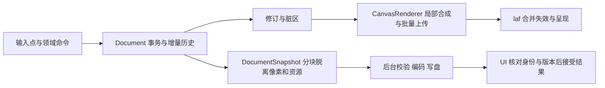

# 原生版性能框架与全功能承接计划

2026-10-15。适用唯一 `native/` 开发与 `build/Release/moonsprite-native.exe`。本文件规划性能承接，不把尚未迁移的功能写成已经实现。实际修复和计时见 [本轮审计](performance-audit-2026-10-15.md)。需求范围以 [需求基线](requirements-baseline/README.md) 的全部 57 项为准，隐藏面板仍保留需求。

## 必须保持的边界

沿用 legacy 的文档事务、增量历史、源存储身份、内容修订、局部失效、后台任务和缓存预算。C++/laf/Skia 只适配技术机制；不恢复 WebView2，不改布局、Fusion 10px/2×、像素素材、取消或撤销语义。未经实测不能把旧 WebView 的 tracker 堆积归因移植到原生程序，也不能凭原生技术路线宣布长期卡顿已解决。

已落地：`uploadRgbaRegion`、按 resolved cel owner 的可见内容缓存、`RasterSnapshot`、`DocumentSnapshot`、异步保存、分块恢复、后台恢复清理。`Document` 仍是唯一文档写入者；worker 拥有完全脱离的副本，不持有活动文档、UI 对象或撤销历史。保存结果不得替另一个文档或已修改的版本清除 dirty。

## 来源与技术适配

以下都是实际 legacy 实现或定向测试入口；不是“参照 legacy”的泛称。代码来源及哈希另在 [来源台账](legacy-provenance.json) 登记。

| 机制 | legacy 依据 | native 承接 |
| --- | --- | --- |
| 增量历史与内容失效 | `core/history.ts`、`history-source-invalidation.test.ts` | 已有 PixelEdit、脏区、历史载荷预算；结构操作的整状态历史仍待迁移为结构差量 |
| 稀疏与共享像素 | `core/runtime-raster.ts`、`runtime-raster.test.ts` | 当前编辑子集仍为 dense RGBA vector；后续移植源存储身份、不可变 tile 与局部 detach，不能把全工程复制当作等价方案 |
| 合成、上传与生命周期 | `components/canvas-composite-cache.ts`、`canvas-composite-cache-surfaces.ts`、`canvas-composite-cache-chunked-upload.test.ts`、`canvas-composite-cache-cleanup.test.ts` | 已有脏区及原生批量写入；多帧/区域 LRU、样式缓存、关闭释放还需按对应功能接入 |
| 动画内容标记 | `core/animation-cel-content-cache.ts`、`animation-cel-content-performance.test.ts` | 已迁移 owner 缓存；结构重建失效，像素写入只失效相应 owner，实时借用像素期间绕过缓存 |
| 快照与保存串行 | `core/project-save-transfer.ts`、`store/document-save-tasks.ts`、`store/recovery-service.ts` | 已迁移 detached ownership、稳定版本和串行保存；原生不能借 worker API 在 UI 线程先深拷贝整个 Document |
| 最新预览任务 | `core/latest-task-queue.ts`、`latest-task-queue.test.ts`、`workers/adjustment-preview.worker.ts` | 现有滤镜 generation/future 保留；后续共享“一项运行、一项可替换待处理”模型，过期结果只释放，不写回 |
| 总缓存与样式预算 | `core/global-cache-manager.ts`、`layer-style-cache-budget.ts` | 规划注册/注销、LRU 与统计；沿用 legacy 样式 64MiB、缓存软/硬 256/512MiB 语义。不是进程总内存或作品大小限制 |
| 本地回溯与缩时 | `core/local-history-budget.ts`、`local-history-committed-delta.ts`、`timelapse-task-yield.ts` | 后续承接差量、检查点、分块与有界队列；保留文件和用户恢复数据 |
| 扩展预算 | `store/lua-script-budget.test.ts`、`core/extension-runtime.ts` | 执行/传输前估算上下文，事务绑定目标，事件/订阅随扩展注销；保留旧预算和明确兼容子集 |

## 调度与任务契约

输入轨迹不得为了“流畅”丢点。每个笔画点进入增量事务，绘制请求交给现有 laf Manager 合并。几何拖动和重型预览只保留最新显示请求；这与保留真实笔画样本是两个不同契约。

快照每次推进设 2ms 截止时间和 1MiB 像素/笔刷载荷上限，基础块为 16K 像素。时间是让出检查点，不是硬实时保证：一次内存分配、metadata 构造或调度仍可能超时，须单独计量。只复制当前 cel/笔刷资源，不先 reserve 全部作品。每次推进核对 identity/revision/contentRevision 和未活动事务；失效的恢复快照释放，保留 scheduler 的失败资格。完成的值移动给 worker，在 worker 上构造并校验 Document。

当前保存保持“一项运行”：保存期间保留窗口消息处理，阻止作品编辑；关闭请求等保存完成，保存前 New/Open/Close 的原动作随后继续。文件选择器仍使用原生 Windows 对话框。写盘成功后核对版本，再接受保存点；失败保留作品、路径与 dirty。恢复清理在 worker 等待旧恢复写入完成，失败进入可观察通道并保留 owned id。

后续文件打开、导出、批量操作沿用此快照/结果契约，但不能直接把保存 continuation 当作导出 continuation：导出不清 dirty；打开先校验 candidate，失败不替换活动文档；取消必须区分可取消的计算和已经开始的原子提交。预览任务可替换，保存、关闭、删除和事务提交不能丢弃。

## 全功能性能矩阵

下表覆盖全部需求 ID。每个尚未迁移领域实施前仍需定位具体 legacy 命令/测试，沿用输入和预期；此表不是各领域逻辑已等价的证明。

| 需求 | 功能范围 | 性能归属和实施约束 |
| --- | --- | --- |
| CO-001、CO-002 | 事务、历史、坐标、长期使用 | Document 单写入；内容/结构差量；缓存关闭释放；视图不进历史；2h/8h 固定序列验收 |
| DR-001 | 铅笔、橡皮 | 保留每个输入点，增量覆盖/脏区，不在 MouseMove 复制整图；stroke 和取消/redo 精确对照 |
| DR-002 | 图片笔刷、图案 | 缩放旋转后的 stamp 按源/参数缓存；大项目笔刷资源纳入分块快照，共享所有权不能混入工程串行化 |
| DR-003、DR-007 | 压感动态、喷枪、柔化、液化等 | 复用旧采样状态机、确定性和计时；按修改 tile 记录差量；重型预览脱离 UI，最终提交保留全部语义 |
| DR-004、DR-006 | 线/曲线/形状、渐变 | 稳定基线与最后一项预览；参数 generation；ROI 合成与上传，确认/取消一事务 |
| DR-005 | 填充、魔棒、智能闭合 | 复用旧区域搜索/紧凑历史，后台可取消；结果校验目标，预览不重复复制整份工程 |
| DR-008 | 对称和辅助线 | 复用对称落点；绘制仅覆盖可见视口，辅助线失效不触发像素上传 |
| DR-009 | 颜色、色板、模式 | 小型 UI 更新不使内容缓存失效；全图模式转换在任务边界预检和后台计算，颜色语义精确沿用 |
| DR-010 | 调整、卷积、抗锯齿、替色 | 源快照复用，最新任务队列，参数/范围缓存；临时预览与提交互相隔离 |
| SE-001、SE-002 | 选区创建/组合、选框/内容移动 | 选区版本独立于像素；边界按 mask identity/revision 缓存；浮动覆盖层和背景分开 |
| SE-003、SE-004 | 多层多帧变换、缩放/旋转/自由变换 | 每个共享源只处理一次；按目标 tile 失效；后台重采样结果经 generation 校验；沿用 RotSprite 等旧算法 |
| SE-005、SE-006 | 剪贴板、浮动粘贴、切片、衍生资源 | 复制必要区域和对应身份；剪贴板保留用户语义；衍生资源走任务/预算，不能借关闭文档删除用户剪贴板 |
| LA-001、LA-002 | 图层结构/属性、关联层/Cel | 元数据变更不复制像素；共享源 identity，索引解析；结构历史差量；可见 owner 缓存和 invalidation 一致 |
| LA-003、LA-004 | 蒙版、剪贴、样式 | 合成依赖图记录源/参数修订；样式 tile LRU；蒙版和样式扩展 ROI，保留旧 blend/alpha 语义 |
| LA-005、LA-006 | 文字、渐变映射层 | 字形/文本布局依源参数缓存；调整层依赖底部合成；原生字号与作品字体分开；栅格化按事务提交 |
| AN-001、AN-002 | 帧/Cel、播放/循环/洋葱皮 | 元数据导航不清源内容缓存；帧合成 LRU；播放按时间推进且只画最后显示请求；洋葱邻帧依旧范围/层序缓存 |
| AN-003、AN-004 | 多对象复制、补间、变形 | 保留链接与跨工程身份；预估新帧/唯一像素字节后分块；复用旧 tween budget，最终提交不能静默降级帧数 |
| TI-001、TI-002 | Tilemap 与四种编辑模式 | 共享 tileset/source，编辑依赖传播；只合成可见实例/tile；实例映射不展开为整图副本 |
| TI-003、TI-004 | 瓦片槽/跨文档、自由瓦片 | 按共享集合所有权释放；引用重映射和结构差量；场景空间索引，跨文档传输前预算 |
| FS-001、FS-002 | 新建、多工程、文件打开 | 多文档分别保存任务/缓存；关闭注销所有引用；文件读/解码放后台，一次 candidate admission，UI 不预复制完整文件 |
| FS-003、FS-004、FS-005 | 保存、原图格式、兼容/资源 | detached generation、按路径串行、原子写/字节校验；保留未知资源/格式损失提示；不把优化变成删除资料 |
| FS-006 | 恢复、本地回溯 | 已有 bounded snapshot/scheduler；回溯按 committed delta/checkpoint 实施，预算不等于自动删除用户文件 |
| FS-007、FS-008 | 图片/GIF/精灵表、缩时 | worker 编码/合成，预览按输入键复用；每帧/段分块，不同时持有所有放大帧；缩时有界入队与可观察反压 |
| UI-001、UI-002、UI-003 | 导航/预览、工作区、多视图、焦点/快捷键 | 复用统一物理像素几何和选中边框命中；内容源供多视图复用；布局、hover 和控件失效不串入像素处理 |
| UI-004、UI-007 | 首页/资源/参考图、工程参考图库 | 缩略图后台解码、可见项优先、虚拟列表、字节 LRU；大图原件与缩略图生命周期分开 |
| UI-005、UI-006 | 设置/语言/诊断、桌面平台/外部入口 | 资源字体缓存、一次订阅/注销；日志和指标有界；拖放后台 candidate，UI 显示进度/错误；不运行常驻重扫描 |
| EX-001、EX-002、EX-003 | 扩展生命周期、Lua/MSE、原生 Dialog | 按扩展 owner 注册和释放；脚本预算在像素读取前核对；领域事务、UI 消息接线，禁止隐藏 WebView |
| EX-004、EX-005、EX-006 | Runtime/外部服务、兼容、宠物 | 事件队列与订阅有界；兼容子集显式登记；宠物动画共享 atlas、停止隐藏动画、注销定时器；外部调用结果绑定任务身份 |
| NX-001、NX-002、NX-003、NX-004 | 原生产品、字体/2×、皮肤、覆盖 | 复用旧图标；九宫格源片与字形缓存；皮肤切换按资源代际失效；检查需求覆盖，不以缩减入口换性能 |

## 剩余接入顺序与验收

1. **公共运行时**：先承接 `runtime-raster` 的共享不可变源/局部 detach，补齐结构历史差量及统一缓存注册/注销；不得替换旧增量历史为 encode/decode 快照。整作品 dense vector 与结构全状态复制仍是当前规模风险。
2. **渲染**：接入帧/区域 LRU、样式/蒙版依赖图、选区边界缓存，细分内容、覆盖层和 chrome 失效；沿用 legacy 的 frame-diff/cleanup/budget 测试。当前未实现多帧合成 LRU，不把本轮上传优化当作该机制已完成。
3. **重任务入口**：把现有同步打开、导出、精灵表重建和结构操作分批接入快照/后台任务；保留旧 cancellation、失败和后续动作，再收敛滤镜 worker 的公用最新任务队列。文件快照模块已经可复用，这些入口尚未接入。
4. **未迁移领域**：依上述矩阵实施瓦片、蒙版/样式/文字、多工程、图库、缩时/回溯、Lua/Runtime/宠物，先定位旧预算与性能测试，不另起隐藏 web runtime 或通用“全量刷新”框架。
5. **长期验收**：相同工程/硬件在冷态、2h、8h 比较输入到呈现、消息队列等待、CPU paint、缓存/唯一像素/历史/worker 临时字节及进程私有内存；关闭工程后验证引用和任务释放。保存原始样本，不把单次离屏计时写成发布基线。

操作目标：交互每帧总工作 16.7ms 是观测目标；输入 handler、合成、上传、布局分别计量。内存区分作品唯一像素、缓存、历史、快照、编解码临时数据，不能用某个缓存上限声称整个进程受限。未来中央预算只淘汰可再生缓存，绝不自动删除工程、恢复、录像、会话或构建缓存。

本轮针对性检查包括 `canvas-performance`、`raster-snapshot`、`document-snapshot`、`performance-ui`、`timeline-model` 和 `layer-compositor`。逐像素/生命周期断言是行为门禁；计时输出用于同机趋势观察。来源覆盖通过和需求 ID 完整覆盖均不代表所有旧版功能完成，也不替代 Windows 人工交互与长期使用验收。

2026-10-15 已接入普通 RGBA 时间轴的可见行复用、共享视口合成、稳定 ID 位置索引、空 Cel 摘要跳过及哈希范围选择；证据与限制见 [大量帧／图层性能](large-timeline-performance.md)。
